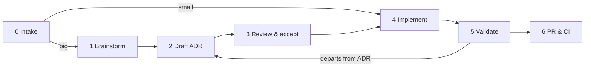

# EGM Rules

How the Elephant-and-Goldfish Model (EGM) skills fit this repository. EGM runs
long design and review loops with an *Elephant* (the agent holding context) and
*Goldfish* (fresh-context reviewers that see only what they are handed). Its
defaults assume a generic repository: `docs/designs/`, a `SITEMAP.md`, and working
files dropped in the working directory. This file maps those defaults onto how
CHouse UI already works, so a run lands in the right place and ends in a clean PR.

**Setup:** the EGM plugin is optional. Install steps are in
[CONTRIBUTING.md](../CONTRIBUTING.md#optional-egm-skills). Without it, everything
here about directory contracts and the pre-PR gate still applies; only the
`egm-*` skills are missing.

When this file and an EGM skill's default disagree, **this file wins**. When it
disagrees with [AGENTS.md](../AGENTS.md) or another rule file, follow the stricter
of the two and say so.

---

## From idea to PR

The end-to-end path an agent follows when the user brings an idea, from the first
conversation to a validated, green PR. Each stage names its exit condition and
whether the agent **stops for the user** before going on. Stages link to the rule
that owns the detail; this section only fixes the order.



| # | Stage | What happens | Done when | Stop for the user? |
|---|---|---|---|---|
| 0 | **Intake** | Discuss the idea in chat — no code, branches or worktrees yet. Classify it with [ADR.md](ADR.md#when-an-adr-is-required): **small** (fix, patch, minor feature) skips to stage 4; **big** goes through 1–3. | Scope, size and non-goals agreed | **Yes** — wait for an explicit go-ahead |
| 1 | **Brainstorm** | `egm-brainstorm` stress-tests the concept → `.egm/concepts_brief.md`. | Concept, risks and open questions written down | **Yes** — confirm the concept |
| 2 | **Draft** | `egm-draft` writes `docs/adr/NNNN-kebab-title.md` (`Proposed`, MADR spine, index row — see [Designs are ADRs](#designs-are-adrs)), including an **implementation plan** (target files) and a **verification plan** (tests, e2e, edge cases). | Every section approved | **Yes** — per section |
| 3 | **Review & accept** | `egm-review` with the right [Goldfish context](#goldfish-context), then `egm-resolve` to fold findings into the ADR. Flip the status to `Accepted` when the user approves. | Findings resolved; ADR `Accepted` | **Yes** — approval of the design |
| 4 | **Implement** | Branch from up-to-date `preview` (`<type>/<slug>`). Build to the ADR's plan under [CODE_CHANGES.md](CODE_CHANGES.md) (+ [SECURITY.md](SECURITY.md), migration rules when they apply): code, co-located tests and [directory contracts](#directory-contracts) change together. The ADR goes in the **same branch and PR** by default ([ADR.md](ADR.md#the-flow)). | Every item of the implementation plan is done | Only if the code must depart from the ADR — then go back to stage 2 |
| 5 | **Validate** | Run [PRE_PR.md](PRE_PR.md) end to end: triggered obligations, the full gate (`./scripts/verify-all.sh`), real-app checks (browser at desktop and narrow widths, API as permitted and denied callers, real ClickHouse), the ADR's verification plan and edge-case list **item by item**, a self-review against [CODE_REVIEWER.md](CODE_REVIEWER.md), and `egm-drift-report` on the ADR and the touched contracts. Fix everything found and re-run. | All green, drift report clean, anything not run is written down with the reason | No — keep fixing until done |
| 6 | **PR & CI** | `gh pr create --base preview` with the template filled from stage 5's evidence (commands, results, screenshots, follow-ups). Watch CI and fix any red check. | CI green | **Yes** — hand off with the PR link and what was and wasn't verified |

Rules that hold across the stages:

- **Never skip a stop.** A "yes" in one stage is not approval for the next.
- **One request, one PR.** Everything the user batched into one thread ships in
  one PR, ADR included, unless they ask otherwise.
- **The ADR is the spec.** If reality disagrees with it during stages 4–5, the ADR
  changes first (while unmerged), then the code.
- **Working files stay in `.egm/`;** only the ADR, code, tests, contracts and docs
  are committed.
- **Small changes still validate.** Skipping stages 1–3 never skips stage 5.

---

## Where files go

| EGM output | Location | Committed? |
|---|---|---|
| `concepts_brief.md` (egm-brainstorm) | `.egm/` | No |
| `design_draft.md`, `discussion_summary.md` (egm-draft) | `.egm/` | No |
| `goldfish_review_report.md`, resolve notes (egm-review, egm-resolve) | `.egm/` | No |
| `{YYYY-MM-DD}_DRIFT_REPORT.md` (egm-drift-report) | `.egm/` | No |
| The finished design | `docs/adr/NNNN-kebab-title.md` | Yes |
| Directory contracts (egm-bootstrap) | `README.md` in each code directory, rolled up in [ARCHITECTURE.md](../ARCHITECTURE.md) | Yes |

`AGENTS.md` declares `EGM artifact directory: .egm/`, and `.egm/` is in
`.gitignore`. Before committing, `git status` must not show anything EGM wrote
outside `docs/adr/` and the contracts. Paste review findings that matter into
the PR or ADR discussion instead of committing the report.

---

## Designs are ADRs

A design produced with `egm-draft` is an [ADR](ADR.md), and it follows that rule
file's flow (draft → discuss → accept → implement). Do not create
`docs/designs/` or `SITEMAP.md`.

1. **Target directory.** When `egm-draft` asks where to save, pick `docs/adr/`.
2. **Filename.** Use the next free zero-padded number:
   `ls docs/adr | grep -E '^[0-9]{4}-' | sort | tail -1`, plus one.
3. **Header.** Start with `# NNNN — Title`, followed by the bullet header the
   existing ADRs use: `**Status:** Proposed`, `**Date:**`, `**Amends:**` /
   `**Supersedes:**` when relevant, and `**Scope:**`, which lists the
   files, routes, settings and docs the design touches.
4. **Sections.** Keep the MADR spine from [`docs/adr/README.md`](../docs/adr/README.md):
   **Context**, **Decision**, **Consequences**, **Alternatives considered**. EGM's
   extra sections are welcome; merge them into the spine like this:

   | EGM template section | Goes in |
   |---|---|
   | Overview, The Problem | Context |
   | Goals, Non-Goals, CUJs | Context, as subsections |
   | Technical Plan, Non-Functional Requirements | Decision |
   | Detailed Implementation Plan, Target Files, Verification Plan | Decision, under a final *Implementation plan* subsection |
   | Alternatives Considered | Alternatives considered |
   | Open Questions, Future Improvements | Consequences, or an *Open questions* subsection while still `Proposed` |

5. **Index.** Instead of updating a sitemap, add the row to the table in
   `docs/adr/README.md`: `| [NNNN](NNNN-kebab-title.md) | Title | Proposed |`.
6. **Never edit an `Accepted` ADR's decision in place.** Supersede it, as
   [ADR.md](ADR.md) requires. `egm-drift-report` findings against an accepted ADR
   are fixed in the code or recorded in a new ADR, never by rewriting history.

By default the accepted ADR ships in the same PR as its implementation (see
[From idea to PR](#from-idea-to-pr)). An ADR-only PR needs no changelog fragment;
a combined PR needs one for the user-visible implementation.

---

## Goldfish context

Goldfish reviewers see only what you pass them, so pass the right things:

- **`GoldfishContext` for `egm-review` / `egm-review-loop`:** the `README.md`
  contract of every directory the design touches, and
  [ARCHITECTURE.md](../ARCHITECTURE.md) for anything spanning frontend and server.
  Add any ADR the design amends.
- **Security-sensitive designs** (anything listed in the "When to Apply" row for
  [SECURITY.md](SECURITY.md)): also pass [SECURITY.md](SECURITY.md), and ask for its
  checklist to be applied.
- **Migrations:** pass the "Database Migrations" section of
  [AGENTS.md](../AGENTS.md) and `packages/server/src/rbac/db/README.md`.
- **Absolute paths.** Reviewers cannot open URLs. Save any web page you want
  them to read into `.egm/` and pass its path.

---

## Implementing an EGM design

The ADR's implementation plan is the spec. Implement it under the normal rules:

1. [CODE_CHANGES.md](CODE_CHANGES.md) for the code, [SECURITY.md](SECURITY.md) when it
   applies, and the migration rules in [AGENTS.md](../AGENTS.md).
2. **Contracts move with the code.** In the same change, update the `README.md` of
   every directory whose exports, invariants, side effects, env vars or
   verification command changed, plus [ARCHITECTURE.md](../ARCHITECTURE.md) when
   a cross-cutting invariant changes. Add a contract for every new code
   directory (template below).
3. Finish with [PRE_PR.md](PRE_PR.md). The PR is not ready until every
   applicable step passes.

If the implementation has to depart from the ADR, stop. Update the ADR while it
is still `Proposed`, or raise it with the user, before writing more code.

---

## Directory contracts

Every code directory carries a `README.md` contract. They were generated by
`egm-bootstrap` and are now maintained by hand.

**Component (a directory with source files):**

```markdown
# <name>

## Overview
What the directory is for and how it fits its parent.

## Interface
- `[file.ts:exportedSymbol]` — one line on what it is
- Subdirectories: [child](./child/README.md) — one line each

## Invariants
- Rules callers and editors must keep, each citing `[file.ts:symbol]`

## Side Effects
- DB tables written, network calls, timers, storage, events — or `None`

## Verification
- Run: `<command that exercises this directory>`
```

**Blueprint (only subdirectories):** `# <name>`, `## Overview`, and
`## Subdirectories & Boundaries`, with one linked line per child.

Rules:

- **Cite real code.** Write each citation as `[path/relative/to/this/README:symbol]`.
  The symbol must literally appear in that file. Never infer routes,
  permissions or tables from file names.
- **Describe the code as it is.** If the code breaks a project rule (for example
  a fail-open path), state the behaviour plainly and open a follow-up. Don't
  write the rule as if it were met.
- **Verification must run.** `bunx vitest run <dir>` fails when the directory
  has no tests. For a directory without tests, write
  `No co-located tests; covered by \`bun run typecheck\`` and add the nearest
  ancestor scope that has tests.
- **Validate:** `bun run check:contracts` checks that the sections exist, that
  every relative link resolves and that every cited symbol is in its file. It
  runs in CI and in `scripts/verify-all.sh`.
- **Skip list:** [`.egmignore`](../.egmignore) lists the trees that have no
  contracts (test-only, generated or data). Update it when you add such a tree.

---

## Skill quick reference

| Skill | Use it for | Notes for this repo |
|---|---|---|
| `egm-brainstorm` | Testing an idea before designing | The brief goes to `.egm/`. Ideas from the user are discussed first; don't start a design until asked. |
| `egm-draft` | Writing the design | Save it as an ADR (see above). |
| `egm-review` / `egm-review-loop` | Fresh-context review of an ADR | Pass contracts and SECURITY.md as `GoldfishContext`; reports go to `.egm/`. |
| `egm-resolve` | Working through review findings | Apply the fixes to the ADR. The report stays in `.egm/`. |
| `egm-bootstrap` | Generating contracts for new trees | Pass the subtree, not the repo root; the root is `ARCHITECTURE.md`. It honours `.egmignore`. |
| `egm-drift-report` | Periodic check of contracts and ADRs against the code | The report goes to `.egm/`. Fix contract drift in a docs PR, and open issues for code bugs. |
