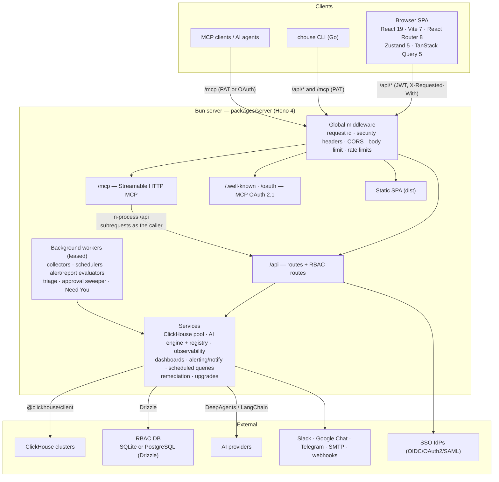

# Architecture

How CHouse UI is put together, for contributors and coding agents. For what it
does and how to run it, see the [README](README.md) and the
[documentation](https://chouse-ui.com/docs/).

This file is the root of the **directory contracts**. Every code directory has a
`README.md` with an Overview, Interface, Invariants, Side Effects and
Verification. They are written in the Elephant-and-Goldfish Model (EGM) format
and kept true by `bun run check:contracts` (rules:
[.rules/EGM.md](.rules/EGM.md#directory-contracts)). Start here, follow the
links down to the directory you are changing, and read its contract before you
edit it.

## System overview



- **The browser never talks to ClickHouse.** The SPA calls `/api`. The server
  resolves the requested connection against RBAC on every request and runs the
  query with credentials that stay on the server, encrypted with AES-256-GCM.
- **One API, three front doors.** The UI (JWT), the CLI (PAT) and MCP agents (PAT
  or OAuth) all reach the same `/api` routes. MCP and assistant tools call
  `/api` in-process as the caller, so permission checks, data-access rules and
  audit apply unchanged.
- **Stateless replicas.** Shared state lives in the RBAC DB. Background work is
  coordinated with row leases, so any replica can serve any request. Running
  more than one replica (HA) requires PostgreSQL
  ([ADR 0010](docs/adr/0010-pod-local-state-and-multi-replica-correctness.md)).

Design decisions are recorded as ADRs in [docs/adr/](docs/adr/README.md).

## Repository layout

| Path | What it is | Contract |
|---|---|---|
| `src/` | React SPA: routing and permission gating in `App.tsx`, feature modules, API clients, stores, shared components | [src](src/README.md) |
| `packages/server/` | Bun + Hono API server: RBAC, `/api`, `/mcp`, OAuth, AI engine, background workers | [packages/server](packages/server/README.md) → [src](packages/server/src/README.md) |
| `cli/` | Standalone Go module for the `chouse` CLI, versioned on its own (`cli/VERSION`, `cli-vX` tags) | [cli](cli/README.md) |
| `docs/portfolio/` | The chouse-ui.com landing page and the static `/docs` site generator | [docs](docs/README.md) → [portfolio](docs/portfolio/README.md) |
| `docs/adr/` | Architecture Decision Records | [index](docs/adr/README.md) |
| `scripts/` | Release helpers, CLI build and installer, isolated test runners, Docker e2e suites, `verify-all.sh`, `check-contracts.ts` | [scripts](scripts/README.md) |
| `charts/chouse-ui/` | Production Helm chart, published as an OCI artifact | [chart README](charts/chouse-ui/README.md) (generated) |
| `changelogs/` | Release-note fragments. Never edit `CHANGELOG.md` by hand | [fragments](changelogs/unreleased/README.md) |
| `e2e/`, `testbed/` | Browser and Docker end-to-end harnesses | — |

At the root, only configuration remains: `vite.config.ts` sets the `@` → `src`
alias, injects `__CH_UI_VERSION__` and proxies `/api` and `/mcp` to `:5521` in
dev. `vitest.config.ts` runs jsdom tests and excludes `packages/**`, which uses
Bun Test. `eslint.config.js` is the lint configuration.

## Cross-cutting invariants

These hold across directory boundaries. Breaking one is a design change and needs
an ADR.

- **The server is authoritative for access.** Client gates (`PermissionGuard`,
  `AdminRoute`, `useRbacStore().hasPermission`) only shape the UI. Every protected
  route uses `rbacAuthMiddleware` + `requirePermission` /
  `requireAnyPermission`. See
  [rbac/middleware](packages/server/src/rbac/middleware/README.md).
- **SQL from users is checked statement by statement.** `validateQueryAccess`
  parses each statement and checks every table it touches against the caller's
  data-access rules, and `enforceSchemaPreflight` blocks DDL that would break
  dependents. Server-built SQL uses `escapeIdentifier` / `quoteStringLiteral`.
  See [middleware](packages/server/src/middleware/README.md),
  [utils](packages/server/src/utils/README.md) and
  [.rules/SECURITY.md](.rules/SECURITY.md).
- **Direct API access is refused.** Non-public `/api` requests must carry
  `X-Requested-With: XMLHttpRequest` or a PAT/MCP-subrequest bearer, or they get
  403 `DIRECT_ACCESS_DENIED`. See [routes](packages/server/src/routes/README.md).
- **One AI engine, one write path.** Every AI feature runs through the engine
  against the agent its registry binds it to
  ([services/ai](packages/server/src/services/ai/README.md)). Every AI write, from
  chat, MCP, the CLI or the approval queue, goes through `performAction`, with
  tiers, grants and approvals
  ([services/ai/actions](packages/server/src/services/ai/actions/README.md)).
- **No pod-local state.** Collectors, schedulers, evaluators and sweepers claim
  work through leases or row claims in the RBAC DB.
- **Mirrored contracts stay in sync.** These live on both client and server and
  must change together:
  - AI provider and model-param constants:
    [src/constants](src/constants/README.md) ↔
    [rbac/constants](packages/server/src/rbac/constants/README.md).
  - The dashboard viz spec and time helpers:
    [src/lib/viz](src/lib/viz/README.md) ↔
    [services/dashboards](packages/server/src/services/dashboards/README.md).
- **Migrations are forward-only and idempotent.** Each version has a
  `VERSION_CHECKS` entry in `packages/server/src/rbac/db/migrations.test.ts` and
  must pass on SQLite and PostgreSQL. See
  [rbac/db](packages/server/src/rbac/db/README.md) and the migration rules in
  [AGENTS.md](AGENTS.md#database-migrations--testing-is-mandatory).

## Shared resources

- **RBAC DB:** users, roles, sessions, PATs, audit log, encrypted connections,
  the AI registry, AI runs, usage and memory, observability evidence and incidents,
  dashboards, alerting and channel messages, scheduled queries, remediation, and
  rate-limit counters.
- **ClickHouse:** user queries and DDL through pooled clients. Collectors,
  profiles and diagnostics run read-only (`readonly=1`, execution caps).
  Remediation and materialize write-back run engine-generated SQL.
- **Outbound network:** AI providers, chat platforms, SMTP, webhooks, SSO IdPs,
  and the upgrade-check sources (`raw.githubusercontent.com`,
  `hub.docker.com`).
- **Browser storage:** auth tokens, connection and session ids, and per-user
  persisted stores. All of them are cleared by `cleanupUserSession`
  ([src/utils](src/utils/README.md)).

## Known issues

Code behaviour that contradicts a project rule. These were found by the
2026-11-06 contract drift review and are recorded here until fixed. Contracts
that describe them link back to this section. When you fix one, update the
contract and remove its entry.

| # | Issue | Where | Contract |
|---|---|---|---|
| 2 | A statement the SQL parser can't handle falls back to keyword and regex classification, and a statement with no detected tables is allowed. That falls short of "unknown shapes fail closed" | `packages/server/src/middleware/sqlParser.ts`, `dataAccess.ts` | [middleware](packages/server/src/middleware/README.md) |

## Verification

```bash
bun run lint && bun run typecheck && (cd packages/server && bun run typecheck)
bunx vitest run                       # frontend
./scripts/test-isolated-server.sh     # server
./scripts/test-migrations.sh          # migrations, SQLite + PostgreSQL (Docker)
bun run check:contracts               # these contracts
cd cli && go test ./...               # CLI
```

`./scripts/verify-all.sh` runs the whole gate in order. Run
[.rules/PRE_PR.md](.rules/PRE_PR.md) before opening a PR.
