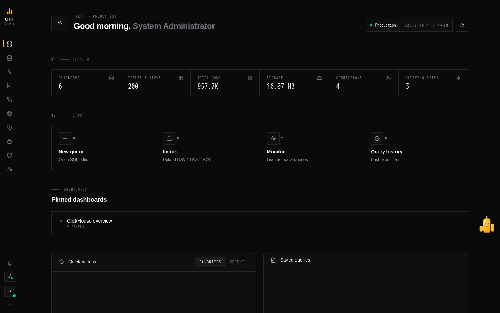

<p align="center">
  
</p>

<h1 align="center">CHouse UI</h1>

<p align="center">
  <strong>The team console for ClickHouse: RBAC, fleet monitoring, data observability and an AI SRE.</strong>
</p>

<p align="center">
  <a href="https://chouse-ui.com">Website</a> •
  <a href="https://chouse-ui.com/docs/">Documentation</a> •
  <a href="#quick-start">Quick start</a> •
  <a href="ARCHITECTURE.md">Architecture</a> •
  <a href="CONTRIBUTING.md">Contributing</a>
</p>

<p align="center">
  <a href="https://github.com/daun-gatal/chouse-ui/actions/workflows/ci.yml"></a>
  <a href="https://github.com/daun-gatal/chouse-ui/actions/workflows/auto-release.yml"></a>
  <a href="https://github.com/daun-gatal/chouse-ui/releases"></a>
  <a href="LICENSE"></a>
</p>

<p align="center">
  
</p>

---

CHouse UI is a self-hosted web console for teams that run their own ClickHouse.
It sits between your people and your clusters:

- **Credentials stay on the server.** Users sign in to CHouse UI, not to
  ClickHouse. Connection passwords are encrypted server-side and never reach the
  browser.
- **Access is under your control.** Roles, per-database and per-table data-access
  rules, SSO and audit logs come built in.
- **Problems surface on their own.** It monitors every cluster, watches every
  table, and investigates with an AI SRE that proposes fixes and runs them only
  after approval.

It is open source under Apache 2.0.

## Highlights

| | |
|---|---|
| 🔐 **Access control** | App-level RBAC with six built-in roles and custom roles, data-access rules down to the table, native ClickHouse user and role management, OIDC/OAuth2/SAML SSO, personal access tokens and a full audit log. |
| 📊 **Query workspace** | A Monaco SQL editor with schema-aware completion, Visual EXPLAIN, saved and shared queries, exports, and a ⌘K command palette. |
| 🔬 **Monitoring** | Query logs, patterns and histograms, live queries with kill, parts and merges, replication, memory and CPU breakdowns, schema advice, errors, capacity forecasts and an upgrade check. No exporter needed. |
| 🛰️ **Fleet & Chouse AI** | Every cluster on one page, with threshold alerts to Slack, Google Chat, Telegram or email. A read-only AI SRE runs root-cause scans and optimises queries with before/after `EXPLAIN` proof. |
| 📈 **Data observability** | Freshness and volume baselines for every table, pipelines (Kafka, RabbitMQ, NATS, S3Queue, replication, views) in one model, lineage, incidents with a root cause, and catalogued fixes that need approval. |
| 📐 **Dashboards** | Custom dashboards with variables, alerts, scheduled reports, snapshots and Grafana import, which AI can draft from a sentence. |
| 🤖 **AI platform** | The agent registry, guardrails, budgets, memory, evals and auto-triage are all managed in the UI. Approved write actions with undo, and Chobi, an in-app assistant. |
| 🧩 **Automation** | A `chouse` CLI and an MCP endpoint (PAT or OAuth) give scripts and AI agents the same governed API as the UI. |

See the [full feature tour](https://chouse-ui.com/docs/overview/) and
[what's new](https://chouse-ui.com/docs/whats-new/).

## Quick start

### Docker Compose

```bash
git clone https://github.com/daun-gatal/chouse-ui.git
cd chouse-ui
docker compose up -d
```

Open <http://localhost:5521> and sign in as `admin@localhost` / `admin123!`.
Change that password straight away. The compose file also starts a ClickHouse
server you can add as a connection (`clickhouse-server:8123`, `admin` /
`password`). Its built-in secrets are public placeholders, for local use only.

### Kubernetes (Helm)

```bash
helm install chouse-ui oci://ghcr.io/daun-gatal/charts/chouse-ui \
  --set secrets.jwtSecret="$(openssl rand -base64 32)" \
  --set secrets.encryptionKey="$(openssl rand -hex 32)" \
  --set secrets.encryptionSalt="$(openssl rand -hex 32)"
```

The default install runs a single replica with SQLite. For high availability,
use PostgreSQL (`database.type=postgres`) and scale `replicaCount`. See the
[Helm guide](https://chouse-ui.com/docs/deploy-helm/) and the
[chart values](charts/chouse-ui/README.md).

### From source

Requires [Bun](https://bun.sh/) 1.x.

```bash
bun install && (cd packages/server && bun install)
bun run dev        # UI on :5173, API on :5521
```

## Documentation

Everything about running CHouse UI lives at **[chouse-ui.com/docs](https://chouse-ui.com/docs/)**:

| Topic | Start here |
|---|---|
| Install and deploy | [Quick start](https://chouse-ui.com/docs/quick-start/) · [Docker](https://chouse-ui.com/docs/deploy-docker/) · [Helm](https://chouse-ui.com/docs/deploy-helm/) · [Compatibility](https://chouse-ui.com/docs/compatibility/) |
| Configure | [YAML config](https://chouse-ui.com/docs/configuration-yaml/) · [Environment variables](https://chouse-ui.com/docs/configuration-env/) · [Secrets](https://chouse-ui.com/docs/configuration-secrets/) · [SSO](https://chouse-ui.com/docs/sso/) |
| Secure | [Roles](https://chouse-ui.com/docs/rbac-roles/) · [Data access rules](https://chouse-ui.com/docs/data-access-rules/) · [Security model](https://chouse-ui.com/docs/security/) · [Production checklist](https://chouse-ui.com/docs/production-checklist/) |
| Operate | [Upgrades and migrations](https://chouse-ui.com/docs/migrations-upgrades/) · [Troubleshooting](https://chouse-ui.com/docs/troubleshooting/) · [FAQ](https://chouse-ui.com/docs/faq/) |
| Automate | [CLI](https://chouse-ui.com/docs/cli/) · [MCP](https://chouse-ui.com/docs/mcp/) · [Personal access tokens](https://chouse-ui.com/docs/personal-access-tokens/) |

## Architecture

A React 19 SPA talks to a Bun + Hono server. The server holds the ClickHouse
credentials, enforces RBAC and data-access rules on every request, and keeps its
state in SQLite or PostgreSQL. The CLI and MCP agents use the same API as the
UI. Replicas are stateless, and background work is coordinated through leases in
the shared database.

[ARCHITECTURE.md](ARCHITECTURE.md) has the system diagram, the cross-cutting
invariants and a map of every directory. Each code directory carries a
`README.md` contract that describes its interface and rules. Design decisions are
recorded as [ADRs](docs/adr/README.md).

## Contributing

Contributions are welcome. Read [CONTRIBUTING.md](CONTRIBUTING.md) for the
workflow. The short version:

- Branch from `preview` and open PRs against `preview`.
- Add a changelog fragment for user-visible changes.
- Follow [AGENTS.md](AGENTS.md) and the rules in [`.rules/`](.rules). This applies
  whether you write the code yourself or with an AI assistant.

Please also read the [Code of Conduct](CODE_OF_CONDUCT.md).

## Security

Please report vulnerabilities privately, as described in
[SECURITY.md](SECURITY.md), not in public issues. Before going to production, go
through the [production checklist](https://chouse-ui.com/docs/production-checklist/).

## License

CHouse UI is licensed under the [Apache License 2.0](LICENSE).

It began as a fork of **[CH-UI](https://github.com/caioricciuti/ch-ui)** by
[Caio Ricciuti](https://github.com/caioricciuti) (Apache 2.0) and has since been
substantially rewritten. The original attribution is kept in [NOTICE](NOTICE).

## Acknowledgments

- **[QueryDog](https://github.com/benjaminwootton/QueryDog)** by
  [Benjamin Wootton](https://benjaminwootton.com) (Elastic License 2.0). The
  Monitoring deep-dive is heavily inspired by QueryDog's chart-plus-table layout
  and its aggregation patterns over ClickHouse system tables. That covers the Logs
  sub-views, Parts, Schema advisor, Cluster activity and the query timeline. No
  QueryDog source code is bundled; full attribution is in [NOTICE](NOTICE).
- Built with [Bun](https://bun.sh/), [Hono](https://hono.dev/),
  [Drizzle ORM](https://orm.drizzle.team/), [React](https://react.dev/),
  [Vite](https://vitejs.dev/), [TanStack Query](https://tanstack.com/query),
  [Zustand](https://zustand-demo.pmnd.rs/), [shadcn/ui](https://ui.shadcn.com/),
  [Tailwind CSS](https://tailwindcss.com/),
  [Monaco Editor](https://microsoft.github.io/monaco-editor/),
  [AG Grid](https://www.ag-grid.com/),
  [DeepAgents](https://docs.langchain.com/oss/javascript/deepagents/overview) /
  [LangChain](https://js.langchain.com/) and the official
  [ClickHouse JS clients](https://github.com/ClickHouse/clickhouse-js).
