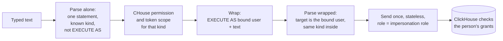

# 0033 — Every Statement Gets a ClickHouse Identity: One Executor, an Optional Role Ceiling, and Personal Connections

- **Status:** Proposed
- **Date:** 2026-11-14
- **Author:** daun-gatal
- **Supersedes:** [0027](0027-connection-privilege-check.md) and [0031](0031-optional-clickhouse-access-admin.md) (the privilege catalog becomes per connection kind)
- **Amends:** [0030](0030-clickhouse-parses-sql-access-checks.md) (who is parsed, and the default for system databases), [0011](0011-personal-access-tokens.md) (what a token runs as on a personal connection)
- **Scope:** a new `packages/server/src/services/chExecutor/`; every server file that reaches ClickHouse (67); `middleware/sqlAccess/` and `middleware/dataAccess.ts`; RBAC migrations 1.76.0 to 1.78.0; the connection routes and three new route modules; Admin › Connections, Preferences and the connection switcher; `.rules/SECURITY.md`; docs; CI. Four deliveries, see §10.

## Context

### Overview

CHouse UI reaches each ClickHouse server through one saved login per
connection. Every person allowed to use the connection runs as that login, and
so does every background job. This ADR changes how a statement gets its
ClickHouse identity, in three stages:

1. **Fix the shared-login model.** One server function sends every statement
   and always knows who it is for. ClickHouse itself refuses writes from
   callers without write permission, and each statement can be traced to a
   person.
2. **An optional role ceiling.** On a shared-login connection, an
   administrator can tie each CHouse role to a ClickHouse role. ClickHouse
   then refuses anything outside that role, whatever CHouse decided.
3. **Personal connections.** On servers that support it safely, each
   statement runs as the person's own ClickHouse user. ClickHouse grants, not
   CHouse data access policies, decide which tables that person reaches.

A person still signs in to CHouse with a CHouse account in every case.

### The problem

**1. One boundary stands between a restricted person and a powerful login.**
[ADR 0027](0027-connection-privilege-check.md) requires the saved login to
hold the privileges for every feature: monitoring, data health, stopping
queries and editing data. `.rules/SECURITY.md` states the result: CHouse's own
roles and data access policies are the only boundary between a restricted
person and everything that login can read or change. A single mistake in a
CHouse check exposes all of it.

**2. That boundary is applied in many places, not one.** About 30 call sites
obtain a ClickHouse client with no person attached: dashboards, notebooks,
data health, scheduled-query preview, the upgrade check, AI fleet tools. Each
has to remember to run the access check itself. A review of the code found
several paths that reach ClickHouse without it. They are fixed as the first
delivery of this work and are not listed here until those fixes ship.

**3. CHouse admins are not checked at all.** A CHouse `admin` returns
"allowed" before the statement is parsed (`middleware/dataAccess.ts`,
`validateQueryAccess`). `.rules/SECURITY.md` names an admin who is not a super
admin as an attacker, yet nothing limits what such an admin can send through
the saved login.

**4. ClickHouse cannot tell people apart.** `system.query_log` shows the saved
login for every statement. The real person appears only in `log_comment`, on
the paths that set it. Several person-triggered paths set nothing. A person
can also overwrite it with a `SETTINGS log_comment = ...` clause, which was
confirmed on all 12 ClickHouse versions tested. ClickHouse quotas, row
policies and settings profiles therefore cannot apply per person.

**5. Restricted people can read system tables by default.** The rule
evaluator allows `system` and `information_schema` for everyone before any
policy is read (`rbac/services/dataAccess.ts`, `evaluateRules`). The saved
login must be able to read `system.query_log`, so a restricted person can read
other people's query text.

**6. Work that runs later can run under the wrong person.** A scheduled query
is checked against its owner's policies when it runs. A different person who
may edit the job can change its SQL, and it still runs as the owner.

**7. People with a ClickHouse user ask why they need a second identity.**
Some users already have a ClickHouse user with grants their ClickHouse
administrator maintains. In CHouse they get a separate account with separate
table rules that someone else maintains. The ClickHouse administrator and the
CHouse administrator are often different people, so the two sets of rules
drift apart.

**Who is affected.** A restricted CHouse user is the attacker in the threat
model, and problems 1 to 5 are what such a user can exploit. Administrators
carry problem 7 as duplicate upkeep. ClickHouse administrators cannot audit
or limit individual people from their side (problem 4).

### Goals

Each goal names how it is checked.

1. **One path to ClickHouse.** Every statement the server sends goes through
   one executor, and the caller must state who it acts for. *Check:* a CI step
   fails when any other file obtains a ClickHouse client.
2. **ClickHouse refuses writes from read-only callers.** On a shared-login
   connection, with or without a role ceiling, a caller without write
   permission cannot change data even when CHouse classifies the statement
   wrongly. *Check:* with the CHouse statement check forced to allow, an
   `INSERT` from such a caller fails with ClickHouse error 164.
3. **Every statement can be traced to a person by a value the person cannot
   forge.** *Check:* for a statement sent with a forged `log_comment`, CHouse
   still reports the true account.
4. **Restricted people cannot read other people's query text.** *Check:* a
   restricted user's `SELECT` from `system.query_log` is refused unless an
   administrator granted the new permission.
5. **A role ceiling holds when CHouse's policy check fails.** *Check:* with
   the CHouse data access check forced to allow, a person whose mapped role
   cannot read a table gets ClickHouse error 497 for it.
6. **On a personal connection, SQL a person submits reaches no more than
   their own ClickHouse grants.** *Check:* the same forced-allow test, for
   every way a statement can be submitted: editor, explorer, dashboard,
   schedule, token, MCP.
7. **On a personal connection ClickHouse records the person.** *Check:* the
   `system.query_log` row for the statement has `user` set to the person's
   ClickHouse user.
8. **No personal ClickHouse password is stored by CHouse or passes through
   it.** *Check:* no request body, table column or log line carries one.
9. **A request that carries no identity reaches nothing.** On a role-ceiling
   or personal connection, a request sent as the saved login with no role and
   no impersonation can read no user data and act as no one. This must also
   hold for an older CHouse version running against the same connection.
   *Check:* a request sent that way gets error 497.
10. **Nothing changes on a connection until a super admin switches it.** The
    stage 1 changes are the exception. They apply everywhere, and each ships
    with a release note.

### Non-goals

- Replacing CHouse accounts or CHouse roles with ClickHouse users and roles.
  ClickHouse has no way to say who may edit a dashboard or configure AI.
- Signing in to CHouse with a ClickHouse user. Reviewed and moved to its own
  later ADR.
- Storing personal ClickHouse passwords, or a generated secret per person.
- Copying CHouse data access policies into ClickHouse grants automatically.
- Personal connections on servers that fail the self-test described in the
  technical plan.
- Gating data CHouse has already stored (collected evidence, published
  snapshots) by ClickHouse grants. CHouse permissions keep governing it.
- Protecting against a full compromise of the CHouse server.

### Critical user journeys

**CUJ 1: A read-only analyst on a shared-login connection.**
- **Given** Bima holds a CHouse role with select permission only.
- **When** he sends a statement that CHouse wrongly classifies as a read but
  that writes.
- **Then** ClickHouse refuses it, because the request carries `readonly`.
  Bima sees a message saying the statement would change data.

**CUJ 2: An administrator turns on the role ceiling.**
- **Given** a shared-login connection on ClickHouse 24.4 or later, and a
  ClickHouse role `analyst_ro` that the ClickHouse administrator created.
- **When** a super admin maps the CHouse role Analyst to `analyst_ro` and
  turns the ceiling on.
- **Then** CHouse first checks that the saved login holds no grants of its
  own and no default roles, and refuses to turn the ceiling on otherwise.
  Afterwards each Analyst request names `analyst_ro`, and a table outside
  that role is refused by ClickHouse even if a CHouse policy allows it.

**CUJ 3: Alice links her ClickHouse user.**
- **Given** a personal connection, and Alice has a ClickHouse user `alice`.
- **When** she chooses to link it, runs the one-time statement CHouse shows
  her in her own ClickHouse client, and the ClickHouse administrator runs the
  grant CHouse shows them.
- **Then** her link moves from pending to active. Until the grant is run she
  cannot query the connection, and CHouse tells her why and whom to ask.

**CUJ 4: Alice runs a query on a personal connection.**
- **Given** an active link.
- **When** she runs a `SELECT` on a table her ClickHouse user may read, and
  then on one it may not.
- **Then** the first returns rows and `system.query_log` shows `alice`. The
  second is refused by ClickHouse, and CHouse shows the missing grant.

**CUJ 5: A scheduled query runs at night after its author's link is gone.**
- **Given** a scheduled query on a personal connection, last edited by Alice,
  whose link was removed.
- **When** the schedule fires.
- **Then** the run is refused. It does not run as the saved login. The job
  shows the reason and Alice is told.

**CUJ 6: A server stops qualifying.**
- **Given** a personal connection on a server that passed the self-test.
- **When** the server is upgraded to a build that fails it.
- **Then** the connection becomes unavailable with a named reason. No
  statement runs until it passes again.

**CUJ 7: A CHouse admin tries to act as someone else.**
- **Given** any connection.
- **When** an admin types a statement that begins with `EXECUTE AS bob`.
- **Then** it is refused before it reaches ClickHouse.

**CUJ 8: CHouse is rolled back to an older version.**
- **Given** a personal connection, and CHouse is rolled back to a version
  that knows nothing about connection kinds.
- **When** the older version sends a statement as the saved login.
- **Then** ClickHouse refuses it, because the saved login holds nothing
  without a role named on the request.

### Open questions

Questions the brief carried that the Decision below answers are removed from
this list. These remain.

- **Servers with several nodes.** A session lives on one node and
  `system.query_log` is per node. File import (§7.7) and the linking proof
  (§7.4) are observed on a single node only. Behind a load balancer the
  import fails closed; the proof may not find the statement.
- **Materialize write-back** on a personal connection. Unavailable in the
  first version (§7.5). A redesign is future work.
- **A link to a team ClickHouse user**, so a team's jobs survive one person
  leaving. Future work. A user with `HOST NONE` can be impersonated
  (observed), which makes it possible.
- **Row policies and published results.** A publication shows rows as its
  author saw them (§7.6). Nothing detects that a reader's row policy would
  have hidden some.
- **Not tested at all:** ClickHouse Cloud, LDAP, Kerberos, users defined in
  `users.xml`, and builds between the ones probed.

## Decision

### 1. Terms

| Term | Meaning |
| --- | --- |
| Caller | Who CHouse is acting for when it sends a statement: a person, or a named service purpose. |
| ClickHouse identity | What ClickHouse sees: the service login, optionally with a role, optionally acting as a person's user. |
| Service login | The username and password saved on a connection. |
| Bare request | A request sent as the service login with no role and no `EXECUTE AS`. |
| Typed text | SQL a person or a model wrote. Everything else is CHouse-built. |
| Binding | The record "this CHouse account is this ClickHouse user on this connection". |
| Connection kind | `shared`, `shared_ceiling` or `personal`. The UI shows two kinds, shared login and personal, with the ceiling as an option on the first. |

### 2. One executor (delivery 2)

A new module, the executor, is the only code that talks to ClickHouse.

**What callers hand it.** A connection, a caller, and one of four operations:
read, command, insert rows, stop a query. They also say whether the text is
typed or CHouse-built.

**Caller kinds.**

| Caller | Used for |
| --- | --- |
| Person | A signed-in person, or a token or MCP call acting for one. Carries the account id and the token id. |
| Service purpose | Work CHouse wrote itself, by name: `collector`, `fleet-metrics`, `stop-query`, `self-test`, `access-parse`, `version-probe`. May carry the person who triggered it, for the record only. |
| Credential under test | A connection being tested before it is saved. |
| Remediation login | The separate stored login remediation already uses. |

**What the executor owns.** Callers can no longer set any of these:

- the ClickHouse identity (role, `EXECUTE AS`);
- `readonly`, the output format, sessions and the settings sent on the URL;
- the query id and `log_comment`;
- the quota key;
- turning a ClickHouse error into a CHouse error (§8).

**Enforced by CI.** A check in the style of `bun run check:contracts` fails
when any file outside the executor imports `@clickhouse/client`, calls
`ClientManager.getClient`, or calls `clientForConnection`. About 30 call
sites and about 95 direct `.query`/`.command`/`.insert` calls move behind the
executor.

**One pooled client per connection.** Identity is passed on each request. The
pool key no longer holds the password or the `log_comment`.

This step changes no behaviour. Its tests assert that every existing route
sends the same statement, settings and identity as before.

### 3. Typed text is parsed for everyone (delivery 2)

Today a CHouse `admin` skips ClickHouse's parse of the statement. From this
ADR on, every typed statement is parsed for every caller.

- A statement whose root is `EXECUTE AS` is refused on every connection, for
  everyone. The check reads the parsed tree, not the first word, so a leading
  comment cannot hide it.
- On a shared-login connection an admin keeps the bypass of table rules.
  Nothing else an admin can run today is refused.
- No request sent for a service purpose may contain a fragment a person
  supplied.

Cost: one `EXPLAIN AST` per admin statement, and admins are blocked when the
parse is unavailable. Today they are not.

### 4. Behaviour changes on shared-login connections (delivery 2)

Each of these ships with a release note.

| Change | What a person notices |
| --- | --- |
| **`readonly` on the request** for a caller whose CHouse permissions allow no write. `readonly=2` for typed text, so a `SETTINGS` clause still works; `readonly=1` for CHouse-built reads. | Nothing, unless CHouse had classified a write as a read. Then ClickHouse refuses it. |
| **The executor makes the query id**, and it contains the account id or the service purpose. Live queries, "stop my query" and CHouse's reports read ownership from it. `log_comment` keeps its context fields and is no longer trusted for identity, because a statement can overwrite it. | A ClickHouse administrator can see the account in `query_id` in `system.query_log`. |
| **System databases are closed to non-admins by default.** A short allow-list covers what the editor's autocomplete and built-in pages need. A new permission, `system_tables:query`, restores the old behaviour for a role. | A restricted person's `SELECT` from `system.query_log` is refused. |
| **A quota key on every request**, sent as the `X-ClickHouse-Quota` header: the account id, or the service purpose. | Nothing until a ClickHouse administrator creates a keyed quota. |
| **A scheduled job with no owner is refused.** It passes without a check today. | The job shows "no owner" and offers an "assign to me" action. |
| **A scheduled query or data health check runs as whoever last changed its SQL or destination.** Today it keeps running as its creator after someone else edits it. Dashboard alerts and reports already work this way. | After editing someone else's job, the editor is shown as its owner. |
| **The connection switcher shows the identity in use.** | "Shared login svc_chouse". |

### 5. Connection kinds and the empty service login (deliveries 3 and 4)

`rbac_clickhouse_connections` gets a typed column `identity_mode`, default
`shared`. Any value the running code does not know means the connection is
unusable.

On a `shared_ceiling` or `personal` connection the service login must be
**empty**: no direct grants and no default roles. Everything it may do sits in
ClickHouse roles the ClickHouse administrator creates, and the executor names
one role per request.

| Role | Holds | Named on |
| --- | --- | --- |
| System role | Reads on the system tables collectors and monitoring need; `KILL QUERY`; `SELECT` on `system.processes`; `SELECT(name, id)` on `system.users` | Service-purpose requests |
| Mapped roles (ceiling) | The data grants for one CHouse role | A person's requests on a `shared_ceiling` connection |
| Impersonation role (personal) | `IMPERSONATE` on each bound user and on the service login itself | A person's requests on a `personal` connection, and the self-test |

Because the login is empty, a bare request reaches nothing. Observed on 26.3
and 26.5: a login whose only route to `IMPERSONATE` is a role cannot
impersonate unless the request names that role. That is what protects against
an older CHouse version, an old replica during an update, and a code path
that forgets the identity. No request is sent bare on these two kinds.

**Checks before a switch, repeated on a timer.** CHouse refuses the switch,
and marks an already switched connection unhealthy, when the login:

- holds any direct grant or default role;
- holds any user-management privilege, any grant option, or `IMPERSONATE` on
  all users;
- is a login any shared-login connection also uses.

A `shared` connection cannot be saved with a login that can impersonate.

**Who may switch.** Only a super admin, in either direction, with an audit
entry. A switch re-runs the privilege check for the new kind and clears every
result cache for the connection.

**The privilege catalog becomes per kind.** `PRIVILEGE_FEATURES` gains, for
each feature group and kind, one of: required on the login, required on the
system role, comes from the mapped role or the person, or unavailable. For
`shared` the report stays byte-for-byte what it is today.

### 6. The role ceiling (delivery 3)

- A new table maps (connection, CHouse role) to one ClickHouse role. Only a
  super admin edits it; each edit is audited.
- The executor reads the person's CHouse role from the database on each
  request, not from the session token, so a removed role stops at once.
- A CHouse role with no mapping is refused by CHouse. It is never sent
  without a role.
- Data access policies and the statement parse apply exactly as on a plain
  shared-login connection. The ceiling is a second boundary under them.
- Result caches include the role in their key.
- Scheduled work names the role of the job's owner at run time.
- Needs ClickHouse 24.4. Older servers answer `role=` with error 115, so they
  fail closed.

What the ceiling does not cover: the query log still shows the service login,
and the bound is the role's grants, not one person's.

### 7. Personal connections (delivery 4)

#### 7.1 The self-test

A server may be a personal connection only while it passes four checks. Each
uses a statement observed to have no side effect.

| Check | Statement, sent with the impersonation role | Pass |
| --- | --- | --- |
| Impersonation is on | `EXECUTE AS <service login> SELECT 1` | not error 344 or 62 |
| `CREATE` is access-checked | `EXECUTE AS <service login> CREATE DATABASE IF NOT EXISTS system` | error 497. A `200` means the build has the unchecked `CREATE`. |
| `FORMAT` is honoured | `EXECUTE AS <service login> SELECT 1 AS a FORMAT JSONEachRow` | reply is `{"a":1}` |
| No nesting | `EXECUTE AS <service login> EXECUTE AS <service login> SELECT 1` | error 62 |

It runs at the switch, when CHouse starts, every few minutes, and when
`version()` changes. A failure makes the connection unavailable with a named
reason. Of the builds probed, only 26.3.63 passes; 25.11.9, 26.2.19, 26.4.5
and 26.5.7 fail the second check. The fix is listed upstream for 26.10.

#### 7.2 How a typed statement is sent

- The user name is written in backquotes. Probes showed that text following
  an unquoted name can change the target, and the second parse catches it.
- No `readonly` is sent: ClickHouse refuses the whole request if it is. The
  output format goes on the URL.
- Unqualified names resolve against the person's own default database, which
  wins over the one on the request (observed). The executor reads it once per
  binding and uses it for the parse.
- The request's query id identifies the outer statement, which ClickHouse
  records under the service login. The person's row has a server-made id. The
  executor's query id carries the account, so the two can be matched.

#### 7.3 What CHouse still decides

- **Statement kind.** The person's CHouse permission and token scope for the
  kind, as today. Data access policies do not apply.
- **Someone else's SQL.** When the person running a statement did not write it
  (a dashboard panel, a public saved query, a shared notebook cell, "run now"
  on another person's job), the statement must be a read, and ADR 0030's
  allow-lists for table functions still apply. This stands in for the
  `readonly` that cannot be sent.
- **Who may use the connection.** An active binding. There is no separate
  membership record: a binding only works once the ClickHouse administrator
  has granted it, so that grant is the admission.

#### 7.4 Bindings

A new table holds one row per (account, connection), unique also on
(connection, ClickHouse user id), so one ClickHouse user belongs to one
account.

| State | Meaning | Moves on when |
| --- | --- | --- |
| Requested | The person asked to link; CHouse shows a one-time statement | CHouse finds that statement in `system.query_log` and reads which user ran it |
| Pending grant | Ownership is proven; the grant is missing | A test `EXECUTE AS <user> SELECT 1` succeeds |
| Active | Statements run as that user | — |
| Suspended | An administrator reset the account's password or changed its SSO link | The person proves ownership again |
| Disabled | The user's id in `system.users` no longer matches, or the user is gone | A new binding |

- **Proof.** The person runs the statement in their own ClickHouse client.
  Observed: it is visible to the service login after about 10 seconds. No
  ClickHouse password reaches CHouse. A super admin may create a binding in
  the pending state for a person with no other client.
- **The grant.** CHouse shows the ClickHouse administrator one script for all
  pending bindings. It cannot run the grant itself.
- **The id check.** CHouse reads the id by name when a binding becomes active,
  again on a timer, and after any identity failure. The grant is by name and
  survives a drop and recreate (observed), so the id is what detects a
  different person behind the same name.
- **Excluded targets.** `default`, the service login, and any user holding
  user-management or `IMPERSONATE` grants. ClickHouse administrators therefore
  cannot bind in the first version.
- **Where.** The binding page works without a usable connection, and bindings
  can be prepared while a connection is still shared.

#### 7.5 Work that runs later

| Work | Runs as | When it cannot |
| --- | --- | --- |
| Scheduled query, data health check | The binding of whoever last changed its SQL or destination. An edit by someone else moves it to them. | Refused; the job shows why and its owner is told |
| Dashboard alert and report | The same rule, on the panel's SQL | Refused and shown |
| Token, CLI and MCP calls | The token owner's binding, within the token's scope | Error naming the missing binding |
| Chat-button actions | The binding of the person who clicked | Error in the chat reply |
| Stop on timeout | Service purpose `stop-query`, by the outer query id | — |
| Materialize write-back | Unavailable on personal connections | Refused when the job is saved |
| Collectors, fleet metrics, automatic triage | Service purpose, system tables only | Features that read user tables are unavailable |
| Upgrade check, table profiling | Unavailable: they replay or read other people's data | Shown as unavailable |

At a switch, jobs whose identity would be refused are paused with a reason
and resume when the binding becomes active.

#### 7.6 Results CHouse holds

- Result caches and in-flight sharing are keyed on the ClickHouse identity. A
  person never receives rows fetched for someone else.
- A dashboard snapshot, a report sent to a channel and a notebook cell are
  **publications**: the author shares the rows on purpose, behind a
  permission, with an audit entry, labelled "as seen by <user> at <time>".
- Evidence collectors gathered as a service purpose is shown under CHouse
  permissions, as today.

#### 7.7 File import

`INSERT` with rows cannot be sent as one `EXECUTE AS` request. The executor's
insert-rows operation, and nothing else, uses a short ClickHouse session:

1. Open a session with a random id.
2. Send `EXECUTE AS <bound user>` in it.
3. Send a CHouse-built `INSERT INTO <table> FORMAT <format>` with the file as
   the body.

Observed on 26.3: 400,000 rows went in, and a user without the `INSERT` grant
was refused with error 497. The query log shows the service login for this
insert, so the person is identified by the query id. Typed text never runs in
such a session. A typed `INSERT ... VALUES` is refused with a message that
points to import or to `INSERT ... SELECT`.

This is the one exception to ADR 0030's rule that no session is sent.

#### 7.8 Which features run as whom on a personal connection

| Feature | Runs as |
| --- | --- |
| SQL editor, explorer, table details, AI chat tools | The person |
| Dashboards | Each viewer, panel by panel |
| Monitoring, live queries, query history | Service purpose with the system role, behind CHouse permissions |
| "Stop my query" | Service purpose, after CHouse checks ownership from the query id |
| Admin › ClickHouse users and roles | Unavailable |
| Data access policy editor | Shows that policies do not apply here |

#### 7.9 Switching

Both directions need a maintenance window, because a `shared` connection
requires grants on the login that the other kinds forbid.

- **To personal:** prepare bindings first. CHouse shows a readiness report
  (who has an active binding, which jobs and tokens would be refused, the
  self-test result) and the statements for the ClickHouse administrator.
- **Back to shared:** refused while the login can still impersonate. CHouse
  shows the `REVOKE` script, and asks the super admin to review the data
  access policies, which were not in force.

### 8. Errors

One classifier in the executor replaces today's string matching. It decides
from the ClickHouse error code and from which user the message names.

| Refused by | What the person is told | Who can fix it |
| --- | --- | --- |
| CHouse permission or token scope | Which permission is missing | CHouse administrator |
| CHouse data access policy (shared login) | Which table | CHouse administrator |
| ClickHouse grant of the person or mapped role (497 naming them) | The missing grant, and that non-default roles do not apply | ClickHouse administrator |
| Identity unavailable (497 naming the service login, 512, no binding, suspended binding) | That their link or role mapping is not usable, and its state | Depends on the state |
| Server does not qualify (344, 62 on the wrapper, self-test failed, 115) | That the connection is unavailable and why | ClickHouse administrator |

None of these is reported as a sign-in failure, which today triggers a token
refresh in the browser. Each connection gets an optional "access contact"
text shown with these messages.

### 9. Non-functional requirements

**Security.**

- The service login of a personal connection can act as every bound user. A
  way to make the executor send a chosen `EXECUTE AS` is a way to become any
  of them. The executor builds the prefix only from the binding of the caller
  it was handed, and §7.2 parses the result.
- Bindings follow `.rules/SECURITY.md` §2: tests that an `admin` cannot create,
  move or revive a binding to gain another person's grants.
- A personal connection is weaker than a hardened shared one in one respect:
  ClickHouse does not enforce read-only for read-scoped tokens. CHouse's
  statement check is the only fence on writes there.

**Cost.**

- Each personal request is two ClickHouse queries and counts on both quotas.
- A typed statement costs two parses instead of one.
- Dashboards no longer share results between viewers on personal
  connections: one execution per panel per viewer.

**Rollout and rollback.**

- Deliveries 2 to 4 each ship alone. Nothing changes which identity runs a
  statement until a super admin switches a connection.
- A CHouse rollback leaves switched connections unusable, not open: old code
  sends bare requests, which reach nothing.
- Migrations are additive: one column, one mapping table, one bindings table.

**Test matrix.** CI runs ClickHouse 23.8 and 26.5 today. Delivery 3 adds 24.3
and 24.4. Delivery 4 adds 25.10, 26.3 and one build that fails the self-test.
One regression suite, "a person limited to `public` cannot read `secret.t`
through ...", runs against all three kinds on a real server, with the CHouse
checks forced to allow.

### 10. Implementation plan

Paths starting with `S/` are under `packages/server/src/`. "+ test" means the
co-located `*.test.ts` changes with the file. Every directory named here has a
`README.md` contract that is updated in the same change.

#### 10.1 Deliveries

| # | Contents | Branch | Fragment | Migration |
| --- | --- | --- | --- | --- |
| 1 | Fixes for gaps in today's model. No ADR. Its files are not listed here until the fixes ship. | `fix/…` | patch | none |
| 2 | The executor (§2), parsing for everyone (§3), behaviour changes (§4), the error classifier (§8) | `feat/statement-executor` | minor | 1.76.0 |
| 3 | Connection kinds and the role ceiling (§5, §6) | `feat/role-ceiling` | minor | 1.77.0 |
| 4 | Personal connections and bindings (§7) | `feat/personal-connections` | minor | 1.78.0 |

Each delivery is one pull request against `preview`. Each minor fragment also
updates `docs/portfolio/src/content/release.ts` and
`docs/portfolio/src/content/docs/whats-new.md`. This ADR and its index row
ship with delivery 2.

#### 10.2 Delivery 2: the executor and the shared-login changes

**New files**

| File | What and why |
| --- | --- |
| `S/services/chExecutor/README.md` | Contract for the new directory: only this directory talks to ClickHouse. |
| `S/services/chExecutor/index.ts` | Public interface: read, command, insert rows, stop, run in a session. |
| `S/services/chExecutor/types.ts` | Caller kinds (§2), text origin (typed or CHouse-built), result and error types. |
| `S/services/chExecutor/executor.ts` + test | Sends a statement for a caller. Owns `readonly`, format, sessions and URL settings. Takes over `isCommand` from `S/services/clickhouse.ts`. |
| `S/services/chExecutor/identity.ts` + test | Decides the ClickHouse identity for a connection and caller. In this delivery it always returns the service login. |
| `S/services/chExecutor/queryId.ts` + test | Makes and reads query ids that carry the account or service purpose. |
| `S/services/chExecutor/settings.ts` + test | `readonly` level by caller and text origin, `log_comment` context, the quota header. |
| `S/services/chExecutor/errors.ts` + test | The classifier in §8. Replaces three string-matching helpers. |
| `S/services/chExecutor/session.ts` + test | Moved from `S/services/scheduledQueries/session.ts`, so sessions cannot be opened elsewhere. |
| `scripts/check-clickhouse-access.ts` + test | The CI check: fails when a file outside `chExecutor/` imports `@clickhouse/client` or the client pool. Allow-lists `S/middleware/sqlAccess/fixtures/record.ts`, a developer script. |
| `S/rbac/db/connectionIdentityMigrations.ts` | Migration 1.76.0: adds the permission `system_tables:query` and grants it to roles whose defaults include it. |
| `changelogs/unreleased/<pr>-statement-executor.md` | `type: minor`, with the §4 table under *Changed*. |
| `docs/adr/0033-every-statement-gets-a-clickhouse-identity.md` | This ADR. |

**Deleted files**

| File | Why |
| --- | --- |
| `S/services/scheduledQueries/chClient.ts` | `clientForConnection` is replaced by the executor. |
| `S/services/scheduledQueries/session.ts` | Moved into the executor. |

**Modified: the path to ClickHouse**

| File | Change |
| --- | --- |
| `S/services/clientManager.ts` + test | One pooled client per connection. The key is a hash and no longer holds the password or `log_comment`. Imported only by the executor. |
| `S/services/clickhouse.ts` + tests | `ClickHouseService` is built from a connection and a caller and sends through the executor (57 query, 2 command and 1 insert call). `handleError` is removed in favour of the classifier. Recent queries filter on the account in the query id. |
| `S/services/connectionResolver.ts` + test | Builds the person caller, with the token id, and hands it to `ClickHouseService`. The version probe becomes a service purpose. |
| `S/middleware/connectionContext.ts` | Passes the caller on the request context. |
| `S/rbac/routes/connections.ts` + test | `/connect` builds its service with the caller. Test connection uses the "credential under test" caller. |
| `S/rbac/services/connections.ts` + tests | Its three direct clients go through the executor. Removes an unused pool import. |
| `S/rbac/routes/clickhouseShared.ts` + test, `S/rbac/routes/clickhouseUsers.ts` + test, `S/rbac/routes/clickhouseRoles.ts` + test, `S/rbac/services/clickhouseUsers.ts` + test, `S/rbac/services/clickhouseRoles.ts` + test | Errors come from the classifier instead of local string matching. |
| `S/services/observe/clickhouse.ts` | `observeClient` and `selectRows` become wrappers over the executor with purpose `collector`. |
| `S/services/observe/collector.ts` + test, `capabilities.ts`, `adapters.ts` + test, `codecTrials.ts`, and `collectors/` `catalog.ts`, `changes.ts`, `tables.ts`, `lineage.ts`, `usage.ts`, `queries.ts`, `profiles.ts`, `pipelines.ts`, `capacity.ts`, `fleet.ts` | Take an executor handle instead of a raw client. `lineage.ts` and `usage.ts` read the account from the query id. `codecTrials.ts` uses the remediation-login caller. |
| `S/services/fleetMetrics.ts`, `S/routes/fleet.ts` | Purpose `fleet-metrics`, recording who triggered it. |
| `S/services/upgrades/assess.ts` + tests, `tryQueries.ts` + test, `snapshot.ts`, `workload.ts`, `S/routes/upgrades.ts` | Purpose `upgrade-check`, recording who started it. |
| `S/services/remediation/executor.ts` + test, `catalog.ts` | Remediation-login caller for execution; a service purpose for reads; stop through the executor. |
| `S/services/context/profile.ts` + test | Service purpose, recording the person. |
| `S/services/dataHealth/diagnostics.ts` + test, `execution.ts` | Executor handle; `readonly` set by the executor. |
| `S/services/dashboards/runner.ts` + test, `alerts.ts` + test, `reports.ts`, `snapshots.ts`, `explain.ts` + test, `baseline.ts` + test, `draft.ts` + test, `S/routes/dashboards.ts` + test | Panels run for a person caller (the viewer, or the owner for alerts and reports). Errors from the classifier. |
| `S/services/dashboards/cache.ts` + test | The key gains the ClickHouse identity. It is constant per connection here, so behaviour does not change. |
| `S/services/dashboards/templates.ts` + tests | Built-in panels that read system tables need `system_tables:query`. |
| `S/services/scheduledQueries/runner.ts` + test, `scheduler.ts`, `materialize.ts` + test, `cluster.ts` + tests | Run for the owner as a person caller; refuse a job with no owner; stop and sessions through the executor. |
| `S/services/scheduledQueries/store.ts`, `S/routes/scheduled-queries.ts` | Ownership moves to whoever changes the SQL or destination. New "assign to me" route. |
| `S/services/dataHealth/store.ts`, `S/routes/data-health.ts` + tests | The backing job's owner follows the promise's owner. Routes pass the person caller. |
| `S/routes/query.ts` + test | Sends through the executor. The audit entry stores the real query id. |
| `S/routes/live-queries.ts` + test, `S/routes/metrics.ts` + test, `S/services/ai/actions/toolkits/data.ts` | Ownership read from the query id. Stop through the executor. |
| `S/routes/explorer.ts` + test, `S/routes/upload.ts` + test, `S/routes/notebooks.ts`, `S/routes/observe/index.ts` | Pass the person caller. Upload uses the insert-rows operation. |
| `S/services/agentTools.ts`, `S/services/ai/guardrails/runtime.ts`, `S/services/agents/governance.ts` | Statements and estimates go through the executor. |
| `S/services/ai/capabilities/fleetShared.ts`, `dataOps.ts`, `fleetScan.ts`, `optimizeQuery.ts`, `optimizeLog.ts`, `observe.ts` | Pass the calling context so each statement has a caller. Lookups by query id use the new format. |
| `S/services/ai/types.ts`, `S/services/ai/registry/builder.ts` + test, `catalog.ts` + test, `S/routes/ai.ts`, `ai-chat.ts` + test, `ai-agents.ts` + tests, `ai-evals.ts` + test | Type of the service they pass along. No logic change. |

**Modified: the access check**

| File | Change |
| --- | --- |
| `S/middleware/dataAccess.ts` + test | Admins are parsed for the statement root. System databases are closed to non-admins without `system_tables:query`. Returns whether the statement writes, for the executor's `readonly`. |
| `S/rbac/services/dataAccess.ts` + test | `evaluateRules` no longer allows system databases unconditionally. |
| `S/routes/observe/access.ts` | Uses the same system-table rule. |
| `S/middleware/sqlAccess/analyze.ts`, `index.ts`, `clickhouseParse.ts`, `access.test.ts` | `EXECUTE AS` is a recognised root that is always refused. A root-only entry point for admins. The parse request goes through the executor as purpose `access-parse`. |
| `S/middleware/sqlAccess/fixtures/cases.ts`, `explain-ast.json`, `record.ts` | New cases: `EXECUTE AS` as root, and behind a leading comment. |

**Modified: permission and migration**

| File | Change |
| --- | --- |
| `S/rbac/schema/base.ts` | `SYSTEM_TABLES_QUERY` in `PERMISSIONS` and in the admin defaults. |
| `S/rbac/services/seed.ts` | Category and display name for it. |
| `S/rbac/db/migrations.ts`, `migrations.test.ts` | Import and spread the new migrations; `APP_VERSION` 1.76.0; a `VERSION_CHECKS` entry. |

**Modified: frontend**

| File | Change |
| --- | --- |
| `src/stores/rbac.ts`, `src/lib/permissionCategories.ts` + test | The new permission. |
| `src/components/common/ConnectionSelector.tsx`, `src/api/rbac.ts` + test | The switcher shows the identity in use. |
| `src/features/scheduled-queries/JobDetail.tsx`, `JobsTab.tsx` | "No owner" state and the "assign to me" action. |

**Modified: docs, rules, CI**

| File | Change |
| --- | --- |
| `.rules/SECURITY.md` | §3: admins are parsed, the system-database default. A new rule that only the executor reaches ClickHouse. The review checklist gains that line. |
| `ARCHITECTURE.md` | The new directory and the invariant. |
| `docs/adr/README.md` | Row for 0033; 0027 and 0031 become "Superseded by 0033"; 0030 and 0011 "amended by 0033". |
| `docs/portfolio/src/content/docs/security.md`, `data-access-rules.md`, `scheduled-queries.md`, `troubleshooting.md` | System tables, who a job runs as, the new error messages. |
| `docs/portfolio/src/content/docs/permissions.md`, `docs/portfolio/src/content/reference/permissions.json` | Regenerated by `bun scripts/gen-reference.ts`. |
| `package.json`, `.github/workflows/ci.yml`, `scripts/verify-all.sh` | Add and run `check:clickhouse-access`. |
| Contracts | `README.md` of `S/services/`, `S/services/scheduledQueries/`, `dashboards/`, `observe/`, `observe/collectors/`, `upgrades/`, `remediation/`, `dataHealth/`, `context/`, `ai/capabilities/`, `S/middleware/`, `S/middleware/sqlAccess/`, `S/routes/`, `S/rbac/routes/`, `S/rbac/services/`, `S/rbac/db/`, `S/rbac/schema/`. |

#### 10.3 Delivery 3: connection kinds and the role ceiling

**New files**

| File | What and why |
| --- | --- |
| `S/rbac/db/connectionIdentitySchema.ts` | DDL for migration 1.77.0, both dialects: columns `identity_mode`, `system_role`, `impersonation_role` and `access_contact` on `rbac_clickhouse_connections`; table `rbac_connection_role_map` (connection, CHouse role, ClickHouse role), unique on (connection, CHouse role). |
| `S/rbac/services/connectionIdentity.ts` + test | Reads and switches the kind, runs the checks in §5, and keeps the role map. |
| `S/rbac/routes/connectionIdentity.ts` + test | Super-admin routes: get and set the kind, run the checks, get and set the role map. |
| `S/services/chExecutor/health.ts` + test | Repeats the §5 checks on a timer under a lease, and holds the health state per connection. |
| `S/services/chExecutor/identity.e2e.test.ts` | The regression suite from §9, run with CHouse checks forced to allow. |
| `src/api/connectionIdentity.ts` + test | Client for the new routes. |
| `src/features/admin/components/ConnectionManagement/IdentityPanel.tsx` + test, `RoleMapEditor.tsx` + test | Choose the kind, see the check results and copyable statements, edit the role map. |
| `docs/portfolio/src/content/docs/connection-identity.md` | Explains the two kinds and the ceiling, with text for the ClickHouse administrator. |
| `scripts/e2e-connection-identity.sh` | Runs the regression suite against real servers. |
| `changelogs/unreleased/<pr>-role-ceiling.md` | `type: minor`. |

**Modified files**

| File | Change |
| --- | --- |
| `S/rbac/db/connectionIdentityMigrations.ts`, `migrations.ts`, `migrations.test.ts`, `reset.ts` | Migration 1.77.0, guarded so it applies on an existing database; `VERSION_CHECKS`; the new table in `RBAC_TABLES`. |
| `S/rbac/schema/sqlite.ts`, `postgres.ts`, `index.ts`, `schema.test.ts` | The new columns and table. |
| `S/rbac/schema/base.ts` | Audit actions for a kind switch and a role-map edit. |
| `S/rbac/services/connections.ts` + tests | The connection response carries the new fields, in its six mapping sites. |
| `S/rbac/routes/connections.ts` + test, `S/rbac/routes/index.ts` | The save-time check uses the catalog for the connection's kind. Mounts the new routes. |
| `S/services/connectionPrivileges.ts` + test, `S/routes/observe/index.ts` | The catalog per kind (§5). The report gains a `kind` field; for `shared` it is unchanged. |
| `S/services/chExecutor/identity.ts` + test, `executor.ts` + test, `session.ts` + test, `errors.ts` + test | Name the mapped role, read from the database per request; name the system role for service purposes; refuse an unmapped role; errors 512 and 115. |
| `S/services/agents/governance.ts` | A failed cost estimate blocks on a ceiling connection instead of being ignored. |
| `S/index.ts` | Starts and stops the health checker. |
| `src/features/admin/components/ConnectionManagement/index.tsx`, `PrivilegeReport.tsx` + test, `src/features/observe/ConnectionObservability.tsx`, `src/api/rbac.ts` + test | Show the kind, mount the new panels, render the per-kind report. |
| `src/components/common/ConnectionSelector.tsx` | "Shared login svc_chouse, limited to role analyst_ro". |
| `docs/portfolio/scripts/gen-reference.ts`, `scripts/docs-screenshots.mjs` | Generate the privileges page per kind; a screenshot of the new panel. |
| `docs/portfolio/src/content/docs/connections.md`, `connection-privileges.md` (generated), `audit-events.md` (generated), `security.md`, `data-access-rules.md`, `compatibility.md`, `production-checklist.md`, `guide-least-privilege-role.md`, `docs/portfolio/src/docs-site/manifest.ts` | The ceiling, the 24.4 requirement, the new page in the navigation. |
| `.rules/SECURITY.md`, `ARCHITECTURE.md` | The opening statement and checklist become per connection kind. |
| `testbed/observe-e2e/docker-compose.yml`, `.github/workflows/ci.yml`, `scripts/verify-all.sh` | ClickHouse 24.3 and 24.4 servers; a CI job that runs `scripts/e2e-connection-identity.sh`. |
| `charts/chouse-ui/Chart.yaml`, `charts/chouse-ui/README.md` (generated) | Chart version bump: a new lease-coordinated background check (`.rules/HELM_CHART.md`). No new setting. |

#### 10.4 Delivery 4: personal connections and bindings

**New files**

| File | What and why |
| --- | --- |
| `S/rbac/db/connectionIdentitySchema.ts` (extended) | DDL for migration 1.78.0: table `rbac_clickhouse_bindings` (account, connection, ClickHouse user name and id, state, reason, hashed proof code and its expiry), unique on (account, connection) and on (connection, ClickHouse user id). |
| `S/rbac/services/clickhouseBindings.ts` + test | The states in §7.4, the proof, the id check, excluded targets, suspension. |
| `S/rbac/routes/clickhouseBindings.ts` + test | For a person: list, start, check again, remove. For a super admin: list per connection, create pending, the grant script, the readiness report. Mounted outside the connection context. |
| `S/services/chExecutor/selfTest.ts` + test | The four checks in §7.1. |
| `S/services/chExecutor/impersonate.ts` + test | Wraps typed text and verifies the second parse (§7.2). |
| `S/services/chExecutor/importSession.ts` + test | The short session for file import (§7.7). |
| `src/api/clickhouseBindings.ts` + test | Client for the binding routes. |
| `src/features/rbac/components/ClickHouseLinksCard.tsx` + test | Preferences card: a person's links, their state, the one-time statement, "check again". |
| `src/features/admin/components/ConnectionManagement/BindingsPanel.tsx` + test, `ReadinessReport.tsx` + test | Bindings per connection, the grant script, and the report shown before a switch. |
| `docs/portfolio/src/content/docs/personal-connections.md`, `guide-link-clickhouse-user.md` | What a personal connection is and what changes on it; how to link. |
| `changelogs/unreleased/<pr>-personal-connections.md` | `type: minor`. |

**Modified: server**

| File | Change |
| --- | --- |
| `S/rbac/db/connectionIdentityMigrations.ts`, `migrations.ts`, `migrations.test.ts`, `reset.ts`, `S/rbac/schema/sqlite.ts`, `postgres.ts`, `index.ts`, `schema.test.ts`, `base.ts` | Migration 1.78.0 and its checks; the table; audit actions for each binding state change. |
| `S/services/chExecutor/identity.ts` + test, `executor.ts` + test, `health.ts` + test, `errors.ts` + test, `settings.ts` + test | The personal identity; no `readonly` on the URL; the self-test and the id check on the timer; errors 344, 497 by named user, 113. |
| `S/middleware/sqlAccess/analyze.ts`, `clickhouseParse.ts`, `index.ts`, `access.test.ts`, `fixtures/cases.ts`, `explain-ast.json` | Accept `EXECUTE AS` as root only for executor-wrapped text, require the bound user, analyse the inner statement. The default database is looked up per binding. Fixtures recorded on a qualifying build. |
| `S/middleware/dataAccess.ts` + test | On a personal connection: no table rules; statement-kind permission; a statement run by someone other than its author must be a read and pass the table-function lists. |
| `S/services/connectionResolver.ts` + test, `S/rbac/services/connections.ts` + tests | On a personal connection an active binding admits the person. A `shared` connection cannot be saved with a login that can impersonate. |
| `S/rbac/routes/connections.ts` + test | Host, port, TLS and login edits on a personal connection are super-admin only. `/my` returns the person's binding state. |
| `S/rbac/services/connectionIdentity.ts` + test, `S/rbac/routes/connectionIdentity.ts` + test, `S/services/connectionPrivileges.ts` + test | The switch to and from `personal`, with its checks, readiness report and the personal catalog. |
| `S/rbac/routes/users.ts`, `S/rbac/sso/service.ts` | Suspend a person's bindings when an administrator resets their password or their SSO link changes. |
| `S/services/scheduledQueries/runner.ts` + test, `scheduler.ts`, `store.ts`, `validation.ts`, `S/routes/scheduled-queries.ts` | Refuse a run whose owner has no usable binding, with the reason on the job. Refuse materialize on save. Pause and resume at a switch. |
| `S/services/dashboards/runner.ts` + test, `alerts.ts` + test, `reports.ts`, `snapshots.ts`, `access.ts`, `S/routes/dashboards.ts` + test | Each viewer's identity per panel; the read-only rule for someone else's SQL; snapshots and reports as publications. |
| `S/routes/notebooks.ts`, `S/services/notebooks/store.ts` | A stored cell result is labelled with who saw it and when. |
| `S/routes/upload.ts` + test | Import through the short session. |
| `S/routes/query.ts` + test | Messages for a typed `INSERT ... VALUES`, `SET` and `USE`. |
| `S/routes/live-queries.ts` + test, `S/routes/metrics.ts` + test, `S/services/observe/collectors/lineage.ts`, `usage.ts`, `queries.ts` | Run as a service purpose with the system role. Count a statement once although the log holds two rows for it. |
| `S/routes/upgrades.ts`, `S/services/upgrades/assess.ts`, `S/services/context/profile.ts`, `S/services/ai/capabilities/upgrades.ts`, `observe.ts`, `dataOps.ts`, `fleetShared.ts`, `S/rbac/routes/clickhouseShared.ts` + test | Report "unavailable on this connection" for the features in §7.5 and §7.8. |
| `S/services/agentTools.ts` | Table checks defer to ClickHouse on a personal connection. |
| `S/services/alerting/notify/actions.ts` | A clear reply when the person who clicked has no binding. |
| `S/mcp/tools/core.ts` | Connection tools report the kind and the caller's binding state. |
| `S/index.ts` | Starts the self-test and id-check timers with the health checker. |

**Modified: frontend**

| File | Change |
| --- | --- |
| `src/pages/Preferences.tsx`, `src/features/rbac/components/PersonalAccessTokensCard.tsx` | Mount the links card. Each token shows which ClickHouse user it runs as. |
| `src/components/common/ConnectionSelector.tsx`, `src/stores/auth.ts` + test, `src/lib/activateConnection.ts`, `src/api/rbac.ts` + test | "You are: alice (your ClickHouse user)"; the active connection carries its kind and the binding state. |
| `src/features/admin/components/ConnectionManagement/index.tsx`, `IdentityPanel.tsx` + test | Mount the bindings panel and the readiness report. |
| `src/pages/Admin.tsx`, `src/features/admin/components/DataAccessPolicies/index.tsx` | ClickHouse users and roles show "unavailable" on a personal connection. The policy editor says policies do not apply there. |
| `src/features/dashboards/components/PanelCard.tsx`, `SnapshotsDialog.tsx`, `ReportsDialog.tsx`, `ShareDialog.tsx` | A "you lack ClickHouse access to this panel" state; "as seen by"; a note that viewers may see less. |
| `src/features/scheduled-queries/JobWizard.tsx`, `JobDetail.tsx`, `src/features/data-health/PromiseDetail.tsx` | "Runs as"; materialize unavailable; the refusal reason. |
| `src/features/explorer/components/ImportWizard/ImportWizard.tsx`, `src/features/workspace/editor/clickhouseLanguage.ts`, `src/features/workspace/components/SqlTab.tsx` | Import errors; the `INSERT ... VALUES` snippet is not offered on a personal connection; refusals show their reason and the access contact. |
| `src/features/observe/UpgradesView.tsx`, `ContextTab.tsx`, `NotebookPanel.tsx` | Unavailable states; the "as seen by" label. |

**Modified: docs, rules, CI**

| File | Change |
| --- | --- |
| `docs/portfolio/src/content/docs/connections.md`, `clickhouse-users-roles.md`, `security.md`, `data-access-rules.md`, `scheduled-queries.md`, `dashboards.md`, `personal-access-tokens.md`, `mcp.md`, `compatibility.md`, `troubleshooting.md`, `faq.md`, `connection-identity.md`, `audit-events.md` (generated), `docs/portfolio/src/docs-site/manifest.ts`, `scripts/docs-screenshots.mjs` | What changes on a personal connection; why CHouse accounts exist apart from ClickHouse users; which builds qualify. |
| `.rules/SECURITY.md`, `ARCHITECTURE.md` | Bindings under §2; the personal kind in §3 and the checklist; the one session exception. |
| `testbed/observe-e2e/docker-compose.yml`, `scripts/e2e-connection-identity.sh`, `.github/workflows/ci.yml` | ClickHouse 25.10, 26.3 and one build that fails the self-test. |
| `charts/chouse-ui/Chart.yaml`, `charts/chouse-ui/README.md` (generated) | Chart version bump for the new timers. |
| Contracts | `README.md` of `S/services/chExecutor/`, `S/rbac/services/`, `S/rbac/routes/`, `S/rbac/sso/`, `S/rbac/db/`, `S/rbac/schema/`, `S/middleware/`, `S/middleware/sqlAccess/`, `S/services/scheduledQueries/`, `dashboards/`, `notebooks/`, `upgrades/`, `context/`, `alerting/notify/`, `S/mcp/tools/`, `S/routes/`, and `src/features/admin/components/ConnectionManagement/`. |

Not changed: `cli/` prints connection responses as received, and its
reference snapshot does not include them.

#### 10.5 Verification plan

**Every delivery.** `./scripts/verify-all.sh` with `FULL=1`: lint, types,
`check:contracts`, `check:clickhouse-access`, frontend and server tests,
build, `./scripts/test-migrations.sh` on SQLite and PostgreSQL in all three
upgrade shapes, and the end-to-end gates. `bun scripts/gen-reference.ts
--check` in `docs/portfolio`. Browser checks at desktop and narrow width.

| Delivery | What must pass |
| --- | --- |
| 2 | Tests that every moved route sends the same statement, settings and identity as before. Goals 1 to 4 and CUJ 1 and 7 on a real server, 23.8 and 26.5: a forced-allow `INSERT` is refused with 164; a forged `log_comment` does not change the reported account; a restricted `SELECT` from `system.query_log` is refused; an admin's `EXECUTE AS` is refused, also behind a comment. The new CI check fails on a planted import. |
| 3 | Goals 5, 9 and 10 and CUJ 2 on 24.3, 24.4 and 26.5: the switch is refused while the login holds a direct grant or default role; a table outside the mapped role gives 497 with CHouse checks forced to allow; a bare request reaches nothing; 24.3 fails closed with 115; an `admin` cannot edit the role map. The migration test seeds connections at 1.76.0 and checks they become `shared`. |
| 4 | Goals 6 to 9 and CUJ 3 to 6 and 8 on 26.3, 25.10 and a build that fails the self-test: the forced-allow suite through editor, explorer, dashboard, schedule, token and MCP; `query_log.user` is the person; the self-test refuses the failing build and 25.10; a link goes requested, pending, active; a dropped and recreated user disables it; an admin password reset suspends it; an `admin` cannot create, move or revive a binding; a job whose owner lost the binding is refused and shown; import of a 5 MB file works and is refused without the `INSERT` grant; an older CHouse build pointed at the connection reaches nothing. |

Anything not run is written into the pull request's Testing section with the
reason.

## Consequences

**Easier or safer.**

- A new feature cannot reach ClickHouse without saying who it acts for. The
  class of bug "this path forgot the access check" is caught by CI.
- ClickHouse refuses writes from read-only callers on shared-login
  connections, whatever CHouse decided.
- A ClickHouse administrator can see which CHouse account ran a statement,
  and can set a ceiling or per-person grants that CHouse cannot exceed.
- On a personal connection, one set of table rules exists, and the ClickHouse
  administrator owns it.

**Harder, and accepted.**

- Three connection kinds must be built, documented and tested, on more
  ClickHouse versions than CI runs today.
- Personal connections work only on builds that pass the self-test. Few
  installs run one today.
- Linking needs the ClickHouse administrator once per person.
- The `EXECUTE AS` statement is one year old. One access-check bug in it is
  known and fixed upstream. Statement kinds the probes did not try may have
  others; the self-test covers only the known one.

**What changes for people on a personal connection.** The owner accepted this
list on 2026-11-14.

1. Anyone without an active binding cannot use the connection.
2. Scheduled work stops for people without a binding or without the grants.
   Materialize write-back, the upgrade check and table profiling are
   unavailable.
3. A shared dashboard shows different rows to different viewers, some panels
   are refused, and dashboards cost more queries.
4. `INSERT ... VALUES`, `SET` and `USE` typed in the editor are refused.
5. CHouse admins lose their bypass and are limited by their own ClickHouse
   grants. Admin › ClickHouse users and roles are unavailable, and ClickHouse
   administrators cannot bind.
6. Unqualified table names resolve against each person's default database,
   and only a person's default ClickHouse roles apply.
7. The data access policy editor has no effect on that connection.
8. The person's own ClickHouse limits and quota apply to CHouse traffic, and
   both the person's and the service login's quota count.
9. ClickHouse does not enforce read-only for read-scoped tokens there.

**What changes for every install** is the table in §4.

**Other documents this changes.** `.rules/SECURITY.md` (its opening statement
that the shared login is the only model, §3 on who is parsed, and its
checklist, which becomes per connection kind), `ARCHITECTURE.md`, and the
contracts of every directory the implementation plan touches.
[ADR 0015](0015-cluster-aware-materialize-destinations.md) and the dashboard
cache rule in [ADR 0021](0021-custom-dashboards.md) keep their behaviour on
shared-login connections; this ADR states what replaces them on personal ones.

**Future work.**

- Signing in to CHouse with a ClickHouse user, as its own ADR.
- A binding to a team ClickHouse user.
- Materialize write-back and the upgrade check on personal connections.
- Letting ClickHouse administrators bind.
- A carrier for typed `INSERT ... VALUES` on personal connections.

## Alternatives considered

Each entry says what the option was and why it lost. "In review" means the
two rounds of fresh-context review run on the concept before this draft.

### Who a statement runs as

- **Keep one shared login and only fix the gaps.** Works on every version and
  is the smallest change. *Rejected by author:* a mistake in a CHouse check
  would still expose everything the login can reach, and ClickHouse would
  still see one user. It is kept as the first two deliveries, not as the end
  state.
- **Fall back to the service login for people without a ClickHouse user.**
  Would let a connection serve everyone on day one. *Rejected by author after
  review (7 of 7):* a person without a binding would reach more than a person
  with one, so removing a binding would raise access.
- **Three modes side by side: shared, role, personal.** *Rejected by author
  after review (7 of 7):* the role ceiling changes nothing a person sees, so
  it is an option on a shared-login connection. That leaves two kinds to
  explain.
- **The person's own ClickHouse password, stored by CHouse.** Works on every
  version and puts the real user in the query log. *Rejected by author:*
  CHouse would hold every person's ClickHouse password, which for LDAP users
  is the directory password, and it fails for certificate and Kerberos users.
- **The person's own password, kept only for the session.** No stored secret.
  *Rejected by author:* it cannot serve several replicas, tokens, MCP,
  schedules or alerts.
- **A generated secret per binding, installed by the ClickHouse administrator
  as a second password.** Would work without `EXECUTE AS`. *Rejected by
  author:* a second password on an existing user needs ClickHouse 24.12
  (observed) and does not work for users defined in `users.xml`, so it adds
  few servers at the cost of one stored secret per person.
- **`IMPERSONATE` on all users.** One grant instead of one per person.
  *Rejected by author after review:* the service login would equal every
  ClickHouse user, administrators included.
- **`EXECUTE AS` through an HTTP session for every statement.** Would make
  `INSERT ... VALUES` work. *Rejected by author:* the query log then shows
  the service login (observed), typed text would run in a session whose
  identity was switched, and ADR 0030 relies on no session on the request
  path. A session is used for file import only (§7.7).
- **Personal connections on ClickHouse 25.11 and 26.2.** Would add servers.
  *Rejected by author:* those builds skip the access check for `CREATE`,
  ignore a `FORMAT` clause under `EXECUTE AS`, and name the enabling setting
  differently (all observed).
- **Sign in to CHouse with a ClickHouse user, inside this ADR.** Matches most
  closely what users asked for. *Rejected by author after review (7 of 7),
  and moved to its own ADR:* a ClickHouse user has no email, which CHouse
  accounts require; the ClickHouse password would pass through CHouse at
  every sign-in; it skips any second factor; and those accounts could not
  sign in while that ClickHouse server is down.

### Guarding the statement

- **Confirm a `CREATE` from `SHOW GRANTS` before sending it,** to work around
  the unchecked `CREATE` on any build. *Rejected by author after review
  (7 of 7):* ClickHouse creates in the person's default database while the
  check would use the connection's, and it misses read-only profiles, roles
  and the wider set of affected statements (dictionaries, materialized
  views). The self-test replaces it.
- **Qualify servers by version number.** Simpler to explain. *Rejected by
  author:* the fix is in one patch release of 26.3 and absent from later
  26.4 and 26.5 builds, so a version table would be wrong in both
  directions, and a server setting can turn the feature off.
- **Refuse `EXECUTE AS` by looking at the first word of the text.** No extra
  request. *Rejected by author:* a leading comment defeats it, and
  `.rules/SECURITY.md` rejects prefix checks.
- **`readonly=1` for every read-only caller.** The strictest setting.
  *Rejected by author:* it refuses every `SETTINGS` clause in typed text
  (observed, error 164). `readonly=2` still blocks writes and cannot be
  undone by the statement.
- **Refuse `log_comment` in a typed `SETTINGS` clause,** to keep it
  trustworthy. *Rejected by author:* it needs the setting names from the
  parse and still leaves `log_comment` as the identity. The query id cannot
  be changed by the statement at all.
- **A read login and a write login per connection.** *Rejected by author
  after review:* it limits write damage only, and `readonly` on the request
  does most of that with no second secret.

### Table rules, results and membership

- **Copy data access policies into ClickHouse grants automatically.** One
  place to edit. *Rejected by author after review:* policies are patterns
  with deny priorities and grants are lists of names, so a new table matching
  a deny pattern would be readable until the next sync.
- **Check each reader before showing a stored result.** `EXPLAIN PLAN` or
  `DESCRIBE` run as the reader is refused exactly when a grant is missing
  (observed). *Rejected by author after review (5 of 7):* it cannot see row
  policies, and a reader's default database can change what the statement
  means. Stored results are publications instead.
- **A separate table for who may use a connection.** Would split membership
  from table rules on every kind. *Rejected by author:* shared-login
  connections would need a backfill and gain nothing, and on a personal
  connection the ClickHouse administrator's grant already decides admission.
- **Run deferred work as its original creator.** What happens today.
  *Rejected by author after review:* someone else who may edit the job could
  run their SQL with the creator's ClickHouse grants.

### Sending rows on a personal connection

- **An external data table in the request body.** *Rejected by author:* the
  statement run as the person cannot see the table (observed,
  `UNKNOWN_TABLE`).
- **Rows as a bound parameter of `format(...)`.** Stateless, and the log
  shows the person. *Rejected by author:* observed only for a few rows in
  the URL; a file does not fit there, and the request-body form is untested.
- **No file import on personal connections.** Nothing to build. *Rejected by
  author:* the session form is observed to work with the person's grants
  enforced, and losing import would be one more change for people on these
  connections.

### How the work is split

- **One pull request for everything.** The project default. *Rejected by
  author:* delivery 4 alone is estimated at three to five times delivery 2.
- **One ADR per stage or per component.** Smaller documents that can be
  accepted one at a time. *Rejected by author:* the owner chose one ADR for
  all three stages, so the whole identity model is in one place.

---

*Drafted with EGM*
