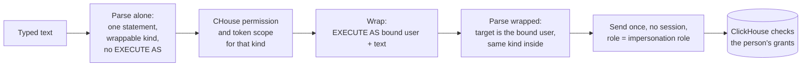

# 0033 — Every Statement Gets a ClickHouse Identity: One Executor, an Optional Role Ceiling, and Personal Connections

- **Status:** Accepted
- **Date:** 2026-11-15
- **Amends:** [0027](0027-connection-privilege-check.md) and [0031](0031-optional-clickhouse-access-admin.md) (the privilege catalog becomes per connection kind; everything else in both stands), [0030](0030-clickhouse-parses-sql-access-checks.md) (admins are parsed too, `EXECUTE AS` is refused, a typed `KILL QUERY` needs `live_queries:kill_all`, and on a personal connection the default database comes from the person and file import sends a session), [0011](0011-personal-access-tokens.md) (what a token runs as on a personal connection), [0015](0015-cluster-aware-materialize-destinations.md) (materialize is unavailable on a personal connection), [0021](0021-custom-dashboards.md) (the result cache key gains the ClickHouse identity)
- **Scope:** a new `packages/server/src/services/chExecutor/`; every server file that reaches ClickHouse; `middleware/sqlAccess/` and `middleware/dataAccess.ts`; RBAC migrations 1.76.0 to 1.78.0; the connection routes and two new route modules; Admin › Connections, Preferences and the connection switcher; `.rules/SECURITY.md`; `ARCHITECTURE.md`; the Helm chart version; docs; CI. Four deliveries, see §10.

## Context

### Overview

CHouse UI reaches each ClickHouse server through one saved login per
connection, called the service login in this ADR. Every person allowed to use
the connection runs as that login, and so does every background job. (One
feature, remediation, has its own second stored login; see §5.) This ADR
changes how a statement gets its ClickHouse identity, in three stages:

1. **Fix the shared-login model.** One server module sends every statement
   and always knows who it is for. ClickHouse itself refuses writes sent
   through read paths or by people without write permission, and each
   statement can be traced to a CHouse account or a named service purpose.
2. **An optional role ceiling.** On a shared-login connection, a super admin
   can tie each CHouse role to a ClickHouse role. ClickHouse then refuses
   anything outside that role, even when a CHouse check is wrong.
3. **Personal connections.** On servers that pass the self-test in §7.1, each
   statement runs as the person's own ClickHouse user. ClickHouse grants, not
   CHouse data access policies, decide which tables that person reaches.

A person still signs in to CHouse with a CHouse account in every case.

The work ships as four deliveries. Delivery 1 is a set of fixes to today's
model and needs no ADR. Stage 1 is delivery 2, stage 2 is delivery 3 and
stage 3 is delivery 4.

### How the access check works today

[ADR 0030](0030-clickhouse-parses-sql-access-checks.md) decides how CHouse
checks SQL a person typed. CHouse asks ClickHouse to parse the text
(`EXPLAIN AST`) and reads two things from the result:

- **The statement-kind check.** The kind of statement (select, insert, alter
  and so on) must be covered by one of the person's CHouse permissions.
- **The table check.** Every table the statement touches must be allowed by
  the person's data access policies, which are allow and deny patterns on
  database and table names, per connection.

Both run in `validateQueryAccess`. Each route that accepts SQL calls it and
then sends the text to ClickHouse itself.

[ADR 0027](0027-connection-privilege-check.md) decides that a connection can
be saved only when its login holds the ClickHouse privileges for every
feature group in a catalog, and reports which are missing.
[ADR 0031](0031-optional-clickhouse-access-admin.md) makes one group, managing
ClickHouse users and roles, optional.

CHouse has three levels of account that matter here. A **restricted person**
holds a role with some permissions and some data access policies. An
**admin** holds the `admin` role. A **super admin** holds `super_admin`. The
person who manages the ClickHouse server, the **ClickHouse administrator**,
may have no CHouse account at all.

### The problem

**1. One boundary stands between a restricted person and a powerful login.**
ADR 0027 requires the service login to hold the privileges for every feature:
monitoring, data health, stopping queries and editing data.
`.rules/SECURITY.md` states the result: CHouse's own roles and data access
policies are the only boundary between a restricted person and everything
that login can read or change. A single mistake in a CHouse check exposes all
of it.

**2. That boundary is applied in many places, not one.** About 30 places in
the server obtain a ClickHouse client with no person attached: dashboards,
notebooks, data health, scheduled-query preview, the upgrade check, AI fleet
tools. Each has to remember to run the access check itself. A review of the
code found several paths that reached ClickHouse without it. They are fixed
as the first delivery of this work.

**3. Admins and super admins are not checked.** For both, the access check
returns "allowed" before the statement is parsed (`middleware/dataAccess.ts`,
`validateQueryAccess`). `.rules/SECURITY.md` names an admin who is not a super
admin as an attacker, yet nothing limits what such an admin can send through
the service login.

**4. ClickHouse cannot tell people apart.** `system.query_log` shows the
service login for every statement. The real person appears only in
`log_comment`, on the paths that set it. Several person-triggered paths set
nothing. A person can also overwrite it with a `SETTINGS log_comment = ...`
clause (observed on all 12 builds, see "Evidence" below). ClickHouse quotas,
row policies and settings profiles therefore cannot apply per person.

**5. Restricted people can read system tables by default.** The table check
allows `system` and `information_schema` for everyone before any policy is
read (`rbac/services/dataAccess.ts`, `evaluateRules`). The service login must
be able to read `system.query_log`, so a restricted person can read other
people's query text.

**6. Work that runs later can run under the wrong person.** A scheduled query
is checked against its owner's policies when it runs. A different person who
may edit the job can change what it runs, and it still runs as the owner.

**7. People with a ClickHouse user ask why they need a second identity.**
Some users already have a ClickHouse user with grants their ClickHouse
administrator maintains. In CHouse they get a separate account with separate
data access policies that someone else maintains, so two sets of rules for
the same tables can drift apart. This is the concern the repository owner
raised that started this work.

**Who is affected.** A restricted person is the first attacker in the threat
model and can exploit problems 1, 2, 4, 5 and 6. An admin who is not a super
admin is the second, and problem 3 is theirs. Super admins and ClickHouse
administrators carry problem 7 as duplicate upkeep. ClickHouse administrators
cannot audit or limit individual people from their side (problem 4).

### Evidence

"Observed" in this ADR means a response seen from a real ClickHouse server on
2026-11-14 or 2026-11-15. The servers were single-node Docker containers of
these 12 builds: 23.8.16.16, 24.3.18.7, 24.4.4.113, 24.8.14.39, 24.12.6.70,
25.8.33.6, 25.10.7.6, 25.11.9.34, 26.2.19.43, 26.3.63.123, 26.4.5.143 and
26.5.7.64. `EXECUTE AS` exists only on the last five. Most follow-up runs
used 26.3.63.123 and 26.5.7.64, and some used 26.3.63.123 alone; each claim
below names its builds where that matters. Behaviour differs by patch build,
so "26.3" in this ADR always means build 26.3.63.123. Claims about upstream
fixes come from the ClickHouse changelog and issue tracker, not from a run.
Nothing was run on a multi-node server, on ClickHouse Cloud, or with LDAP or
Kerberos users.

### Goals

Each goal names how it is checked.

1. **One path to ClickHouse.** Every statement the server sends goes through
   one executor, and the call must state who it acts for. *Check:* a CI step
   fails when any other file imports the ClickHouse client library or its
   pool, or reads the remediation login.
2. **A statement sent through a read path, or by a person without write
   permission, cannot change data.** This holds on shared-login connections
   even when CHouse classifies the statement wrongly, and for every caller,
   admins included. *Check:* with the statement-kind check forced to allow, an
   `INSERT` from a read-only person, and an `INSERT` placed in a dashboard
   panel viewed by an admin, both fail with ClickHouse error 164 (`READONLY`).
3. **Every statement CHouse sends can be traced to a CHouse account or a
   named service purpose, by a value the statement cannot change.** *Check:*
   for a statement sent with a forged `log_comment`, CHouse still reports the
   true account.
4. **On shared-login connections, restricted people cannot read other
   people's query text.** *Check:* a restricted person's `SELECT` from
   `system.query_log` is refused unless they hold the permission to read
   everyone's query history.
5. **A role ceiling holds when CHouse's table check fails.** *Check:* with
   the table check forced to allow, a person whose mapped role cannot read a
   table gets ClickHouse error 497 (`ACCESS_DENIED`) for it.
6. **On a personal connection, SQL a person submits reaches no more than
   their own ClickHouse grants.** *Check:* the same forced-allow test through
   each way of submitting a statement listed in §7.5 and §7.8.
7. **On a personal connection ClickHouse records the person.** *Check:* the
   `system.query_log` row for the statement has `user` set to the person's
   ClickHouse user. File import is the one exception (§7.7).
8. **No personal ClickHouse password is stored by CHouse or passes through
   it.** *Check:* no route accepts one, and no table has a column for one.
9. **A request that carries no identity reaches no data.** On a role-ceiling
   or personal connection, a request sent as the service login with no role
   and no impersonation reads no user table, no log or process table, and
   cannot act as anyone. This must also hold for an older CHouse version
   running against the same connection. *Check:* such a request gets error
   497 for a user table and for `system.processes`, and `system.query_log` is
   refused or hidden.
10. **Work that runs later runs as the person who last decided what it
    does.** *Check:* after a second person edits a scheduled query, its next
    run is checked against that person's rules.
11. **An admin who is not a super admin has a stated limit on each kind.**
    On a `shared` connection the limit is unchanged: none on tables. On a
    role-ceiling connection it is the admin's mapped ClickHouse role. On a
    personal connection it is their own ClickHouse grants. *Check:* the
    forced-allow tests of goals 5 and 6, run as an admin.
12. **Apart from the changes listed in §4, nothing changes on a connection
    until a super admin switches its kind.** *Check:* the tests of the move
    behind the executor compare what each route sends before and after
    (§10.5), and a migration test shows existing connections stay `shared`.

### Non-goals

- Replacing CHouse accounts or CHouse roles with ClickHouse users and roles.
  ClickHouse has no way to say who may edit a dashboard or configure AI.
- Signing in to CHouse with a ClickHouse user. Reviewed and moved to its own
  later ADR.
- Storing personal ClickHouse passwords, or a generated secret per person.
- Copying CHouse data access policies into ClickHouse grants automatically.
- Personal connections on servers that fail the self-test in §7.1.
- Gating data CHouse has already stored (collected evidence, published
  snapshots) by ClickHouse grants. CHouse permissions keep governing it.
- Limiting an admin on a `shared` connection. Problem 3 stays open there; the
  two new kinds are the answer to it.
- Protecting against a full compromise of the CHouse server.

### Critical user journeys

**CUJ 1: A read-only analyst on a shared-login connection.**
- **Given** Bima holds a CHouse role with select permission only.
- **When** he sends a statement that CHouse wrongly classifies as a read but
  that writes.
- **Then** ClickHouse refuses it, because the request carries `readonly`.
  Bima sees a message saying the statement would change data.

**CUJ 2: A super admin turns on the role ceiling.**
- **Given** ClickHouse 24.4 or later, a ClickHouse role `analyst_ro`, and a
  new, empty ClickHouse user that the ClickHouse administrator prepared.
- **When** a super admin maps the CHouse role Analyst to `analyst_ro` and
  switches the connection to the ceiling, giving the new login.
- **Then** CHouse first checks that the new login holds no grants of its own
  and no default roles, and refuses the switch otherwise. Afterwards each
  Analyst request names `analyst_ro`, and a table outside that role is
  refused by ClickHouse even if a CHouse policy allows it.

**CUJ 3: Alice is linked to her ClickHouse user.**
- **Given** a personal connection, and Alice has a ClickHouse user `alice`.
- **When** a super admin creates the binding from her CHouse account to
  `alice`, and the ClickHouse administrator runs the grant CHouse shows.
- **Then** the binding moves from pending grant to active. Until the grant is
  run Alice cannot query the connection, and CHouse tells her why and whom
  to ask.

**CUJ 4: Alice runs a query on a personal connection.**
- **Given** an active binding.
- **When** she runs a `SELECT` on a table her ClickHouse user may read, and
  then on one it may not.
- **Then** the first returns rows and `system.query_log` shows `alice`. The
  second is refused by ClickHouse, and CHouse shows the missing grant.

**CUJ 5: A scheduled query runs at night after its owner's binding is gone.**
- **Given** a scheduled query on a personal connection, last changed by
  Alice, whose binding was removed.
- **When** the schedule fires.
- **Then** the run is refused. It does not run as the service login. The job
  shows the reason and Alice is told.

**CUJ 6: A server stops qualifying.**
- **Given** a personal connection on a server that passed the self-test.
- **When** the server is upgraded to a build that fails it.
- **Then** within one check interval (five minutes) the connection refuses
  every person's statement, with a named reason, until the test passes
  again. A statement of the `CREATE` family is refused sooner: the executor
  repeats the `CREATE` check before sending one (§7.1).

**CUJ 7: An admin tries to act as someone else.**
- **Given** any connection.
- **When** an admin types a statement that contains `EXECUTE AS bob`.
- **Then** it is refused before it is executed.

**CUJ 8: CHouse is rolled back to an older version.**
- **Given** a personal connection, and CHouse is rolled back to a version
  that knows nothing about connection kinds.
- **When** the older version sends a statement as the service login.
- **Then** ClickHouse refuses it, because the service login holds nothing
  without a role named on the request.

### Open questions

- **Servers with several nodes.** A session lives on one node, the self-test
  sees only the node that answered, and `system.query_log` is per node.
  Nothing here was run on a multi-node server. §7.1 and §7.7 state what is
  expected and what is not covered.
- **Row policies and published results.** A publication shows rows as its
  author saw them (§7.6). Nothing detects that a reader's row policy would
  have hidden some.
- **ClickHouse users from other sources.** A user defined in `users.xml` was
  observed to work as an `EXECUTE AS` target. Not run: such a user as the
  service login, whether its id is stable across restarts, LDAP and Kerberos
  users, ClickHouse Cloud, and builds after 26.5.7.64.

## Decision

### 1. Terms

| Term | Meaning |
| --- | --- |
| Service login | The username and password saved on a connection. Older documents call it the saved login. |
| Remediation login | A second stored login some connections have, used only to carry out approved remediation actions (§5). |
| Actor | Who CHouse is acting for when it sends a statement: a person (with the token, if any), or a named service purpose, optionally with the person who triggered it. |
| Credential | Which login a request authenticates with: the connection's service login, the remediation login, or a login being tested before it is saved. |
| ClickHouse identity | What ClickHouse sees for a request: the credential, optionally with a role named on the request, optionally acting as a person's ClickHouse user. |
| Bare request | A request sent as the service login with no role and no `EXECUTE AS`. |
| Typed text | SQL a person or a model wrote, in whole or in part. CHouse-built text that contains a fragment a person wrote (a `WHERE` predicate, for example) is typed text. |
| CHouse-built text | SQL the server code wrote. A person's input reaches it only as a bound parameter or as an identifier that passed the table check and the identifier helper. |
| Statement-kind check, table check | The two parts of the access check described in Context. |
| Role named on the request | The HTTP parameter `role=<name>`. ClickHouse runs the request with that role, which must be granted to the login (24.4 and later; older servers answer with error 115, `UNKNOWN_SETTING`). |
| `EXECUTE AS` | A ClickHouse statement prefix, `EXECUTE AS <user> <statement>`, that runs the statement with the named user's grants. It exists from 25.11. The sender needs the grant `IMPERSONATE ON <user>`. |
| Binding | The record "this CHouse account is this ClickHouse user on this connection". The UI calls it a link. |
| Connection kind | `shared`, `shared_ceiling` or `personal`, stored per connection. |
| Shared-login connection | A connection of kind `shared` or `shared_ceiling`. Where only the first is meant, this ADR writes "`shared` connection". The UI shows two choices, shared login and personal, with the ceiling as an option on the first. |
| Admin, super admin, ClickHouse administrator, restricted person | As defined in Context. |

### 2. One executor (delivery 2)

A new module, the executor, is the only code that talks to ClickHouse.

**What a call hands it.** A connection, an actor, a credential (the
connection's service login unless stated), and one of these operations:

| Operation | Text | Used by |
| --- | --- | --- |
| Run a checked statement | Typed | The SQL editor, saved and scheduled queries, dashboard panels, notebook cells, AI tools, every other place that runs typed text |
| Read | CHouse-built | Explorer, monitoring pages, collectors |
| Command | CHouse-built | DDL the explorer builds, materialize steps, remediation actions |
| Insert rows | CHouse-built, with a body of rows | File import |
| Stop a query | CHouse-built | Live queries, timeouts |
| Parse | `EXPLAIN AST` followed by typed text | The access check |
| Pinned session | CHouse-built | Materialize runs, as [ADR 0015](0015-cluster-aware-materialize-destinations.md) §4 decides |

**Checked means executed.** The first operation does not accept a string. It
accepts a *checked statement*: a value that only the access check can
produce, holding the exact text, parameters, connection and actor it checked,
and the verdict. A route cannot send typed text that was not checked, or
check one text and send another. This is the "one guarded helper" ADR 0030
named and deferred. What the type system cannot stop is server code passing
typed text to the read or command operations, which take a string; code
review and the forced-allow tests on the two new kinds cover that.

**Actors.**

| Actor | Carries | Example |
| --- | --- | --- |
| Person | Account id, and token id when a token or MCP call acts for them | Anything a signed-in person does |
| Service purpose | A name from a fixed list in code, and optionally the person who triggered it, written to the audit trail and `log_comment` | `collector`, `fleet-metrics`, `stop-query`, `health-check`, `version-probe`, `upgrade-check`, `connection-test` |

A person's input reaches a service-purpose request only as a bound parameter
or as an identifier that passed the table check. Two operations are the
stated exceptions and have fixed shapes: parse (the text follows
`EXPLAIN AST`; ClickHouse executes nothing and checks no grant for it,
observed) and stop (the query id is a bound parameter).

**What the executor owns.** A call can no longer set any of these:

- the ClickHouse identity (role, `EXECUTE AS`);
- `readonly`, the output format, sessions and the settings sent on the URL
  (a call may ask for limits such as a timeout or a row cap by name);
- the query id and `log_comment`;
- the quota key;
- turning a ClickHouse error into a CHouse error (§8).

**The query id.** The executor makes it: a fixed prefix, the actor kind, the
account id or service purpose, and a random part. A statement cannot change
its own query id (ClickHouse has no setting for it). The SQL editor needs to
stop its own running statement, so the browser may send a random nonce with
the request; the executor uses it as the random part, and "stop" accepts the
nonce and rebuilds the id from the caller's own account. CHouse reads the
account from the id only on rows whose `user` is the connection's service
login, because anyone with their own ClickHouse login can choose any id for
their own statements. Rows logged before this change, or by an older replica
during an update, have no such id and are attributed from `log_comment` as
today.

**Enforced by CI.** A check in the style of `bun run check:contracts` fails
when any file outside the executor imports `@clickhouse/client`, imports the
client pool, or reads the remediation login. This catches a path that obtains
a client outside the executor. It does not police reads of the connection's
own stored password by name, because the same lookup also returns host and
port; a file can only use that password by building a client, which the
check catches. Together with the checked statement it means a path cannot
send typed text without naming an actor and passing the access check.

**Pooled clients.** One pooled client per connection and credential, and a
second small one for parse, stop and health checks, so they do not wait
behind long statements. Identity is passed on each request. The pool key no
longer holds the password or the `log_comment`. The pool entry is dropped
when a connection's login or kind changes.

**Two pull requests.** Delivery 2 ships as 2a and 2b.

- **2a** moves every call behind the executor and gives every request its
  identity: the query id, `log_comment` and the quota key. It also ships §3
  and refuses a scheduled job with no owner. In 2a the executor's calls have
  the shape of the ClickHouse client's (`query`, `command`, `exec`,
  `insert`), minus the fields only the executor may set, so that about 95
  call sites move without being rewritten.
- **2b** ships the rest of §4 and §8, and narrows typed text to the checked
  statement described above.

### 3. Typed text is parsed for everyone (delivery 2)

Today the access check returns "allowed" for an admin or super admin before
ClickHouse parses the statement. From delivery 2 on, every typed statement is
parsed for every person.

- A statement that contains an `EXECUTE AS` node anywhere in its parsed tree
  is refused on every connection, for everyone. The check reads the tree, not
  the first word, so a leading comment or a `PARALLEL WITH` wrapper cannot
  hide it. From delivery 4 the only `EXECUTE AS` CHouse sends is the one the
  executor itself adds (§7.2).
- On a shared-login connection an admin or super admin keeps the bypass of
  the table check. No other statement kind is refused for them. A statement
  is also refused when the parse is unavailable or fails; today it is not.
- A typed `KILL QUERY` needs the permission `live_queries:kill_all` for
  everyone, the same permission the Live Queries page asks for when the query
  is someone else's. ADR 0030 §7 asked for `live_queries:kill` only.

Why this ships in delivery 2, before any connection impersonates: on servers
where impersonation is on by default (26.3 and later), a service login with
wide grants, such as `default`, can already run `EXECUTE AS`. An admin could
use it to make ClickHouse's own log show another user.

Cost: one `EXPLAIN AST` per admin statement.

### 4. What changes on every connection (delivery 2)

These changes, and the three in §3, apply to every install with no switch.
Each ships with a release note.

| Change | What a person notices |
| --- | --- |
| **`readonly` on the request.** Sent as `readonly=2` for typed text when the person holds no write permission or scope for the connection, or when ClickHouse's parse says the statement is a read. Sent on every statement of a read-only feature (dashboards, data health, profiling, collectors, the upgrade check), at the level that feature sends today. A person with write permission sending a statement parsed as a write gets none. | Nothing, unless CHouse had classified a write as a read. Then ClickHouse refuses it. |
| **The executor makes the query id** (§2). Live queries, "stop my query" and CHouse's reports read ownership from it. `log_comment` keeps its context fields and is no longer used to decide who owns a statement or to hide a statement from a report. | A ClickHouse administrator can see the account in `query_id` in `system.query_log`. |
| **System tables that show other people's work need a permission.** A typed read of the statement and session logs (`system.query_log`, `system.processes`, `system.text_log` and the others listed in §10.2) needs `query:history:view:all`, and a read of the access tables (`system.users`, `system.grants` and the like) needs `clickhouse:users:view`. Both permissions exist today. Other system tables stay readable. Pages whose SQL the browser builds follow the same rule. | A restricted person's `SELECT` from `system.query_log` is refused, and the parts of Logs and Monitoring that read it say which permission they need. |
| **A quota key on every request**, sent as the `X-ClickHouse-Quota` header: the account id, or the service purpose. ClickHouse 23.8 refuses the header next to Basic authentication (observed; 24.8.14.39 and 26.5.7.64 accept it), so the executor sends no key to a server that refuses it. | Nothing until a ClickHouse administrator creates a keyed quota. |
| **A scheduled job with no owner is refused.** It passes without a check today. | The job shows "no owner" and offers an "assign to me" action. |
| **Later work runs as whoever last changed what it does.** Saving a scheduled query or data health check with a change to its SQL, connection, destination, output or notification channels makes the saver its owner. The same holds for a dashboard alert or report when someone changes the SQL of its panel. | After editing someone else's job or panel, the editor is shown as the owner and the next run is checked against the editor's rules. |
| **The connection switcher shows the identity in use.** | "Shared login svc_chouse". |
| **Error messages** come from one classifier (§8). | Clearer text for a refused write and for a ClickHouse permission error. |

Why `readonly=2` and not `1` for typed text: `1` refuses every `SETTINGS`
clause (observed, error 164), and `2` still blocks writes and cannot be
undone by the statement.

### 5. Connection kinds and the empty service login (deliveries 3 and 4)

**What is stored.** `rbac_clickhouse_connections` gets these columns:

| Column | Delivery | Meaning |
| --- | --- | --- |
| `identity_mode` | 3 | `shared` (default), `shared_ceiling` or `personal`. Any value the running code does not know makes the connection refuse (see "Health" below). |
| `system_role` | 3 | The ClickHouse role named on service-purpose requests. Entered by the super admin at the switch. |
| `impersonation_role` | 4 | The ClickHouse role that holds the `IMPERSONATE` grants. Entered at the switch to `personal`. |
| `access_contact` | 3 | Optional text shown with refusals: whom to ask for access. |
| `identity_health`, `identity_health_reason`, `identity_checked_at`, `identity_server_version` | 3 | The latest verdict of the checks below, so every replica reads the same one. |

**The empty login.** On a `shared_ceiling` or `personal` connection the
service login must be empty: no direct grants and no default roles.
Everything it may do sits in ClickHouse roles the ClickHouse administrator
creates and grants to it, and the executor names one role on each request.

| Role | Holds | Named on |
| --- | --- | --- |
| System role | Reads on the system tables in the per-kind privilege catalog; `KILL QUERY`; `SELECT` on `system.processes`; `SELECT(name, id)` on `system.users`; `SHOW` privileges so table and column names are visible. No grant on any user table. | Service-purpose requests, except the personal self-test |
| Mapped roles (ceiling) | The data grants for one CHouse role | A person's requests on a `shared_ceiling` connection |
| Impersonation role (personal) | `IMPERSONATE` on each bound user and on the service login itself. Nothing else. | A person's requests on a `personal` connection, and the self-test |

Because the login is empty, a bare request reaches no data. Observed on
24.4.4.113, 26.3 and 26.5.7.64: a bare request from such a login gets error
497 for a user table and for `system.processes`, and `system.query_log` is
hidden; a login whose only route to `IMPERSONATE` is a role cannot
impersonate unless the request names that role (26.3). This is what protects
against an older CHouse version, an old replica during an update, and a code
path that forgets the identity. It depends on the server setting
`select_from_system_db_requires_grant`, which is on in every probed image
except 23.8; the checks below test for it.

**Checks.** They run before a switch, on every edit of the login, and every
five minutes under a lease (`services/observe/lease.ts`), with the verdict
written to the columns above. The login fails when:

- `SHOW GRANTS` for it lists any direct grant or default role;
- any role granted to it holds a user-management privilege, a grant option,
  or `IMPERSONATE` on all users;
- a bare `SELECT` from a user table, from `system.processes` or from
  `system.query_log` returns rows;
- another connection of a different kind uses the same host, port and
  username.

Only CHouse-built check statements change the verdict. An error from a
person's statement never does.

**Health.** A connection is *ready* or *refusing*. It is refusing when the
latest verdict failed, when the verdict is older than 15 minutes (so a
stopped checker fails closed), or when `identity_mode` is unknown. While it
is refusing the executor sends nothing for a person on that connection and
returns the stored reason; the checks themselves still run.

**Switching.** A switch is one write of the kind, a login and password, and
the role names, made by a super admin and audited. It is the same procedure
between any two kinds.

1. The ClickHouse administrator prepares a different ClickHouse user for the
   new kind (empty, with its roles, for the two new kinds; with the ADR 0027
   privileges for `shared`). CHouse shows the statements.
2. The super admin enters the new login. CHouse runs the checks for the new
   kind against it, and the ADR 0027 privilege check with the catalog for
   that kind.
3. If they pass, CHouse saves the kind and the login together, drops the
   pooled client and clears every result cache for the connection.

Because the login is replaced and not rewritten, no maintenance window is
needed and the previous login keeps working until the write. Costs: two
service users exist until the ClickHouse administrator drops the old one;
`system.query_log` history and quotas split across two login names. On a
`shared_ceiling` or `personal` connection only a super admin may edit host,
port, TLS or login, and the checks run on each edit.

Switching back to `shared` asks the super admin to review the data access
policies first when coming from `personal`, where they were not in force.

**The remediation login.** A connection may have a second stored login that
is used only to carry out an approved remediation action or a codec trial,
with CHouse-built statements. It exists today and is set by someone holding
`connections:edit`. It stays available on every kind. It is outside the
ceiling by design: what it may do is bounded by its own ClickHouse grants and
by the approval a remediation action needs. On the two new kinds the checks
also fail when that login can impersonate or manage users.

**The privilege catalog becomes per kind.** `PRIVILEGE_FEATURES` gains, for
each feature group and kind, one of: required on the login, required on the
system role, comes from the mapped role or the person, optional (ADR 0031),
or unavailable. For `shared` the report stays byte-for-byte what it is today.
Everything else ADR 0027 and ADR 0031 decide stands.

### 6. The role ceiling (delivery 3)

- A new table maps (connection, CHouse role) to one ClickHouse role. Only a
  super admin edits it; each edit is audited.
- An account holds one CHouse role (every route that assigns roles sets
  exactly one). The executor reads it from the database on each request, not
  from the session token, so a removed role stops on the next request, and
  names its mapped ClickHouse role. A request is refused by CHouse when the
  account's role has no mapping on that connection or the account holds more
  than one role. It is never sent without a role.
- A CHouse role that has a mapping on any connection can be assigned only by
  a super admin. Without this an admin could assign themselves a role mapped
  to a wide ClickHouse role.
- Admins and super admins get their mapped role like everyone else. The
  bypass of the table check that §3 keeps does not widen what ClickHouse
  allows.
- The statement-kind check and the table check apply exactly as on a `shared`
  connection. The ceiling is a second boundary under them.
- Result caches include the role in their key.
- Needs ClickHouse 24.4. Older servers answer `role=` with error 115, so they
  fail closed.

**Which feature runs as what on a ceiling connection.**

| Feature | Runs with |
| --- | --- |
| SQL editor, explorer, dashboards, notebooks, AI chat tools, tokens and MCP | The person's mapped role |
| Scheduled queries, data health checks, dashboard alerts and reports | The owner's mapped role, read when the run starts |
| Materialize | The owner's mapped role, named on every request of the pinned session. The role needs the `CREATE`, `INSERT` and `ALTER` grants the run uses. |
| Table profiling, data health diagnostics, the mutation impact estimate, the upgrade check's replay of logged statements | The mapped role of the person who started it. A statement the role cannot run is reported as not checked. |
| Monitoring, live queries, query history, collectors, fleet metrics | The system role |
| Remediation actions, codec trials | The remediation login |
| Admin › ClickHouse users and roles | Unavailable: the login may hold no user-management privilege |
| The AI cost estimate before a statement | The person's mapped role. A failed estimate blocks the statement here, because the failure may be the ceiling refusing it. |

What a ClickHouse administrator should know (observed on 24.4.4.113, 26.3
and 26.5.7.64):

- A view cannot be created through CHouse over a table the creator's mapped
  role cannot read.
- An insert is refused when a materialized view on the target table reads
  something the inserter's mapped role cannot.
- A view with `SQL SECURITY DEFINER` runs with its definer's direct grants,
  not with roles granted to the definer. One whose definer is the empty
  service login reads nothing. Views whose definer is the previous login keep
  working while that login keeps its grants.

What the ceiling does not cover: the query log still shows the service login;
the bound is the role's grants, not one person's; the remediation login is
outside it.

### 7. Personal connections (delivery 4)

Delivery 4 starts only when CI has a pinned ClickHouse build that passes the
self-test, and after the probes listed at the end of §7.2 are recorded.

#### 7.1 The self-test

A server may be a personal connection only while it passes four checks. Each
is one statement sent with the impersonation role. The first three were
observed on 26.3 exactly as written here, with a role-held grant; all four
have no side effect.

| Check | Statement | Pass |
| --- | --- | --- |
| Impersonation works | `EXECUTE AS <service login> SELECT 1` | Status 200 with the value `1`. Anything else fails; error 497 here means the role lacks `IMPERSONATE` on the service login. |
| `CREATE` is access-checked | `EXECUTE AS <service login> CREATE DATABASE IF NOT EXISTS system` | Error 497 whose message names the `CREATE DATABASE` privilege. A 200 means the build runs `CREATE` without checking the person's grants. |
| `FORMAT` is honoured | `EXECUTE AS <service login> SELECT 1 AS a FORMAT JSONEachRow` | The reply is `{"a":1}` |
| No nesting | `EXECUTE AS <service login> EXECUTE AS <service login> SELECT 1` | Error 62 (`SYNTAX_ERROR`) |

It runs at the switch, when CHouse starts, with the §5 checks every five
minutes, and when `version()` changes. The verdict is stored as in §5 and a
failure makes the connection refuse with a named reason. Before sending any
statement of the `CREATE` family the executor repeats the second check unless
it passed within the last 60 seconds, so a server upgraded between two timer
runs cannot create objects unchecked.

Of the 12 builds probed, only 26.3.63.123 passes. 26.5.7.64 fails the second
check (observed). 25.11.9.34, 26.2.19.43 and 26.4.5.143 showed the same
unchecked `CREATE` with other statements; this exact statement was not run on
them. 25.11 and 26.2 also ship with impersonation off. The ClickHouse
changelog lists the fix for 26.10.

Not covered: behind a load balancer whose nodes run different builds, the
test can pass on one node while a statement reaches another. ADR 0030
records the same limit for its parse.

#### 7.2 How a typed statement is sent



- **The user name.** In delivery 4 a ClickHouse user can be bound only when
  its name is made of letters, digits and underscores. It is written through
  the identifier helper. Observed: text that follows an unquoted name can
  change the target. The second parse is designed to catch any difference
  between the target ClickHouse sees and the bound user; that it does is
  tested in delivery 4, not yet observed. Wider names (with `.`, `@`, `-`)
  are added only with a recorded parse fixture for each.
- **Wrappable kinds.** A statement kind may be wrapped only when a recorded
  real-server case shows that a user without the grant is refused with error
  497 on every qualifying build, the same rule `.rules/SECURITY.md` applies
  to ADR 0030's allow-lists. Any other kind is refused on a personal
  connection for everyone, admins included.
- **Refused text.** A typed `SET` or `USE` (there is no session to hold its
  effect) and a typed `INSERT ... VALUES` (§7.7) are refused with a message
  that says what to do instead.
- **Read-only.** `readonly` on the URL makes ClickHouse refuse the whole
  request (observed), so it is not sent. For a statement that must be a read
  (§7.3) the executor adds `readonly = 1` as the last entry of the
  statement's own `SETTINGS` clause. Observed on 26.3: a `SELECT` or
  `EXPLAIN` runs, a write is refused with error 164 naming the person, the
  last value in the list wins, and a clause the parser attaches to the
  wrapper makes ClickHouse refuse the request, so a misplaced clause fails
  closed. `SHOW` and `DESCRIBE` cannot carry the clause; for them the kind
  from the parse is the only guard, and they cannot write. A typed `FORMAT`
  clause is refused on these statements, because a `SETTINGS` clause after it
  lands on the wrapper. The output format goes on the URL.
- **The default database.** Unqualified names resolve against the person's
  own default database, which wins over the one on the request (observed).
  The executor reads it when the binding becomes active and again with each
  health check, and uses it for the parse.
- **Two log rows.** ClickHouse writes two rows to `system.query_log` for one
  request. The outer row has the executor's query id and the service login.
  The inner row has `user` set to the person, `authenticated_user` set to
  the service login, and a query id the server made. Observed on 26.3: no
  column links the two, and the URL's `log_comment` does not reach the inner
  row. CHouse therefore reads the account from the outer row when it needs
  the query id (live queries, stop), and for usage, lineage and history it
  counts the inner row only and finds the account through the binding of the
  row's `user`. A ClickHouse administrator pairs the rows by time and text.

Probes to record before delivery 4 is built: the printout of a wrapped
statement for each allowed name shape; `readonly` in the statement on every
qualifying build; whether the inner row can carry a statement-level
`log_comment`; and the wrappable-kind cases.

#### 7.3 What CHouse still decides

- **Statement kind.** The person's CHouse permission and token scope for the
  kind, as today. The table check does not run: data access policies do not
  apply on a personal connection.
- **Statements that must be reads.** A statement must parse as a read, carry
  the statement-level `readonly` of §7.2, and pass ADR 0030's allow-lists for
  table functions, when the person running it did not write it (a dashboard
  panel, a public saved query, a shared notebook cell, "run now" on another
  person's job) or when the person or token is limited to reads.
- **Who may use the connection.** An active binding.
- **What a person sees in monitoring and collected evidence.** Pages that
  filter by table today use the tables the person's own ClickHouse user can
  see: the executor reads the list as the person and keeps it for 60 seconds.

#### 7.4 Bindings

A new table holds one row per (account, connection), unique also on
(connection, ClickHouse user id), so one ClickHouse user belongs to one
account on a connection.

| State | Meaning | Changes when |
| --- | --- | --- |
| Pending grant | A super admin created the binding; ClickHouse has not yet allowed it | A test `EXECUTE AS <user> SELECT 1` succeeds → active |
| Active | The person's statements run as that user | See the two rows below |
| Suspended | Something changed how the account signs in, and its holder did not do it: an admin reset the password, an admin changed the email, an identity link was added, or the account was reactivated | A super admin confirms the binding again → pending grant |
| Disabled | The user's id in `system.users` no longer matches, the user is gone, or the user now holds a privilege on the excluded list | A super admin removes it and creates a new one |

A super admin can remove a binding in any state; the row is deleted. Every
state change is audited.

- **Who creates one.** Only a super admin, by choosing an account and
  entering a ClickHouse user name. CHouse reads that user's id by name and
  stores it with the binding. A super admin can therefore make any account
  act as any user the impersonation role may impersonate; super admins are
  trusted in the threat model.
- **The grant.** CHouse shows super admins one script for all pending
  bindings, to hand to the ClickHouse administrator. It lists each account
  next to its ClickHouse user. CHouse cannot run the grant itself.
- **When the pending test runs.** When the binding is created, when the
  person or a super admin presses "check again", and with each health check.
- **The id check.** CHouse reads the id by name with each health check and
  after any identity failure. The grant is by name and survives a drop and
  recreate (observed), so the id is what detects a different person behind
  the same name.
- **Excluded targets.** `default`, any connection's service or remediation
  login, a name outside the allowed characters, and any user whose own
  `SHOW GRANTS` (read as that user when the binding becomes active, and with
  each health check) lists a user-management privilege, a grant option or
  `IMPERSONATE`. ClickHouse administrators therefore cannot be bound in
  delivery 4.
- **Grants that outlive a binding.** `IMPERSONATE` is granted on a user name,
  not on a binding, and stays after the binding is removed. The health check
  lists users the impersonation role may impersonate that have no binding,
  and shows the `REVOKE` for each. This is a warning, not a refusal.
- **Where.** Bindings are managed in Admin › Connections and can be prepared
  while a connection is still shared. A person sees their own bindings and
  their state in Preferences.

#### 7.5 Work that runs later

| Work | Runs as | When it cannot |
| --- | --- | --- |
| Scheduled query, data health check | The binding of its owner (§4 decides who that is) | Refused; the job shows why and its owner is told |
| "Run now" by someone who is not the owner | The binding of the person who clicked; the statement must be a read (§7.3). A job that writes can be run only by its owner. | Refused with the reason |
| Dashboard alert and report | The binding of its owner | Refused and shown |
| Token, CLI and MCP calls | The token owner's binding, within the token's scope | Error naming the missing binding |
| Actions started from a button in a chat message (Slack, Telegram and the like) | The binding of the person who clicked | Error in the chat reply |
| Stop on timeout | Service purpose `stop-query`, by the outer query id | — |
| Materialize (a scheduled query that rebuilds a table through a staging table) | Unavailable: its pinned session cannot switch identity for typed text | Refused when the job is saved |
| Collectors, fleet metrics, automatic incident triage | Service purpose with the system role, system tables only | Parts that read user tables are unavailable |
| The upgrade check (it replays statements other people ran), table profiling as a background job | Unavailable | Shown as unavailable |

Nothing is paused at a switch. A run whose owner has no active binding is
refused when it starts, recorded with the reason like any failed run, and
its owner is told through the job's existing failure notification. Runs
succeed again once the binding is active.

#### 7.6 Results CHouse holds

- A result cache or an in-flight share never serves rows fetched under a
  different ClickHouse identity. Publications, below, are the stated
  exception.
- A dashboard snapshot, a report sent to a channel and a stored notebook
  cell result are **publications**: someone shares rows on purpose, behind a
  permission, with an audit entry, labelled `as seen by <user> at <time>`.
- Running a notebook cell returns the rows to the person who ran it. Storing
  them in the notebook for other readers is a separate publish action by
  that person.
- Evidence that collectors gathered as a service purpose is shown under
  CHouse permissions and the table list of §7.3.

#### 7.7 File import

`INSERT` with rows cannot be sent as one `EXECUTE AS` request. On a personal
connection the insert-rows operation, and no other operation, opens a
ClickHouse session:

1. Open a session with a random 128-bit id and a 60-second timeout. Send
   `EXECUTE AS <bound user>` in it, with the impersonation role named.
2. Send a CHouse-built `INSERT INTO <table> FORMAT <format>` in the same
   session with the file as the body, with `session_check=1` and no role.

Observed on 26.3 with an empty login and a role-held grant: the rows went
in; a user without the `INSERT` grant was refused with error 497 naming that
user; naming the role on the second request fails with error 512; a
400,000-row, 5.5 MB body went in (that run used a direct grant). The second
request is the one request on a personal connection that names no role. If the session is missing, the request is a bare one from an
empty login and reaches nothing. Behind a load balancer that sends the
second request to another node, `session_check=1` is expected to make
ClickHouse refuse it; not tested.

Two things differ from every other statement on a personal connection, both
observed: `system.query_log` shows the service login for the insert, so the
person is identified only by the executor's query id; and `currentUser()` is
the service login, so a column with `DEFAULT currentUser()` stores the
service login for imported rows.

Typed text never runs in such a session. Materialize on shared-login
connections keeps its pinned session (ADR 0015).

#### 7.8 Which features run as whom on a personal connection

| Feature | Runs as |
| --- | --- |
| SQL editor, explorer, table details, notebooks, AI chat tools | The person |
| Dashboards | Each viewer, panel by panel |
| Table profiling on request, data health diagnostics, the mutation impact estimate | The person who asked |
| Monitoring, live queries, query history | Service purpose with the system role, behind CHouse permissions |
| "Stop my query" | Service purpose, after CHouse checks ownership from the query id |
| Remediation actions, codec trials | The remediation login |
| Test connection | The login being tested, fixed statements only |
| Admin › ClickHouse users and roles | Unavailable |
| Data access policy editor | Shows that policies do not apply here |

### 8. Errors (delivery 2, extended in 3 and 4)

One classifier in the executor replaces the three places that match on
error text today. It decides from the ClickHouse error code and from which
user the message names. Typed text can provoke many error codes, so a
classified error is only ever a message to the person who sent the
statement; it never changes a connection's health.

| Refused by | What the person is told | Who can fix it |
| --- | --- | --- |
| CHouse permission or token scope | Which permission is missing | Admin |
| CHouse data access policy (shared-login) | Which table | Admin |
| CHouse rule on the statement (`EXECUTE AS`, `SET`, `USE`, `INSERT ... VALUES` on a personal connection, a kind that cannot be wrapped) | Which rule, and what to do instead | — |
| ClickHouse, read-only (164) | That the statement would change data and they may only read | Admin |
| ClickHouse grant (497). On a `shared` or ceiling connection the message names the service login and means the login or the mapped role lacks the grant. On a personal connection it counts here when it names the person. | The missing grant; on a personal connection, that only default roles apply | ClickHouse administrator |
| Identity unavailable (on a personal connection, 497 naming the service login; 512 `SET_NON_GRANTED_ROLE`; no mapping; no binding; or a binding that is pending, suspended or disabled) | That their role mapping or binding is not usable, and its state | Depends on the state |
| Connection refusing (a failed or stale health verdict, self-test failed, 115 on a server older than 24.4) | That the connection is unavailable and the stored reason | Super admin or ClickHouse administrator |
| A job with no owner | That the job needs an owner | Anyone who may edit it |

None of these is reported as a sign-in failure, which today triggers a token
refresh in the browser. The connection's access contact, when set, is shown
with them.

### 9. Non-functional requirements

**Security.**

- The service login of a personal connection can act as every bound user. A
  way to make the executor send a chosen `EXECUTE AS` is a way to become any
  of them. The executor builds the prefix only from the binding of the actor
  it was handed, and §7.2 parses the result.
- Bindings follow `.rules/SECURITY.md` §2 (no route may let an account grant
  more than it holds): tests show that an `admin` cannot create, change or
  re-confirm a binding, and that changing another account's email, password
  or identity link suspends its bindings.
- On a personal connection ClickHouse enforces read-only only through the
  statement-level setting of §7.2, which `SELECT` and `EXPLAIN` can carry.
  For other read kinds, CHouse's reading of ClickHouse's parse is the only
  guard. A shared-login connection sends `readonly` on the URL for every
  kind.

**Cost.**

- Each personal request is two ClickHouse queries and counts on both the
  person's and the service login's quota.
- A typed statement costs two parses instead of one on a personal
  connection. The first decides the kind before the text is wrapped; the
  second checks what will be sent.
- Dashboards do not share results between viewers on personal connections:
  one execution per panel per viewer, within the existing limit of four
  panels at a time per connection per replica.

**Rollout and rollback.**

- Deliveries 2 to 4 each ship alone. Apart from §4, nothing changes which
  identity runs a statement until a super admin switches a connection.
- A CHouse rollback leaves switched connections unusable, not open: old code
  sends bare requests, which reach no data.
- Migrations are additive. 1.76.0 (delivery 2) adds an owner column to
  scheduled queries. 1.77.0 (delivery 3) adds the columns of §5 except
  `impersonation_role`, and the role-map table. 1.78.0 (delivery 4) adds
  `impersonation_role` and the bindings table.

**Test matrix.** CI runs ClickHouse 23.8 and 26.5 today. Delivery 3 adds
24.3.18.7 and 24.4.4.113, pinned. Delivery 4 adds 26.3.63.123, pinned, as
the build that passes the self-test; 26.5 already fails its second check and
25.10.7.6 is added as a build without `EXECUTE AS`. One regression suite, "a
person limited to `public` cannot read `secret.t` through ...", runs against
all three kinds on a real server, with the CHouse checks forced to allow.

### 10. Implementation plan

Conventions in this section:

- `S/` is `packages/server/src/`. Other paths are from the repository root.
  A bare file name in a list follows the directory of the entry before it.
- "+ test" means the co-located `*.test.ts` or `*.test.tsx` is changed or
  created with the file.
- Every code directory has a `README.md` contract. Each delivery updates the
  contract of every directory under `S/`, `src/` and `scripts/` in which it
  changes exports, invariants or side effects, and adds one for each new
  directory. `bun run check:contracts` must pass.
- "Both dialects" means SQLite and PostgreSQL. "All three upgrade shapes"
  means fresh install, one release at a time, and a jump from an old release,
  as `migrations.test.ts` runs them.
- §n means a section of this ADR unless the cell says `SECURITY.md`.

#### 10.1 Deliveries

| # | Contents | Branch | Changelog fragment | Migration |
| --- | --- | --- | --- | --- |
| 1 | Fixes for gaps in today's model. No ADR. Shipped separately. | `fix/access-check-gaps` | patch | none |
| 2a | The executor and the identity it sets on every request (§2), parsing for everyone (§3), no run for a job with no owner | `feat/statement-executor` | minor | none |
| 2b | The rest of §4, the checked statement (§2), the classifier rows of §8 that exist on `shared` connections | `feat/checked-statements` | minor | 1.76.0 |
| 3 | Connection kinds, checks, health, switching (§5), the role ceiling (§6), the access contact | `feat/role-ceiling` | minor | 1.77.0 |
| 4 | Personal connections and bindings (§7) | `feat/personal-connections` | minor | 1.78.0 |

Each delivery is one pull request against `preview`, the branch every pull
request in this repository targets. Each minor fragment also updates
`docs/portfolio/src/content/release.ts` and
`docs/portfolio/src/content/docs/whats-new.md`. This ADR ships with delivery
2a, with its status set to `Accepted` and its index row updated. Each
delivery sets `APP_VERSION` to its migration's version.

#### 10.2 Delivery 2: the executor and the every-connection changes

**What 2a built, and what is left for 2b.** 2a created
`S/services/chExecutor/` (`executor.ts`, `clientPool.ts`, `queryId.ts`,
`session.ts`, `types.ts`), moved every call site in the tables below behind
it, added `scripts/check-clickhouse-access.ts`, the `EXECUTE AS` refusal, the
admin parse and the typed `KILL QUERY` permission. Its handle is
`ChExecutor` in `types.ts`: `query`, `command`, `exec`, `insert`, `ping`,
`session`, `queryIdFor`, `withContext`, `onServiceLane`. The service purposes
in code also include `access-parse` and `remediation`. Table profiling, the
upgrade check and the AI fleet tools send as a service purpose in 2a; 2b
makes them send as the person, as the tables below say. Everything else in
this section that 2a did not build is 2b: the interface below, `readonly`,
the classifier, the system-table rule, the forced-allow hook, ownership and
its migration, and the frontend rows.

**What 2b built, and where it differs from the plan below.** 2b shipped
`readonly`, the checked statement, the classifier, the system-table rule,
the forced-allow hook, ownership with migration 1.76.0, and the frontend.
The tables below are the plan as reviewed; these are the differences, each
decided during the build:

| Planned | Built | Why |
| --- | --- | --- |
| A new interface (`runChecked`, `read`, `command`, `insertRows`, `stop`, `parse`) replaces the client-shaped one | The 2a handle stays and gains `queryChecked` and `commandChecked`. `ClickHouseService.executeChecked` and `streamQueryRows` take a checked statement | Rewriting about 95 call sites of CHouse-built text would change nothing they send. The rule that matters is on typed text, and it is enforced where typed text enters |
| `CheckedStatement` is a class in `S/middleware/dataAccess.ts` | The class is in `S/services/chExecutor/checked.ts` with a private constructor. Its one factory may be named only by `dataAccess.ts`; `check:clickhouse-access` fails on any other file | The executor must not import the middleware that imports it. The CI check gives the same guarantee: only the access check makes one |
| "No write permission" means none of `query:execute:dml`, `:ddl`, `:misc` | Also none of `table:insert`, `table:update`, `table:delete`, `table:create`, `table:alter`, `table:drop`, `database:create`, `database:drop`, `live_queries:kill_all` | Those are the permissions the access check asks for on a write. With the shorter list a person holding only `table:insert` would have had every insert refused by ClickHouse |
| `readOnlyFeature` on `read` | CHouse-built reads keep setting `readonly` themselves, as in 2a. `readOnlyFeature` exists on the checked calls only | CHouse-built text is not what the rule guards against |
| A scheduled run's check uses placeholder values for the time parameters | The check runs on the values of that run, and the run sends the checked statement | A checked statement holds the parameters it was checked with |
| A data health check and its job take the same owner | The backing job runs as whoever saved the check (`owner_id`). The check's "owner" field keeps meaning the person responsible for it, and `created_by` keeps deciding who sees the job | Someone who may see every check can name another person as responsible. That person did not write the SQL and was not checked against it |
| The upgrade check replays logged statements through the access check as the person who started it | It stays the service purpose `upgrade-check`, now recording who started it | It sends only `EXPLAIN PLAN` of each statement under `readonly = 2` with a row limit, and shows pass or fail. The statements are other people's; checking them against the starter's table rules would refuse most of the workload the check exists to test |
| Self-exclusion filters use the `chouse:s:collector:` prefix | They use `internalTrafficSql`: that prefix, `chouse:s:remediation:`, and a marked random part (`i-`) on a feature's request made for a person. Only the executor can set the mark | Dashboard panels and notebook cells are sent for a person, so no service prefix covers them, and `log_comment` cannot be trusted to mark them |
| `src/hooks/useQuery.ts` moves to the existing recent-queries route | A new route, `POST /api/metrics/query-logs`, builds and scopes the Logs page's statement | The Logs page needs columns, sorting and a time range that the recent-queries route does not have |
| Built-in dashboard panels over the statement logs are marked as needing the permission | Not marked. A viewer without the permission gets the refusal on the panel, which names the permission | The refusal already says it; a second mechanism would have to be kept in step with the list |
| `identity.ts`, `recording.test-util.ts`, `S/routes/scheduled-queries.test.ts`, `S/services/agents/governance.test.ts` | Not added | In this delivery the identity is the stored login and nothing more. The executor tests record calls with a stand-in client, and the route behaviour is covered by the store tests and the real-server suite |

Also built, and not in the plan: `validateSystemRead`, which checks SQL the
fleet AI writes for a person like typed text (only a single `SELECT`, only
system tables, the same permission rule); the error code
`CONNECTION_AUTH_FAILED` (502) for a stored login ClickHouse rejects, which
used to be reported as a sign-in failure; and moving the owner of a
dashboard's alerts and reports when a save changes the dashboard's
variables or adds a panel, since both change what a later run executes.

**Changed after an independent review of the 2b diff.** The executor
refuses an object that only has a checked statement's fields (the class has
a private member, and `isReal` is checked before anything is sent), and a
statement checked for another connection. The account of a logged row is
read from `initial_query_id`, so a shard-side row, whose own query id the
server made, belongs to the statement that fanned out and not to whatever
its `log_comment` says. Without view-all a job is visible to its owner, or
to its creator while it has no owner: after a takeover its results are read
with the new owner's access. "Assign to me" also works when the owner's
account no longer exists. The materialize preview sends nothing unless the
caller's data access allows the query (it used to describe the query's
columns first; this predates 2b). The classifier goes by the error code
when there is one, so words in a statement's own error text cannot make it
read as a grant, read-only or login problem. The migration's backfill fills
any empty owner, so a start-up that died between adding the column and
filling it is repaired by the next one.

**Known and left for later.** Each of these is narrower than the rule in §2
and is listed so nobody takes the rule as covering it:

- Text CHouse builds around a checked statement is sent through the plain
  calls: `EXPLAIN` of a checked query (now with `readonly = 2`), the row
  count for a mutation's predicate (same), a materialize run's `DESCRIBE`
  and `INSERT … SELECT` around the owner's checked `SELECT`, and data health
  diagnostics. The typed part was checked; the wrapper was not parsed again.
- `EXPLAIN ESTIMATE` of model-written SQL in the AI guardrail and in the
  optimize-log result runs with no access check. It returns row and part
  estimates, not rows.
- A fleet AI run with no person (a background run) sends model-written
  SQL as the service purpose behind the older text guard, as before.
- Lineage and table usage still take `source`, `job_id` and `pat_id` from
  `log_comment` to say which job or token read a table. A statement can
  forge those for itself; it cannot forge the account.
- `system.mutations`, `system.distributed_ddl_queue` and `system.errors`
  can show the text of other people's statements and need no permission,
  because the Monitoring pages read them from the browser. Closing them
  means moving those reads to server routes first.
- Two people saving the same job at the same moment can leave one's SQL
  with the other as owner. Each text passed its own author's check at save.

Observed while building (ClickHouse 23.8.16.16 and 26.5.7.64): under
`readonly = 2`, `SELECT`, `SHOW`, `DESCRIBE`, `EXISTS`, `CHECK`, `EXPLAIN`,
`SET`, `USE` and `KILL QUERY` run, and `INSERT`, `CREATE`, `ALTER` and
`SYSTEM` are refused with 164. A login whose profile sets `readonly = 2`
accepts a request that sends `readonly = 2`. A login whose profile sets
`readonly = 1` refuses any request that sends a setting, `log_comment`
included, so it could not be used with CHouse before this change either.
On 26.5.7.64, with a quota `KEYED BY client_key` assigned to the login, an
`INSERT … VALUES` that the server runs as an asynchronous insert (the
default there) fails with 496 `QUOTA_REQUIRES_CLIENT_KEY` although the
request carries the key; with `async_insert = 0` it runs. This is the
server's behaviour and applies to 2a as well; the user docs say so.

**The executor's interface** (`S/services/chExecutor/types.ts`, `index.ts`).

```ts
type Actor =
  | { kind: "person"; accountId: string; tokenId?: string }
  | { kind: "service"; purpose: ServicePurpose; triggeredBy?: string };
type ServicePurpose =
  | "collector" | "fleet-metrics" | "stop-query" | "health-check"
  | "version-probe" | "upgrade-check" | "connection-test";
type Credential =
  | { kind: "connection" }
  | { kind: "remediation" }
  | { kind: "under-test"; config: ConnectionConfig };

/** Limits a call may ask for. The executor decides everything else. */
interface Limits {
  timeoutSeconds?: number; maxResultRows?: number; maxResultBytes?: number;
  maxRowsToRead?: number; maxBytesToRead?: number; signal?: AbortSignal;
  nonce?: string;            // random part of the query id (§2)
  readOnlyFeature?: 1 | 2;   // a feature that only reads; the level it sends
}
interface Target { connectionId: string; actor: Actor; credential?: Credential }

function executorFor(target: Target): ChExecutor;
interface ChExecutor {
  runChecked(statement: CheckedStatement, limits?: Limits): Promise<Rows>;
  read<T>(sql: string, params?: Params, limits?: Limits): Promise<T[]>;
  command(sql: string, params?: Params, limits?: Limits): Promise<void>;
  insertRows(table: TableRef, format: string, body: Body, limits?: Limits): Promise<void>;
  stop(queryId: string): Promise<void>;
  parse(typedText: string, params?: Params): Promise<string>;   // EXPLAIN AST
  ping(): Promise<boolean>;
  pinnedSession(signal: AbortSignal): ChSession;                // ADR 0015
  readonly queryIdFor: (nonce?: string) => string;
}
```

`CheckedStatement` is a class with a private constructor in
`S/middleware/dataAccess.ts`; only `validateQueryAccess` returns one. `Rows`
carries the rows, the response headers the routes use today, and the query
id. `read`, `command` and `runChecked` return parsed JSON; streaming
variants `runCheckedStream` and `readStream` cover the paths that stream
today (`/query/execute-stream` and exports).

**The query id** (`queryId.ts`). `chouse:p:<account id>:<random>` for a
person and `chouse:s:<purpose>:<random>` for a service purpose. The random
part is the caller's nonce when given (1 to 64 characters of
`[A-Za-z0-9_-]`), else a UUID. An id that does not match is owned by no one.
The AI usage tracker's `chouse-ai-<run>-<n>` becomes the nonce.

**`readonly`** (`settings.ts`), from three inputs, never from CHouse's own
guess at the statement:

| Operation | Condition | Sent |
| --- | --- | --- |
| `runChecked` | `limits.readOnlyFeature` is set (dashboards, data health, the upgrade check) | That level, for every person |
| `runChecked` | Otherwise: the person holds none of `query:execute:dml`, `query:execute:ddl`, `query:execute:misc`, or the token has no write scope | `2` |
| `runChecked` | Otherwise: the checked statement's kind, from ClickHouse's parse, is a read | `2` |
| `runChecked` | Otherwise | none |
| `read` | `limits.readOnlyFeature` is set | That level |
| `read` | Otherwise | What the call site sends today (none for most `ClickHouseService` reads) |
| `command`, `insertRows`, `stop`, `pinnedSession` | — | none |

The call sites that send `readonly=1` today keep it through
`readOnlyFeature: 1`: `dashboards/runner.ts`, `dataHealth/diagnostics.ts`,
`context/profile.ts`, `observe/clickhouse.ts`,
`ai/capabilities/fleetShared.ts`, `dataOps.ts`, `remediation/executor.ts`
(its read). `upgrades/tryQueries.ts` keeps `2`.

**The classifier** (`errors.ts`). Delivery 2 ships these rows; 3 and 4 add
theirs. Existing codes not listed (`ROLE_IN_USE`, `READONLY_STORAGE`,
`NO_SESSION`, `CLICKHOUSE_ACCESS_DENIED` of ADR 0031) are kept and move into
the classifier unchanged.

| Class | ClickHouse code | CHouse code | HTTP |
| --- | --- | --- | --- |
| CHouse permission or scope | — | `FORBIDDEN` (as today) | 403 |
| Data access policy | — | `FORBIDDEN` (as today) | 403 |
| CHouse rule on the statement | — | `STATEMENT_NOT_ALLOWED` | 400 |
| Read-only | 164 | `READ_ONLY` | 403 |
| ClickHouse grant | 497 | `CLICKHOUSE_ACCESS_DENIED` | 403 |
| Parse unavailable | — | `ACCESS_CHECK_UNAVAILABLE` (as today) | 503 |
| No owner | — | `JOB_HAS_NO_OWNER` | 409 |

It replaces the string matching in `S/rbac/routes/clickhouseShared.ts`
(`handleError`), `S/services/clickhouse.ts` (`handleError` and its
access-denied helper), `S/services/observe/collector.ts` and
`S/services/connectionPrivileges.ts`.

**The system-table rule** (`S/rbac/services/systemTables.ts` + test, new).
`evaluateRules` keeps its signature and its allow for system databases. The
new module holds two lists and one function, `systemTablePermission(database,
table)`, which the table check in `S/middleware/dataAccess.ts` calls for
non-admins:

| Tables in `system` | Needs |
| --- | --- |
| `query_log`, `query_thread_log`, `query_views_log`, `processes`, `text_log`, `session_log`, `crash_log`, `asynchronous_insert_log`, `opentelemetry_span_log` | `query:history:view:all` |
| `users`, `roles`, `grants`, `role_grants`, `row_policies`, `quotas`, `quota_usage`, `quotas_usage`, `settings_profiles`, `settings_profile_elements`, `user_directories` | `clickhouse:users:view` |
| Every other table in `system` and `information_schema` | Nothing, as today |

Browser-built reads of the first group, and what happens to each:

| File | Outcome |
| --- | --- |
| `src/hooks/useQuery.ts` + test (own query history; it also reads the account from `log_comment`) | Moves to the existing server route for recent queries, which filters by the account in the query id |
| `src/hooks/useLiveQueries.ts`, `src/api/live-queries.ts` | Already server routes; the SQL in them is a comment or a fallback and is removed |
| `src/pages/Logs.tsx`, `Errors.tsx`, `Monitoring.tsx`, `Agents.tsx`, `src/hooks/useMonitoringTimeline.ts` + test, `src/components/monitoring/QueryTimelineChart.tsx`, `src/features/scheduled-queries/LineageTab.tsx` | The parts that read these tables show "needs `query:history:view:all`" to a person without it |
| `src/components/common/OptimizeQueryDialog.tsx`, `src/features/dashboards/links.ts`, `DashboardView.tsx`, `src/features/buddy/chat/ChobiChat.tsx`, `src/features/agents/assistant/lib.ts`, `src/features/workspace/editor/clickhouseLanguage.ts`, `src/api/query.ts` | Text only (snippets, links, prompts); no change beyond the refusal message |
| `src/features/admin/components/ClickHouseRoles/index.tsx` | Already behind `clickhouse:users:view` |
| `S/services/dashboards/templates.ts` + tests | Built-in panels over these tables are marked as needing the permission, and a viewer without it sees that on the panel |

**The forced-allow hook.** `S/middleware/dataAccess.ts` exports
`setAccessOverrideForTests(fn)`. It throws unless `NODE_ENV === "test"`, and
the server entry point never imports a caller of it. The real-server suites
run the app in process under `bun test` and use it to force the
statement-kind check or the table check to allow.

**Ownership** (migration 1.76.0). `scheduled_queries` gains `owner_id`
(nullable text, filled from `created_by`). The runner uses `owner_id` as the
run identity; `created_by` keeps deciding who sees the job, together with
`owner_id`. A save that changes SQL, connection, destination, output mode or
channels sets `owner_id` to the saver. A data health check ("promise" in
code) and its backing job take the same owner. `POST
/api/scheduled-queries/:id/assign-to-me` (needs the permission to edit the
job; audit action `scheduled_query.owner_changed`) sets it when it is null.
For dashboard alerts and reports, a save of the panel that changes its SQL
sets the owner of that panel's alerts and reports to the saver.

**New files**

| File | What and why |
| --- | --- |
| `S/services/chExecutor/README.md` | Contract: only this directory talks to ClickHouse. |
| `S/services/chExecutor/index.ts`, `types.ts` | The interface above. |
| `executor.ts` + test | Sends each operation. Takes over `isCommand` from `S/services/clickhouse.ts`. |
| `identity.ts` + test | The ClickHouse identity for a target. In this delivery: the chosen credential, no role. |
| `queryId.ts` + test, `settings.ts` + test, `errors.ts` + test | As specified above; `settings.ts` also builds `log_comment` and the quota header. |
| `session.ts` + test | Moved from `S/services/scheduledQueries/session.ts`. |
| `clientPool.ts` + test | Moved from `S/services/clientManager.ts`. One client per connection and credential, a second for parse, stop and ping. Key: a hash of URL, username and database. |
| `recording.test-util.ts` | Records statement, settings and credential per call, for the before-and-after tests. |
| `S/services/chExecutor/shared.e2e.test.ts` | Real-server checks of §10.5 row 2, run by `scripts/e2e-observe.sh` on 23.8 and 26.5. |
| `S/rbac/services/systemTables.ts` + test | The lists above. |
| `scripts/check-clickhouse-access.ts` + test | Fails when a file under `S/` outside `chExecutor/` imports `@clickhouse/client` (including `import type`), `chExecutor/clientPool`, `getConnectionWithPassword` or the remediation `getCredential`. Test files are checked too, except `*.e2e.test.ts` and `*.integration.test.ts`, which may create a client to set up a real server. Allow-list: `S/middleware/sqlAccess/fixtures/record.ts` (a developer script), `S/rbac/services/connections.ts` (defines `getConnectionWithPassword`), `S/services/remediation/store.ts` (defines `getCredential`). |
| `S/rbac/db/connectionIdentityMigrations.ts` | Migration 1.76.0, both dialects: `scheduled_queries.owner_id`, filled from `created_by`. |
| `changelogs/unreleased/<pr>-statement-executor.md` | `type: minor`; the §3 and §4 changes under *Changed*. |

**Deleted files:** `S/services/clientManager.ts` + test (moved),
`S/services/scheduledQueries/chClient.ts`, `session.ts` (moved).

**Modified: the path to ClickHouse**

| File | Change |
| --- | --- |
| `S/services/clickhouse.ts` + tests | `ClickHouseService` is built from a target and sends through the executor (57 query, 2 command and 1 insert call). Its error helpers go to the classifier. Recent queries filter on the account in the query id where `user` is the service login (today: the ClickHouse `user` column). |
| `S/services/connectionResolver.ts` + test | Builds the person actor, with the token id, and hands the target to `ClickHouseService`. The version probe is purpose `version-probe`. |
| `S/middleware/connectionContext.ts` | Puts the actor on the request context. |
| `S/rbac/routes/connections.ts` + test | `/connect` builds its service with the actor. Test connection uses credential `under-test` with purpose `connection-test` and `ping`. |
| `S/rbac/services/connections.ts` + tests | Its three direct clients become `read` calls with purpose `connection-test`, keeping their 10 and 15 second timeouts and asking for no row cap. Removes an unused pool import. |
| `S/services/connectionPrivileges.ts` + test, `S/routes/observe/index.ts` | `checkConnectionPrivileges` takes an executor, not a raw client. |
| `S/rbac/routes/clickhouseShared.ts` + test | `handleError` uses the classifier; `getClickHouseService` passes the actor. `clickhouseUsers.ts` and `clickhouseRoles.ts` (routes and services) change only where they call it. |
| `S/services/observe/clickhouse.ts` | `observeClient(connectionId, actor)` and `selectRows` take the actor: collectors pass purpose `collector`, routes pass the person. |
| `S/services/observe/collector.ts` + test, `capabilities.ts`, `adapters.ts` + test, `codecTrials.ts`, `collectors/` `catalog.ts`, `changes.ts`, `tables.ts`, `lineage.ts`, `usage.ts`, `queries.ts`, `profiles.ts`, `pipelines.ts`, `capacity.ts`, `fleet.ts`; `observe.e2e.test.ts`, `sources.e2e.test.ts` | Take an executor. `lineage.ts` and `usage.ts` read the account from the query id. Self-exclusion filters use the `chouse:s:collector:` id prefix, not `log_comment`. `codecTrials.ts` uses credential `remediation`. |
| `S/services/fleetMetrics.ts`, `S/routes/fleet.ts` | Purpose `fleet-metrics`, with who triggered it. |
| `S/services/upgrades/assess.ts` + tests, `tryQueries.ts` + test, `snapshot.ts`, `workload.ts`, `S/routes/upgrades.ts` | Purpose `upgrade-check` for its own reads. The replay of logged statements goes through the access check and `runChecked` as the person who started the check, with `readOnlyFeature: 2`. |
| `S/services/remediation/executor.ts` + test, `catalog.ts` | Credential `remediation` for execution, person actor for its reads, stop through the executor. |
| `S/services/context/profile.ts` + test | Person actor; identifiers through the table check and the identifier helper, as today. |
| `S/services/dataHealth/diagnostics.ts` + test, `execution.ts` | Executor; owner as the person actor. |
| `S/services/dashboards/runner.ts` + test, `alerts.ts` + test, `alertStore.ts` + test, `reports.ts`, `snapshots.ts`, `explain.ts` + test, `baseline.ts` + test, `draft.ts` + test, `annotations.ts`, `S/routes/dashboards.ts` + test | Panels run through `runChecked` for a person: the viewer, or the alert's or report's owner. A panel save that changes SQL moves that owner. |
| `S/services/dashboards/cache.ts` + test | The key gains the identity from `identity.ts`. It is constant per connection in this delivery. |
| `S/services/scheduledQueries/runner.ts` + test, `scheduler.ts`, `materialize.ts` + test, `cluster.ts` + tests, `cluster.e2e.test.ts` | Run as `owner_id`; refuse when it is null; stop and the pinned session through the executor. |
| `S/services/scheduledQueries/store.ts` + test, `S/routes/scheduled-queries.ts` + test (new), `S/services/dataHealth/store.ts` + test, `S/routes/data-health.ts` + tests | The ownership rule above and the new route. |
| `S/routes/query.ts` + test | `runChecked`. The request's `queryId` field becomes the nonce; the response returns the executor's id; the audit entry stores it. |
| `S/routes/live-queries.ts` + test, `S/routes/metrics.ts` + test, `S/services/ai/actions/toolkits/data.ts` + test | Ownership from the query id, with the `log_comment` fallback for ids that do not parse. Stop through the executor. |
| `S/routes/explorer.ts` + test, `S/routes/upload.ts` + test, `S/routes/notebooks.ts` + test, `S/routes/saved-queries.ts` | Pass the person actor. Upload uses `insertRows`. |
| `S/services/agentTools.ts` + test, `S/services/ai/guardrails/runtime.ts`, `S/services/agents/governance.ts` + test (new) | Statements and estimates go through `runChecked` or `read`. |
| `S/services/ai/usage/run.ts` + test, `S/services/queryObserver.ts`, `usage.integration.test.ts` | The run id becomes the nonce; the observer reads it from the new id. |
| `S/services/ai/capabilities/fleetShared.ts`, `dataOps.ts`, `fleetScan.ts`, `optimizeQuery.ts`, `optimizeLog.ts`, `observe.ts` | Pass the actor. Lookups by query id use the new format. |
| `S/services/ai/types.ts`, `S/services/ai/registry/builder.ts`, `catalog.ts` + test, `S/routes/ai.ts`, `ai-chat.ts` + test, `ai-agents.ts` + tests, `ai-evals.ts` + test | The type of the service they pass along. No logic change. |
| Other tests that mock the client or the pool: `S/services/dataHealth/store.test.ts`, `S/routes/dashboards.test.ts`, `S/rbac/services/connections.testConnection.test.ts`, `S/services/dashboards/templates.e2e.test.ts` | Mock the executor instead. The list is completed by running the new CI check. |

**Modified: the access check**

| File | Change |
| --- | --- |
| `S/middleware/dataAccess.ts` + test | Returns a `CheckedStatement`. Admins are parsed; a tree with `EXECUTE AS` is refused. Calls `systemTablePermission`. The forced-allow hook. |
| `S/middleware/sqlAccess/analyze.ts`, `index.ts`, `clickhouseParse.ts`, `access.test.ts` | `ExecuteAsQuery` anywhere in the tree is a refusal. A tree scan for admins that skips the table check. The parse request uses the executor's `parse`. Typed `KILL QUERY` asks for `live_queries:kill_all`. |
| `S/middleware/sqlAccess/fixtures/cases.ts`, `explain-ast.json`, `record.ts` | New cases: `EXECUTE AS` as root, behind a leading comment, and under `PARALLEL WITH`; the `KILL QUERY` permission. |
| `S/middleware/schemaPreflight.ts`, `S/rbac/routes/dataAccess.ts` + test | Use `systemTablePermission` where they answer "may this person read this table". |

**Modified: frontend**

| File | Change |
| --- | --- |
| `src/api/query.ts` + test, `src/stores/workspace.ts` + test | Send a nonce, keep the returned query id, stop by nonce. |
| The files in the browser-built table above | As listed there. |
| `src/components/common/ConnectionSelector.tsx`, `src/api/rbac.ts` + test | The switcher shows the identity in use. |
| `src/api/scheduledQueries.ts` + test, `src/features/scheduled-queries/JobDetail.tsx`, `JobsTab.tsx` | Owner, "no owner", and "assign to me". |

**Modified: docs, rules, CI**

| File | Change |
| --- | --- |
| `.rules/SECURITY.md` | §3: admins are parsed, `EXECUTE AS`, the system-table rule. A new rule and checklist line: only the executor reaches ClickHouse, and typed text runs only as a checked statement. |
| `ARCHITECTURE.md` | The new directory and the invariant. |
| `docs/adr/README.md`, `0027-…md`, `0030-…md`, `0031-…md`, `0011-…md`, `0015-…md`, `0021-…md` | 0033 becomes `Accepted`; each amended ADR's status line and index row gain "amended by 0033". |
| `docs/portfolio/src/content/docs/security.md`, `data-access-rules.md`, `scheduled-queries.md`, `troubleshooting.md`, `ai-usage.md`, `permissions.md` | System tables, who a job runs as, the new error messages, the query id format. |
| `package.json`, `.github/workflows/ci.yml`, `scripts/verify-all.sh`, `scripts/e2e-observe.sh`, `testbed/observe-e2e/runner.Dockerfile` | Add and run `check:clickhouse-access`; the runner image runs every `*.e2e.test.ts` it is given, including the new one. |
| `S/rbac/db/migrations.ts`, `migrations.test.ts`, `S/rbac/schema/sqlite.ts`, `postgres.ts`, `schema.test.ts`, `base.ts` | 1.76.0 with its `VERSION_CHECKS` entry and a data test (the backfill, and that a second run changes nothing); the column; the audit action. |

#### 10.3 Delivery 3: connection kinds and the role ceiling

**Schema** (migration 1.77.0, both dialects, `S/rbac/db/connectionIdentitySchema.ts`).

- `rbac_clickhouse_connections`: `identity_mode` text not null default
  `'shared'`; `system_role` text null; `access_contact` text null (at most
  500 characters, checked in the route); `identity_health` text null
  (`ok` or `failing`); `identity_health_reason` text null;
  `identity_checked_at` integer null (epoch milliseconds);
  `identity_server_version` text null.
- `rbac_connection_role_map`: `id` text primary key; `connection_id` text
  not null, deleted with its connection; `role_id` text not null, deleted
  with its CHouse role; `clickhouse_role` text not null (letters, digits and
  underscores, checked in the route); `created_by`, `created_at`,
  `updated_at`; unique on (`connection_id`, `role_id`).

A connection with `identity_mode` other than `shared` and no `system_role`
cannot exist: the switch route requires it.

**The §5 checks** (`S/services/chExecutor/health.ts`). All are CHouse-built,
sent with purpose `health-check`.

| Check | Request | Pass |
| --- | --- | --- |
| No direct grant, no default role | Bare: `SHOW GRANTS` | Every line is `GRANT <role list> TO <login>` with no `WITH ADMIN OPTION`; and bare `SELECT currentRoles()` is empty |
| Roles hold nothing forbidden | `role=<each granted role>`: `SHOW GRANTS FOR <role>` | No access-management privilege, no `WITH GRANT OPTION`, no `IMPERSONATE ON *` |
| A bare request reads no data | Bare: `SELECT 1 FROM system.processes LIMIT 1`, `SELECT 1 FROM system.query_log LIMIT 1`, and `SELECT 1 FROM <first table the system role lists> LIMIT 1` | Each is error 497 or 60 |
| The system role works | `role=<system role>`: `SELECT 1 FROM system.processes LIMIT 1` | 200 |
| The login is not reused | RBAC database | No other connection with the same host, port and username has a different kind |
| The remediation login | As the remediation login: `SHOW GRANTS` | No access-management privilege and no `IMPERSONATE` |

The timer starts in every server process (web and scheduler pods), every
five minutes, under the lease key `connection-identity-health`, and writes
the verdict columns. The executor reads the verdict with the connection row
on each request and refuses when it is `failing`, missing, or older than 15
minutes.

**The per-kind privilege catalog** (`S/services/connectionPrivileges.ts`).

| Feature group | `shared` | `shared_ceiling` | `personal` (delivery 4) |
| --- | --- | --- | --- |
| Monitoring and system reads | Login | System role | System role |
| Stopping queries | Login | System role | System role |
| Reading and editing data | Login | Mapped role | Person |
| Data health and scheduled work | Login | Mapped role | Person |
| ClickHouse users and roles (optional, ADR 0031) | Login, optional | Unavailable | Unavailable |
| Impersonation | — | — | Impersonation role |

The report gains a `kind` field only when the kind is not `shared`.

**New files**

| File | What and why |
| --- | --- |
| `S/rbac/db/connectionIdentitySchema.ts` | The DDL above. |
| `S/rbac/services/connectionIdentity.ts` + test | Reads the kind; the switch (§5: checks, privilege check, one write of kind, login, password, role names, access contact); the role map. |
| `S/rbac/routes/connectionIdentity.ts` + test | Super-admin routes under `/api/rbac/connections/:id/identity`: `GET` (kind, role names, health, statements to show the ClickHouse administrator), `POST /check` (run the checks against a login given in the body, save nothing), `PUT` (the switch), `GET` and `PUT /role-map`. Audit actions `connection.identity_switched` and `connection.role_map_changed`. |
| `S/services/chExecutor/health.ts` + test | The checks, the timer and the verdict. |
| `S/services/chExecutor/identity.e2e.test.ts` | The regression suite of §9 for `shared` and `shared_ceiling`, using the forced-allow hook. |
| `src/api/connectionIdentity.ts` + test | Client for the routes. |
| `src/features/admin/components/ConnectionManagement/IdentityPanel.tsx` + test, `RoleMapEditor.tsx` + test | Choose the kind, enter the new login, the role names and the access contact, see check results and copyable statements, edit the role map. |
| `docs/portfolio/src/content/docs/connection-identity.md` | The kinds and the ceiling, with text for the ClickHouse administrator, including the three facts at the end of §6. |
| `scripts/e2e-connection-identity.sh` | Starts the pinned servers and runs the suite. |
| `testbed/connection-identity/docker-compose.yml`, `users/` | Servers 24.3.18.7, 24.4.4.113 and 26.5.7.64 with fixture users: an empty service login, a system role, two mapped roles over `public` and `secret`, and a `shared` login. |
| `changelogs/unreleased/<pr>-role-ceiling.md` | `type: minor`. |

**Modified files**

| File | Change |
| --- | --- |
| `S/rbac/db/connectionIdentityMigrations.ts`, `migrations.ts`, `migrations.test.ts`, `reset.ts`, `S/rbac/schema/sqlite.ts`, `postgres.ts`, `index.ts`, `schema.test.ts`, `base.ts` | 1.77.0, guarded so it applies on an existing database; `VERSION_CHECKS`; a test that connections seeded at 1.76.0 become `shared`; the new table in `RBAC_TABLES`; the audit actions. |
| `S/rbac/services/connections.ts` + tests | The connection response carries `identityMode`, `accessContact` and the health fields in its six mapping sites. The update path rejects `identity_mode`, `system_role` and, on a non-`shared` connection, host, port, TLS and login, unless called by the switch. |
| `S/rbac/routes/connections.ts` + test, `S/rbac/routes/index.ts` | The save gate uses the catalog for the connection's kind and, on a non-`shared` connection, requires a super admin and runs the checks. Mounts the new routes. |
| `S/rbac/routes/users.ts` + test, `S/rbac/services/rbac.ts` + test | Assigning a role that has a row in `rbac_connection_role_map` needs a super admin. |
| `S/services/connectionPrivileges.ts` + test, `S/routes/observe/index.ts` | The catalog above. |
| `S/services/chExecutor/identity.ts` + test, `executor.ts` + test, `session.ts` + test, `errors.ts` + test, `clientPool.ts` + test | Name the mapped role (read from the database per request; refuse on none or more than one), the system role for service purposes, the role on every request of a pinned session. Refuse on a bad verdict. Classifier rows: 512 and no mapping → `IDENTITY_UNAVAILABLE` 403; refusing connection and 115 → `CONNECTION_UNAVAILABLE` 503; on a ceiling connection a 497 is the mapped role's grant. The pool key includes the login, so a switch gets a new client. |
| `S/services/dashboards/cache.ts` + test, `baseline.ts` + test | Keys carry kind, login and role from `identity.ts`, so a switch or a role change never reads an old entry on any replica. |
| `S/services/upgrades/assess.ts` + test, `S/services/context/profile.ts` + test, `S/services/dataHealth/diagnostics.ts` + test, `S/services/clickhouse.ts` + test (the mutation estimate) | A statement the mapped role cannot run is reported as "not checked: outside your ClickHouse role", not as a failure. |
| `S/rbac/routes/clickhouseShared.ts` + test | ClickHouse users and roles answer "unavailable on this connection" when the kind is not `shared`. |
| `S/services/agents/governance.ts` + test | A failed cost estimate blocks on a `shared_ceiling` connection (§6). |
| `S/index.ts` | Starts and stops the health timer in every process. |
| `src/features/admin/components/ConnectionManagement/index.tsx`, `PrivilegeReport.tsx` + test, `src/features/observe/ConnectionObservability.tsx`, `src/api/rbac.ts` + test, `src/pages/Admin.tsx` | Show the kind and health, mount the panels, render the per-kind report, the unavailable state for ClickHouse users and roles. |
| `src/components/common/ConnectionSelector.tsx`, `src/features/workspace/components/SqlTab.tsx` | "Shared login svc_chouse, limited to role analyst_ro"; refusals show the access contact. |
| `docs/portfolio/scripts/gen-reference.ts`, `scripts/docs-screenshots.mjs` | The privileges page per kind; a screenshot of the new panel. |
| `docs/portfolio/src/content/docs/connections.md`, `connection-privileges.md` (generated), `audit-events.md` (generated), `security.md`, `data-access-rules.md`, `compatibility.md`, `production-checklist.md`, `guide-least-privilege-role.md`, `clickhouse-users-roles.md`, `docs/portfolio/src/docs-site/manifest.ts` | The ceiling, the 24.4 requirement, what changes on a ceiling connection, the new page. |
| `.rules/SECURITY.md`, `ARCHITECTURE.md` | The introduction and checklist become per kind; mapped-role assignment under `SECURITY.md` §2. |
| `.github/workflows/ci.yml`, `scripts/verify-all.sh` | A job that runs `scripts/e2e-connection-identity.sh`. |
| `charts/chouse-ui/Chart.yaml`, `charts/chouse-ui/README.md` (generated) | Chart version bump for the new background check (`.rules/HELM_CHART.md`). No new setting: the timer runs in every pod and needs no flag. |

**What delivery 3 built, and where it differs from the plan above.**

| Planned | Built | Why |
| --- | --- | --- |
| An account with more than one role is refused | The check is there, but the state cannot occur: `rbac_user_roles.user_id` is unique | Found while testing; the refusal stays as a second guard |
| The save gate lets a super admin edit host, port, TLS and login of a non-`shared` connection and runs the checks | `PATCH` refuses those fields with 409 `IDENTITY_MANAGED_LOGIN`; they are changed only through `PUT …/identity`, which runs the checks | One path for a login change instead of two that must agree |
| The executor reads the verdict with the connection row on each request | The kind and verdict are read when the connection's config is built, which every request and every background run does anew; the mapped role is read from the database on each request | No second read of the same row per request |
| A switch clears every result cache for the connection | Cache keys carry the login, the kind and the role, so an old entry is never read | Works on every replica without a broadcast |
| `IDENTITY_UNAVAILABLE` for 512 | Also for 511 (`UNKNOWN_ROLE`), which is what ClickHouse answers for a mapped role that does not exist (observed) | |
| A failed AI cost estimate blocks the statement on a ceiling connection | Not built | The statement is then refused by ClickHouse with the grant it lacks, which says more than a blocked estimate |
| Table profiling, diagnostics and the upgrade replay report "not checked: outside your ClickHouse role" | Profiling runs with the person's role and fails quietly as before; the upgrade replay skips a statement that fails today, which covers a role that cannot run it | The existing handling already says "not checked" |
| Chart version bump | Not bumped | No chart file, setting or value changes; the timer runs in every pod with no flag (`.rules/HELM_CHART.md` asks for a bump when the chart changes) |
| `scripts/docs-screenshots.mjs`, a screenshot of the panel | Not added | Screenshots are captured by hand for a release (see the 3.17 docs PR) |
| `S/services/chExecutor/identity.ts` reads the kind | It also holds the health refusal and the cache key | They are one decision: what identity this request has, or why it has none |

Also built: `POST …/identity/recheck` and `PUT …/identity/contact`; the
privilege report's `source` per feature; and the access check passes a
connection's refusal through instead of reporting "ClickHouse didn't answer"
(found by the real-server suite).

Observed while building (24.3.18.7, 24.4.4.113, 26.5.7.64): an empty login's
`SHOW GRANTS` is one line of role grants and `currentRoles()` is empty; a
request naming a granted role can `SHOW GRANTS FOR` that role; naming a
role that does not exist answers 511; 24.3 answers any `role=` with 115. A
login given `DEFAULT ROLE NONE` and later granted a privilege directly is
caught by the next check.

**Known and left for later.**

- SSO role mapping can give an account a mapped role at sign-in. Who may
  edit an SSO provider's role mapping is not restricted to super admins.
- The collectors run with the system role, which has no grant on user
  tables, so background reads of table data (column profiles) are refused on
  a ceiling connection and reported as missing privileges.
- Monitoring charts whose statements the browser builds run with the
  person's mapped role, like any typed statement, so a role with no grant on
  `system` tables sees empty tiles. The server's own monitoring reads (live
  queries, the statement log, the metrics routes) name the system role, as
  purpose `monitoring`, which the real-app run showed was needed. Sending
  browser-built system reads with the system role would make them work
  without a grant, at the cost of showing every role the metadata of every
  table; that is the owner's call, so it is documented and left as is.
- An admin can still change, or reset the password of, an account whose role
  is not mapped; accounts with a mapped role, the default role when it is
  mapped, and SSO's role assignment once any role is mapped, are a super
  admin's (added after an independent review, with quoted role names, more
  refused privileges and a per-login verdict write).
- The checks do not verify that each ClickHouse role in the role map is
  granted to the login. A mapping to a missing role is refused per request
  (511) with a message that says so.

#### 10.4 Delivery 4: personal connections and bindings

**Schema** (migration 1.78.0, both dialects).

- `rbac_clickhouse_connections`: `impersonation_role` text null.
- `rbac_clickhouse_bindings`: `id` text primary key; `user_id` text not
  null, deleted with the account; `connection_id` text not null, deleted
  with the connection; `clickhouse_user` text not null; `clickhouse_user_id`
  text not null; `default_database` text null; `state` text not null
  (`pending_grant`, `active`, `suspended`, `disabled`); `reason` text null;
  `created_by`, `created_at`, `updated_at`, `checked_at`; unique on
  (`user_id`, `connection_id`) and on (`connection_id`,
  `clickhouse_user_id`).

**Statements the binding checks send.**

| Purpose | Request | Uses |
| --- | --- | --- |
| Read the user's id | `role=<system role>`: `SELECT id FROM system.users WHERE name = {n:String}` | Create, health check |
| Pending test | `role=<impersonation role>`: `EXECUTE AS <user> SELECT 1` | Create, "check again", health check |
| Excluded-target test | `role=<impersonation role>`: `EXECUTE AS <user> SHOW GRANTS` | Activation, health check |
| Default database | `role=<impersonation role>`: `EXECUTE AS <user> SELECT currentDatabase()` | Activation, health check |
| Visible tables (§7.3) | `role=<impersonation role>`: `EXECUTE AS <user> SELECT database, name FROM system.tables` | On demand, kept 60 seconds |
| Unbound targets | `role=<impersonation role>`: `SHOW GRANTS FOR <impersonation role>` | Health check, warning only |

**Statements that must be reads.** `validateQueryAccess` gains an input
`writtenBy` (an account id or `"unknown"`). It marks the checked statement
"must be a read" when `writtenBy` is not the running person, or the person or
token is read-limited. Callers that set it: the dashboard runner (the panel's
last SQL editor), saved queries (the query's owner), notebook cells (the
cell's author), "run now" on a scheduled query (its `owner_id`).

**Publications.** The existing permissions for creating a snapshot, a report
and for editing a notebook gate publishing. New audit actions:
`dashboard.snapshot_published`, `dashboard.report_sent`,
`notebook.result_published`.

**New files**

| File | What and why |
| --- | --- |
| `S/rbac/services/clickhouseBindings.ts` + test | The states of §7.4, the checks above, suspension, the grant and `REVOKE` scripts. |
| `S/rbac/routes/clickhouseBindings.ts` + test | For a person: list own, "check again". For a super admin: list per connection, create, confirm again, remove, the grant script. Mounted outside the connection context. Audit actions `binding.created`, `binding.state_changed`, `binding.removed`. |
| `S/services/chExecutor/selfTest.ts` + test | The four checks of §7.1 with their exact pass conditions, and the 60-second `CREATE` re-check. |
| `S/services/chExecutor/impersonate.ts` + test | Wraps typed text, adds the statement-level `readonly`, verifies the second parse (§7.2), holds the wrappable-kind list. |
| `S/services/chExecutor/importSession.ts` + test | The two requests of §7.7. |
| `S/middleware/sqlAccess/fixtures/impersonation-cases.ts`, `explain-ast-impersonation.json` | Recorded on 26.3.63.123: one refusal case per wrappable kind, the wrapped printout per allowed name shape, the `readonly` placements. |
| `src/api/clickhouseBindings.ts` + test | Client for the routes. |
| `src/features/rbac/components/ClickHouseLinksCard.tsx` + test | Preferences: a person's links and their state, "check again". |
| `src/features/admin/components/ConnectionManagement/BindingsPanel.tsx` + test, `ReadinessReport.tsx` + test | Bindings per connection, the grant script, unbound targets, and the report shown before a switch. |
| `docs/portfolio/src/content/docs/personal-connections.md`, `guide-link-clickhouse-user.md` | What a personal connection is, the list in Consequences, how a link is made. |
| `changelogs/unreleased/<pr>-personal-connections.md` | `type: minor`. |

**Modified: server**

| File | Change |
| --- | --- |
| `S/rbac/db/connectionIdentitySchema.ts`, `connectionIdentityMigrations.ts`, `migrations.ts`, `migrations.test.ts`, `reset.ts`, `S/rbac/schema/sqlite.ts`, `postgres.ts`, `index.ts`, `schema.test.ts`, `base.ts` | 1.78.0 and its checks; the table; the audit actions. |
| `S/services/chExecutor/identity.ts` + test, `executor.ts` + test, `health.ts` + test, `errors.ts` + test, `settings.ts` + test, `identity.e2e.test.ts` | The personal identity; no `readonly` on the URL; the self-test and the binding checks on the health timer. Classifier rows: 497 naming the person → `CLICKHOUSE_ACCESS_DENIED`; 497 naming the service login, and a binding that is missing or not active → `IDENTITY_UNAVAILABLE`; self-test failure → `CONNECTION_UNAVAILABLE`; 113 (`THERE_IS_NO_SESSION`, what ClickHouse answers for `SET` and `USE` here) is never reached because CHouse refuses those first. The suite gains the personal cases. |
| `S/middleware/sqlAccess/analyze.ts`, `clickhouseParse.ts`, `index.ts`, `access.test.ts` | Accept `EXECUTE AS` as root only for text `impersonate.ts` wrapped, require the bound user, analyse the inner statement. Refuse typed `SET`, `USE`, `INSERT ... VALUES`, a typed `FORMAT` on a must-be-read statement, and kinds not on the wrappable list. The default database comes from the binding. |
| `S/middleware/dataAccess.ts` + test | On a personal connection: no table check; the statement-kind check; `writtenBy`. |
| `S/services/connectionResolver.ts` + test | On a personal connection an active binding admits the person. |
| `S/rbac/services/connectionIdentity.ts` + test, `S/rbac/routes/connectionIdentity.ts` + test, `S/services/connectionPrivileges.ts` + test | The switch to and from `personal` with `impersonation_role`; builds and serves the readiness report (binding counts come from `clickhouseBindings`; jobs and tokens whose owner has no active binding; the self-test result); the personal column of the catalog. |
| `S/rbac/routes/users.ts` + test, `S/rbac/sso/service.ts` + test, `S/rbac/sso/store.ts` + test | Suspend an account's bindings when someone else resets its password or changes its email, when an identity link is added or removed (including `deleteIdentitiesByProvider`), and on reactivation. |
| `S/services/scheduledQueries/runner.ts` + test, `scheduler.ts`, `validation.ts` + test, `S/routes/scheduled-queries.ts` + test | Refuse a run whose owner has no active binding and record the reason on the run, as a failed run is recorded and notified today. Refuse materialize on save. "Run now" by a non-owner sets `writtenBy`. |
| `S/services/dashboards/runner.ts` + test, `alerts.ts` + test, `reports.ts` + test, `snapshots.ts` + test, `access.ts`, `S/routes/dashboards.ts` + test, `S/routes/saved-queries.ts` + test | Each viewer's identity per panel; `writtenBy`; alerts and reports refused with a recorded reason when the owner has no active binding; snapshots and reports as publications. |
| `S/routes/notebooks.ts` + test, `S/services/notebooks/store.ts` + test | Running a cell returns rows to the runner; a publish action stores them with who saw them and when. |
| `S/routes/upload.ts` + test | Import through `importSession.ts`. |
| `S/routes/live-queries.ts` + test, `S/routes/metrics.ts` + test, `S/services/observe/collectors/lineage.ts`, `usage.ts`, `queries.ts` (+ tests) | Service purpose with the system role. On a personal connection usage counts rows whose text does not start with the wrapper and resolves `user` to an account through the bindings (§7.2). |
| `S/routes/observe/access.ts` + test | The table list of §7.3 on a personal connection. |
| `S/routes/upgrades.ts`, `S/services/upgrades/assess.ts` + test, `S/services/context/profile.ts` + test, `S/services/ai/capabilities/upgrades.ts` + test, `observe.ts`, `dataOps.ts`, `fleetShared.ts` | "Unavailable on this connection" for the features of §7.5. |
| `S/services/agentTools.ts` + test | No table check on a personal connection; ClickHouse decides. |
| `S/services/alerting/notify/actions.ts` + test | A clear reply when the person who clicked has no active binding. |
| `S/mcp/tools/core.ts` + test | The connection tools report the kind and the caller's binding state from the connection routes they already call. |

**Modified: frontend**

| File | Change |
| --- | --- |
| `src/pages/Preferences.tsx`, `src/features/rbac/components/PersonalAccessTokensCard.tsx`, `index.ts` | Mount the links card. Each token shows which ClickHouse user it runs as. |
| `src/components/common/ConnectionSelector.tsx`, `src/stores/auth.ts` + test, `src/lib/activateConnection.ts` + test (new), `src/api/rbac.ts` + test | "You are: alice (your ClickHouse user)"; the active connection carries its kind and the binding state. |
| `src/features/admin/components/ConnectionManagement/index.tsx`, `IdentityPanel.tsx` + test | The personal choice, the impersonation role, the bindings panel and the readiness report. |
| `src/features/admin/components/DataAccessPolicies/index.tsx` | Says that policies do not apply on a personal connection. |
| `src/features/dashboards/components/PanelCard.tsx`, `SnapshotsDialog.tsx`, `ReportsDialog.tsx`, `ShareDialog.tsx` | "You lack ClickHouse access to this panel"; "as seen by"; a note that viewers may see less. |
| `src/features/scheduled-queries/JobWizard.tsx`, `JobDetail.tsx`, `src/features/data-health/PromiseDetail.tsx` | "Runs as"; materialize unavailable; the refusal reason. |
| `src/features/explorer/components/ImportWizard/ImportWizard.tsx`, `src/features/workspace/editor/clickhouseLanguage.ts`, `src/features/workspace/components/SqlTab.tsx` | Import errors; the `INSERT ... VALUES` snippet is not offered on a personal connection; refusals show their reason. |
| `src/features/observe/UpgradesView.tsx`, `ContextTab.tsx`, `NotebookPanel.tsx`, `src/api/notebooks.ts` + test | Unavailable states; publish a cell's result; the "as seen by" label. |

**Modified: docs, rules, CI**

| File | Change |
| --- | --- |
| `docs/portfolio/src/content/docs/connections.md`, `clickhouse-users-roles.md`, `security.md`, `data-access-rules.md`, `scheduled-queries.md`, `dashboards.md`, `personal-access-tokens.md`, `mcp.md`, `compatibility.md`, `troubleshooting.md`, `faq.md`, `connection-identity.md`, `audit-events.md` (generated), `docs/portfolio/src/docs-site/manifest.ts`, `scripts/docs-screenshots.mjs` | What changes on a personal connection; why CHouse accounts exist apart from ClickHouse users; which builds qualify. |
| `.rules/SECURITY.md`, `ARCHITECTURE.md` | Bindings under `SECURITY.md` §2; the personal kind in its §3, §9, §11, §12 and the checklist. |
| `testbed/connection-identity/docker-compose.yml`, `users/`, `scripts/e2e-connection-identity.sh`, `.github/workflows/ci.yml` | Add 26.3.63.123 (passes), 25.10.7.6 (no `EXECUTE AS`); 26.5.7.64 is already there (fails the `CREATE` check). Fixture users `alice` and `bob` and the impersonation role. |
| `charts/chouse-ui/Chart.yaml`, `charts/chouse-ui/README.md` (generated) | Chart version bump: the health timer does more work. No new setting. |

Not changed: `cli/` prints connection responses as received, and its
reference snapshot does not include them.

#### 10.5 Verification plan

**Every delivery.** `./scripts/verify-all.sh` with `FULL=1`: lint, types,
`check:contracts`, `check:clickhouse-access`, frontend and server tests,
build, `./scripts/test-migrations.sh` on both dialects in all three upgrade
shapes, and the Docker end-to-end gates 7 to 9. In `docs/portfolio`:
`bun scripts/gen-reference.ts --check` and `bun run build`. Browser checks at
desktop and narrow width for each changed screen.

| Delivery | What must pass |
| --- | --- |
| 2a and 2b | **The move (2a):** for every moved route, the recorded statement text and credential equal what the route sent before, and the settings are equal except `readonly`, the query id, `log_comment` content and the quota header, each asserted on its own. **On a real server, 23.8 and 26.5** (`shared.e2e.test.ts`): a forced-allow `INSERT` from a read-only person, and one in a dashboard panel viewed by an admin, are refused with 164 (goal 2); a forged `log_comment` does not change the reported account, and the quota header is counted by a keyed quota (goal 3); a restricted `SELECT` from `system.query_log` is refused and one from `system.parts` is not (goal 4); an admin's `EXECUTE AS` is refused as root, behind a comment and under `PARALLEL WITH`, and an admin's other statement kinds still run (CUJ 7); an admin gets 503 when the parse is unavailable; a job with no owner is refused, and a job edited by a second person runs as that person (goal 10); a typed `KILL QUERY` without `live_queries:kill_all` is refused. The new CI check fails on a planted import. The migration data test. |
| 3 | **On 24.3.18.7, 24.4.4.113 and 26.5.7.64:** the switch is refused while the new login holds a direct grant or a default role, and while a bare request can read `system.processes`; a table outside the mapped role gives 497 with the table check forced to allow, for a restricted person and for an admin (goals 5 and 11); a bare request reads no data (goal 9); 24.3 fails closed with 115; an account with no mapping or two roles is refused; an `admin` cannot edit the role map, cannot assign a mapped role, and cannot edit the login of a ceiling connection; a failing or 15-minute-old verdict makes every replica refuse; connections seeded at 1.76.0 become `shared` and behave as before (goal 12). |
| 4 | **On 26.3.63.123, 25.10.7.6 and 26.5.7.64:** the forced-allow suite through editor, explorer, dashboard, saved query, notebook, schedule, alert, token and MCP (goal 6); `query_log.user` is the person, and for an import it is the service login (goal 7); no route or column takes a ClickHouse password (goal 8); the self-test passes on 26.3.63.123 and refuses the other two, and refuses when the role lacks the self grant; a binding goes pending grant, active; a dropped and recreated user disables it; a user who gains a user-management grant is disabled; a password reset, an email change and an identity-link change by someone else each suspend it; an `admin` cannot create, change or confirm a binding (goal 11); a job whose owner lost the binding is refused and shown (CUJ 5); someone else's panel that writes is refused with 164; import of a 5 MB file works and is refused without the `INSERT` grant; CHouse built from the delivery 2 release tag, pointed at the connection, reads no data (CUJ 8). |

Anything not run is written into the pull request's Testing section with the
reason.

## Consequences

### Easier or safer

- A new feature cannot obtain a ClickHouse client without going through the
  executor, and cannot send typed text that the access check did not see. CI
  catches the first; the checked-statement type enforces the second.
- On shared-login connections ClickHouse refuses writes sent through read
  paths or by read-only people, even when CHouse classifies the statement
  wrongly.
- A ClickHouse administrator can see which CHouse account ran a statement,
  and can set a ceiling or per-person grants that ClickHouse enforces.
- On a personal connection, one set of rules decides which tables a person
  reaches, and the ClickHouse administrator owns it.

### Harder, and accepted

- Three connection kinds must be built, documented and tested, on more
  ClickHouse versions than CI runs today.
- Personal connections work only on builds that pass the self-test. Of the
  12 builds probed, one passes.
- Each binding needs a super admin and the ClickHouse administrator once.
- `EXECUTE AS` first parses in 25.11. One access-check defect in it is known
  and listed as fixed upstream. Other statement kinds may have others; the
  wrappable-kind list (§7.2) limits a personal connection to kinds with a
  recorded refusal, and the self-test covers the known defect.
- Problem 3 stays open on `shared` connections: an admin there is not
  limited on tables. Parsing admins costs one `EXPLAIN AST` per statement
  and blocks them when the parse is unavailable.
- The checked-statement type does not stop server code from passing typed
  text to an operation meant for CHouse-built text. On a `shared` connection
  the CHouse check is still the only boundary for such a mistake.
- Behind a load balancer with nodes on different builds, the self-test and
  the parse can see one node while a statement reaches another.

### What changes for every install

The three changes in §3 and the table in §4. In short: admins are parsed,
`EXECUTE AS` is refused, a typed `KILL QUERY` needs `live_queries:kill_all`,
`readonly` is sent, the query id carries the account, system tables that show
other people's work need a permission, a quota key is sent, ownerless jobs are refused, ownership
of later work follows the last change, and error messages change.

### What changes on a role-ceiling connection

1. Admin › ClickHouse users and roles is unavailable.
2. A person whose CHouse role has no mapping cannot use the connection, and
   scheduled work whose owner has none stops.
3. Admins and super admins are limited to their mapped role.
4. A CHouse role that has a mapping can be assigned only by a super admin.
5. Profiling, diagnostics and the upgrade check see only what the mapped
   role of the person who started them can read.
6. An insert is refused when a materialized view on the table reads
   something the inserter's role cannot, and views whose definer is the
   empty service login stop working.
7. Result caches are per role, so two roles do not share a cached panel.

### What changes on a personal connection

The repository owner reviewed this list on 2026-11-14, before the review
that added items 10 to 12.

1. Anyone without an active binding cannot use the connection.
2. Scheduled work stops for people without a binding or without the grants.
   Materialize, the upgrade check and background table profiling are
   unavailable.
3. A shared dashboard shows different rows to different viewers, some panels
   are refused, and dashboards cost more queries.
4. `INSERT ... VALUES`, `SET` and `USE` typed in the editor are refused.
5. Admins and super admins lose their bypass and are limited by their own
   ClickHouse grants. Admin › ClickHouse users and roles is unavailable, and
   ClickHouse administrators cannot be bound.
6. Unqualified table names resolve against each person's default database,
   and only a person's default ClickHouse roles apply.
7. The data access policy editor has no effect on that connection.
8. The person's own ClickHouse limits and quota apply to CHouse traffic, and
   both the person's and the service login's quota count.
9. ClickHouse enforces read-only for read-limited people and tokens only on
   `SELECT` and `EXPLAIN` (§7.2).
10. A statement kind without a recorded refusal case cannot be run, even by
    an admin, and a ClickHouse user whose name has characters other than
    letters, digits and underscores cannot be bound.
11. File import is logged by ClickHouse under the service login, and
    `currentUser()` in a column default is the service login for imported
    rows.
12. Someone else's panel or saved query with a `FORMAT` clause is refused,
    and a notebook cell's rows are stored for other readers only when the
    person who ran it publishes them.

### Other documents this changes

- `.rules/SECURITY.md`: the introduction (RBAC as the only boundary becomes
  true for `shared` connections only); §2 (bindings and mapped-role
  assignment under the no-escalation rule); §3 (admins are parsed, the
  system-database rule, `EXECUTE AS`, the personal kind); §9 (AI tools go
  through the checked statement); §11 (file import on personal connections);
  §12 (ClickHouse user management per kind); and the review checklist, which
  gains "only the executor reaches ClickHouse" and becomes per kind.
- `ARCHITECTURE.md`, and the contracts of every directory §10 touches.
- ADR 0015 and ADR 0021 keep their behaviour on `shared` connections. On a
  ceiling connection the dashboard cache key gains the role. On a personal
  connection materialize is unavailable and the cache is per person.

### Future work

- Signing in to CHouse with a ClickHouse user, as its own ADR.
- Self-service linking: a person proves they own a ClickHouse user by
  running a one-time statement that CHouse then finds in `system.query_log`.
  It must count only rows where `authenticated_user = user`, or a statement
  CHouse itself ran as a viewer would count as proof.
- A binding to a team ClickHouse user, so a team's jobs survive one person
  leaving. A user with `HOST NONE` can be impersonated (observed), which
  makes it possible.
- Materialize and the upgrade check on personal connections.
- Letting ClickHouse administrators be bound.
- A way to send a typed `INSERT ... VALUES` on personal connections.
- Wider ClickHouse user names.

## Alternatives considered

Each entry says what the option was and why it lost. The concept went
through two rounds of review by seven independent reviewers before the first
draft, and the draft through a five-stage review; "after review" marks an
option that those reviews argued against. The working files of both are not
in the repository.

### Who a statement runs as

- **Keep one shared login and only fix the gaps.** Works on every version and
  is the smallest change. *Rejected:* a mistake in a CHouse check would still
  expose everything the login can reach, and ClickHouse would still see one
  user. It is kept as the first two deliveries, not as the end state.
- **Stop after the role ceiling and decide personal connections in a later
  ADR.** It would accept less while one build qualifies and multi-node
  behaviour is untested. *Rejected:* the ceiling does not answer problem 7,
  the question that started this work, and the three kinds share one
  executor, one switch procedure and one set of checks, which are easier to
  judge together. Delivery 4 has entry conditions instead (§7), and a
  connection can only become personal on a server that passes the self-test.
- **Fall back to the service login for people without a ClickHouse user.**
  Would let a connection serve everyone on day one. *Rejected after review:*
  a person without a binding would reach more than a person with one, so
  removing a binding would raise access.
- **Three kinds shown side by side in the UI.** *Rejected after review:* a
  person on a ceiling connection uses it the same way as a `shared` one, so
  the UI offers two choices and the ceiling is an option on the first. Three
  values are still stored.
- **One connection per group, each with its own least-privilege login.** A
  ClickHouse-enforced bound with what exists today, on any version, with no
  `role=`. *Rejected:* each group needs its own stored secret; collectors
  and monitoring would run once per connection or need system grants on
  every narrow login; saved queries, dashboards and jobs are tied to one
  connection id, so people in different groups could not share them; and a
  mistake in choosing the connection reaches the wide one, where the ceiling
  design has no wide path for a person's request.
- **The person's own ClickHouse password, stored by CHouse.** Works on every
  version and puts the real user in the query log. *Rejected:* CHouse would
  hold every person's ClickHouse password, which for LDAP users is the
  directory password, and it fails for certificate and Kerberos users.
- **The person's own password, kept only for the session.** No stored secret.
  *Rejected:* it cannot serve several replicas, tokens, MCP, schedules or
  alerts.
- **A generated secret per binding, installed by the ClickHouse administrator
  as a second password.** Would work without `EXECUTE AS`. *Rejected:* a
  second password on an existing user fails on 24.8.14.39 and works on
  24.12.6.70 (observed), and does not work for users defined in `users.xml`,
  so it adds few servers at the cost of one stored secret per person.
- **`IMPERSONATE` on all users.** One grant instead of one per person.
  *Rejected after review:* the service login would equal every ClickHouse
  user, administrators included.
- **`EXECUTE AS` through an HTTP session for every statement.** Would make
  `INSERT ... VALUES` work. *Rejected:* the query log then shows the service
  login (observed), and typed text would run in a session whose identity was
  switched. A session is used for file import only (§7.7).
- **Personal connections on ClickHouse 25.11 and 26.2.** Would add servers.
  *Rejected:* those builds run `CREATE` without the access check and ignore a
  `FORMAT` clause under `EXECUTE AS` (observed), and they ship with
  impersonation off.
- **Sign in to CHouse with a ClickHouse user, inside this ADR.** Closest to
  what problem 7 asks for. *Rejected after review, and moved to its own
  ADR:* a ClickHouse user has no email, which CHouse accounts require; the
  ClickHouse password would pass through CHouse at every sign-in; it skips
  any second factor; and those accounts could not sign in while that
  ClickHouse server is down.

### Bindings and switching

- **Self-service linking with a one-time statement.** The person proves
  ownership with no super admin step. *Deferred to future work:* the
  ClickHouse administrator must grant per person anyway; a super admin is
  trusted to pair accounts with users; and the proof adds a code with an
  expiry, a wait of about 10 seconds for the log (one run, 26.3), a
  per-node log on clusters, and a way to fake it through a shared panel
  unless the lookup is restricted.
- **Switch a connection's kind in place, keeping its login.** One ClickHouse
  user per connection for its whole life. *Rejected after review:* a `shared`
  login needs grants that the other kinds forbid, so the switch would need a
  maintenance window in both directions. Replacing the login needs none.
- **Refuse to save a `shared` connection whose login can impersonate.**
  Defence in depth for §3. *Rejected after review:* on 26.3 and later a login
  with wide grants, such as `default`, can impersonate, so existing
  connections would fail their next edit, against goal 12. Refusing every
  typed `EXECUTE AS` covers the case.

### Guarding the statement

- **Confirm a `CREATE` from `SHOW GRANTS` before sending it,** to work around
  the unchecked `CREATE` on any build. *Rejected after review:* ClickHouse
  creates in the person's default database while the check would use the
  connection's, and it misses read-only profiles, roles and the wider set of
  affected statements (dictionaries, materialized views). The self-test
  replaces it.
- **Qualify servers by version number.** Simpler to explain. *Rejected:* the
  fix is present in 26.3.63.123 and absent from the higher-numbered builds
  probed, so a version table would be wrong in both directions, and a server
  setting can turn the feature off.
- **Refuse `EXECUTE AS` by looking at the first word of the text.** No extra
  request. *Rejected:* a leading comment defeats it, and `.rules/SECURITY.md`
  rejects prefix checks.
- **Let call sites keep calling the access check themselves.** No change to
  16 call sites. *Rejected after review:* it is problem 2. The checked
  statement makes the check a precondition of sending.
- **`readonly` only for people without write permission.** The first draft's
  rule. *Rejected after review:* a person who may write to one database and
  only read another would get no protection, and read-only features send it
  for everyone today. The rule in §4 also sends it whenever the parse says
  the statement is a read.
- **`readonly=1` for typed text.** The strictest setting. *Rejected:* it
  refuses every `SETTINGS` clause in typed text (observed, error 164).
  `readonly=2` still blocks writes and cannot be undone by the statement.
- **No read-only enforcement by ClickHouse on personal connections.** The
  first draft's position, because the URL setting blocks `EXECUTE AS`.
  *Rejected after review:* the setting works inside the statement for
  `SELECT` and `EXPLAIN` (observed on 26.3), so §7.2 uses it there.
- **Refuse `log_comment` in a typed `SETTINGS` clause,** to keep it
  trustworthy. *Rejected:* it needs the setting names from the parse and
  still leaves `log_comment` as the identity. ClickHouse has no setting that
  changes a statement's query id.
- **A read login and a write login per connection.** *Rejected after review:*
  it limits write damage only, and `readonly` on the request does that with
  no second secret. It would not limit reads either.

### Table rules, results and membership

- **Close every system table to restricted people.** The first draft's
  rule, with a new permission to reopen them. *Rejected after review:* the
  Logs and Monitoring pages build their SQL in the browser and read about
  thirty system tables through the same route as typed text, so those pages
  would stop working for every role without the new permission, and a role
  given it for one dashboard could again read `system.query_log`. The rule
  in §4 gates only the tables that show other people's statements or
  grants, with permissions that already exist, and needs no migration.
- **Move every browser-built system query to a server route first.** Would
  let the server decide per page. *Rejected:* about 110 statements in 30
  files; it is a separate piece of work and does not block this one.
- **Copy data access policies into ClickHouse grants automatically.** One
  place to edit. *Rejected after review:* policies are patterns with deny
  priorities and grants are lists of names, so a new table matching a deny
  pattern would be readable until the next sync.
- **Check each reader before showing a stored result.** `EXPLAIN PLAN` or
  `DESCRIBE` run as the reader was refused when a grant was missing (one
  table each way, two builds). *Rejected after review:* it cannot see row
  policies, and a reader's default database can change what the statement
  means. Stored results are publications instead.
- **A separate table for who may use a connection.** Would split membership
  from table rules on every kind. *Rejected:* shared-login connections would
  need a backfill and gain nothing, and on a personal connection a binding
  already says who may use it.
- **Run deferred work as its original creator.** What happens today.
  *Rejected after review:* someone else who may edit the job could run their
  SQL with the creator's access.
- **Name every mapped role of an account on a ceiling request.** ClickHouse
  accepts several `role=` parameters (observed). *Rejected:* every route
  that assigns roles gives an account exactly one, so one role per request
  is enough, and a union would make the ceiling wider than any single role
  the ClickHouse administrator reviewed.

### Sending rows on a personal connection

- **An external data table in the request body.** *Rejected:* the statement
  run as the person cannot see the table (observed on 26.3, `UNKNOWN_TABLE`).
- **Rows as a bound parameter of `format(...)`.** Would need no session, and
  the log would show the person. *Rejected:* in a form field the value stops
  at the first newline unless escaped, and a 5.5 MB value is refused as too
  long (both observed on 26.3); the URL is smaller still.
- **No file import on personal connections.** Nothing to build. *Rejected:*
  the session form works with the person's grants enforced (observed on
  26.3), and losing import would be one more change for people on these
  connections.

### How the work is split

- **One pull request for everything.** The project default. *Rejected:*
  delivery 4 changes roughly as many files as deliveries 2 and 3 together
  (§10), and each stage is useful without the next.
- **One pull request for all of delivery 2, as two commits.** Keeps the
  move and its behaviour changes together. *Rejected during the build:* the
  move touches about 100 files, and its tests are clearer when the only
  differences they must allow are the three identity fields. The split is 2a
  and 2b in §2.
- **One ADR per stage.** Smaller documents that can be accepted one at a
  time. *Rejected:* the kinds share the executor, the empty-login rule, the
  switch and the checks, and a reader deciding on one needs the other two.
